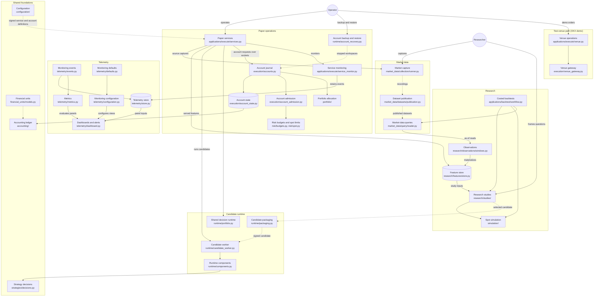

# Alpha Research Platform

A research and paper-trading platform for OKX and Bitfinex spot. It covers market-data
capture and publication, research studies and costed backtests, a versioned feature
store, candidate packaging, and supervised paper and shadow trading with independent
risk, reconciliation, monitoring and recovery.

Once the infrastructure passes [QR onboarding acceptance](roadmap/qr-onboarding.md),
quant research starts with an economic question: can an observable market state improve
a trading decision after costs, delay and risk? The
[research milestones](research/program.md#post-infrastructure-research-milestones) are
planned, not started.

Live trading is out of scope. It is
[reconsidered](roadmap/overview.md#live-trading-kept-in-view) only after profitable
out-of-sample and forward paper evidence, net of transaction costs, slippage and
applicable gas fees. Paper economics do not qualify venue execution.

## Start here

| If you are | Read |
| --- | --- |
| A quant researcher | [Quickstart](research/quickstart.md), then the [research guide](research/guide.md) |
| Developing the platform | [Development environment](development/environment.md), [engineering standards](development/engineering-standards.md), [development workflow](governance/workflow.md) |
| Operating paper services | [Operations runbook](governance/operations.md) and [local services](local-services/lakefs.md) |
| Tracking delivery | [Roadmap](roadmap/overview.md) |

## System map

Paths are under `src/`. Solid arrows are imports or calls; dotted arrows are handoffs
through retained artifacts.

## Documentation map

| Area | Pages |
| --- | --- |
| Research | [Quickstart](research/quickstart.md), [research guide](research/guide.md), [API notes](research/api.md), [study protocol](research/study-protocol.md), [ranked agenda](research/agenda.md), [notebooks](research/notebooks.md), [research program](research/program.md), [saved L2 backtest](research/l2-book-backtest.md) |
| Architecture | [Overview](architecture/overview.md), [platform design](architecture/platform-design.md), [research and simulation](architecture/research-and-simulation-design.md), [portfolio and execution](architecture/portfolio-and-execution-design.md), [runtime and operations](architecture/runtime-and-operations-design.md), [economic and market data](architecture/economic-and-market-data-design.md), [instrument identity](architecture/instrument-identity.md), [venue calendars](architecture/venue-calendar.md), [financial units](architecture/financial-units.md), [dependency admission](architecture/dependency-admission.md) |
| Packages | [Market data](packages/market-data.md), [accounting](packages/accounting.md), [execution](packages/execution.md), [portfolio](packages/portfolio.md), [risk](packages/risk.md), [runtime](packages/runtime.md), [simulation](packages/simulation.md), [strategies](packages/strategies.md), [telemetry](packages/telemetry.md) |
| Research packages | [Experiments](packages/research-experiments.md), [features](packages/research-features.md), [labels](packages/research-labels.md), [models](packages/research-models.md), [observations](packages/research-observations.md), [studies](packages/research-studies.md) |
| Applications | [Execute](packages/execute-application.md), [paper](packages/paper-application.md) |
| Data | [Data contracts](data/contracts.md), [point-in-time semantics](data/point-in-time-semantics.md), [OKX market data](data/okx-market-data.md), [L3 collectors](data/l3-collectors.md), [data sources](data-sources/overview.md) |
| Development | [Environment](development/environment.md), [testing](development/testing.md), [engineering standards](development/engineering-standards.md), [typing stubs](development/typing-stubs.md) |
| Local services | [lakeFS](local-services/lakefs.md), [ClearML](local-services/clearml.md), [Feast worker](local-services/feast-worker.md) |
| Governance | [Development workflow](governance/workflow.md), [operations runbook](governance/operations.md), [dependency locks](governance/dependency-locks.md) |
| Roadmap | [Overview](roadmap/overview.md), [QR onboarding acceptance](roadmap/qr-onboarding.md), [runtime capacity](roadmap/runtime-capacity.md), [research capacity](roadmap/research-capacity.md) |
