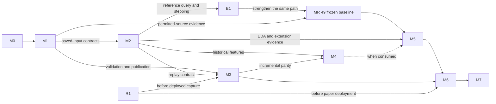

# Platform implementation roadmap

Owner: repository founder. Consolidated 2026-09-14. MR 00 and C0 are complete;
MRs 01–02 are merged in the M0 delivery. MR 03 is merged in PR #24 at `bf3fb99`.
MR 04 is merged in PR #25 at `b136b36`. MR 05 is merged in PR #26 at `48bf9b7`;
its Tardis source probe was not performed; the founder later selected Binance archives below.
MR 06 is merged in PR #27 at `0e35496`. MR 07 is merged in PR #28 at `ddd1bfb`, with evidence
for installed acquisition, including the actual Binance public archive in its
[review candidate](mr-07-implementation.md#binance-source-follow-up).
MR 08 is merged in PR #32 at `f05ef18`; see its [implementation record](mr-08-implementation.md).
MR 09 is merged in PR #33 at `a66b49a`; see its [implementation record](mr-09-implementation.md).
MR 10 is merged in PR #34 at `d88ba11`; see its [implementation record](mr-10-implementation.md).
MR 11 is merged in PR #35 at `5b10f78`; see its [implementation record](mr-11-implementation.md).
MR 12 is merged in PR #36 at `210db65`; see its [implementation record](mr-12-implementation.md).
MR 13 is merged in PR #37 at `7ef4892`; see its [implementation record](mr-13-implementation.md).
MR 14 is implemented and locally verified in its [review candidate](mr-14-implementation.md).
MRs 15–62 and R1 remain planned except the bounded M3 collector slice below;
no M1–M7 completion or P1 result is claimed.

**Review [MR 14](mr-14-implementation.md). The founder-authorized
[crypto L3 collector slice](crypto-l3-collectors.md) brings forward parts of MRs 22–27.
MR 15 is the next historical ingestion package; it has not been started.**
The 2026-09-15 [market-data and replay refinement](#market-data-expansion-and-replay-lessons)
preserves implementation through MR 07 and adds future collection, recovery and
simulation acceptance within the existing MR owners. No additional implementation
or milestone completion is claimed.
The 2026-09-15 founder-authorized Binance source amendment supersedes the Tardis
access prerequisite for P1. Historical eligibility, revision availability and
coverage acceptance remain open; raw download is not dataset or P1 acceptance.
M0 resolves configured inputs and runs an installed fixture consumer. Follow the
dependency graph through verified saved inputs, reference query/replay and E1. Keep MR 05's source
feasibility investigation early. The frozen sample, strategy and cost assumptions
remain in the [P1 experiment specification](../research/p1-baseline.md).

Use the identifiers as follows: **M0–M7** are usable delivery milestones;
**MR 00–62 and R1** are the implementation packages defined once under their
owning milestone or prerequisite; **E1** is an early integration checkpoint;
**P0–P7** describe broader maturity and scope. P1 baseline acceptance is a defined
outcome within M5, with fewer requirements than full M5 acceptance. These are
views of the same work, not separate backlogs.

- [Delivery graph and completion rules](#completion-and-dependency-model)
- [Completed foundations](#completed-foundations), [M0](#m0-minimal-runnable-foundation), [M1](#m1-validated-historical-ingestion), [M2](#m2-research-data-access-and-replay)
- [M3](#m3-reliable-live-capture), [M4](#m4-reproducible-features-and-model-research), [M5 and E1](#m5-strategy-simulation-and-research-controls)
- [Collector integration with shared datasets and replay](#collector-integration-with-shared-datasets-and-replay)
- [Market-data expansion and hftbacktest lessons](#market-data-expansion-and-replay-lessons)
- [R1 deployment prerequisite](#r1-trusted-artifact-before-first-deployment), [M6](#m6-papershadow-deployment), [M7](#m7-controlled-live-operation-and-expansion)
- [P1 versus M5 acceptance](#p1-acceptance-map)
- [Existing libraries](#existing-libraries-and-remaining-work), [code ownership](#p1-code-ownership-and-call-flow), [configuration/support](#shared-configuration-and-support-contracts)
- [Review contract](#merge-size-and-review-contract), [notebook workflow](#local-notebook-workflow), [validation and evidence](#validation-evidence-reuse-and-reversal)
- [Longer-term scope](#longer-term-scope)

## Destination and current state

Build an institutional-grade monorepo for multi-asset, multi-strategy quantitative
research, simulation, portfolio construction, production trading and monitoring.
The founder implements it incrementally. Validated historical ingestion and EDA
are the first usable data deliveries; one reproducible strategy then exercises
the shared research/accounting foundations. These narrow deliveries retain
extension boundaries for the broader platform.

Today the runtime contains instrument identity, venue calendars, financial units,
exact serialization, event provenance, an authored reference catalog, bounded
Tardis/Binance event decoding, configured fixture inspection and saved raw-object
description/verification with durable content-addressed publication and verified
reads. A bounded Tardis partition fetch composes these storage contracts with
explicit access admission, HTTP/gzip checks and progress/failure reports. Its
evidence remains synthetic; MR 07 adds actual Binance daily ZIP/checksum acquisition. MR 06 adds a durable acquisition manifest,
sequential restart and bounded transient retry. MR 07 adds the installed acquisition
command with job/partition progress and terminal status. MR 08 streams verified
Binance archive rows with raw origins and explicit unknown recorder coverage.
MR 09 decodes individual archive trades into stable raw occurrences and retains
binding-scoped controls, with capture/knowledge evidence explicitly absent for archives.
MR 10 admits economic duplicates and explicitly evidenced corrections, retaining raw
lineage, earlier versions and effective knowledge; empirical archive revision evidence remains open.
MR 11 reads strict file-backed eligibility assertions with evidence clocks and catalog/units
linkage, retaining exclusions. MR 12 selects membership using independent validity and
knowledge cutoffs, retaining explicit corrections and unknown/unsupported outcomes;
actual historical membership evidence remains unresolved. MR 13 composes partition quality,
retained histories and deterministic exploratory bytes; unknown recorder coverage
prevents causal admission. MR 14 binds admitted partitions and resolved evidence into
versioned dataset manifests and verifies their saved bytes; atomic snapshot publication remains planned.
The frozen uv build, strict source checks, CI and runtime wheel installation exist. Versioned datasets, strategy
runners, accounting, simulation, execution, deployment and monitoring are planned.
The current native dependency restriction is recorded in the
[architecture guide](../architecture/README.md#dependency-and-release-boundaries).

This single roadmap owns delivery order, MR definitions, pipeline/library
ownership, acceptance and longer-term capability status. The
[platform design](../architecture/platform-design.md) owns intended module
boundaries, interfaces, runtime lanes and scaling choices. The
[research program](research-program.md) owns experiment methodology and candidate
research workstreams. Preserve implementation detail in those documents and add
focused design notes where a complex feature needs them. Page and file counts
are maintenance observations, not a ceiling on technical design.

A monorepo provides shared source history, atomic changes and reusable contracts.
It can contain multiple packages, native libraries, applications and independently
released artifacts. It does not require every application to install the whole
repository, run in one process or deploy on the same schedule. Keep the current
single-package uv path until a concrete consumer justifies another package or
build target; retain a straightforward supported development entry point as it grows.

## Completion and dependency model

A milestone delivers a runnable workflow for a declared supported scope, with
controlled failures and a demonstrated extension boundary. Merged MR counts do
not establish completion. Counts below describe logical review packages and
exclude completed MR 00/C0. Planned work retains **MR 01–62**, grouped by
responsibility; dependency cells determine delivery order. MR 00 remains the merged
specification; C0 identifies the completed cleanup. Milestone names M0–M7 are not
MR IDs. Use `codex/mr-<NN>-<topic>` for implementation branches unless another name
is requested. Split a package at useful review boundaries when necessary and
record its scope under the owning MR; counts do not weaken its acceptance.
E1 is an early integration checkpoint within existing research packages. R1 is
the artifact-consumer responsibility split out of MR 59 and scheduled before the
first deployment; it is one additional logical package, not an M7 prerequisite
on M6. Numeric MR IDs remain stable. MR 18 and MR 54 are conditional on their
declared consumer; deferred packages are not claimed implemented.

| Milestone | Runnable outcome | Assigned packages | Dependencies and scope |
| --- | --- | --- | --- |
| M0 — Minimal runnable foundation | Config resolves a bounded data job and runs a saved fixture through configured decoders. | MR 01–02: **2** | Current foundations and MR 00/C0. No network, registry service or universal runner framework. |
| M1 — Validated historical ingestion | Ingest, normalize, validate, publish and reopen a versioned historical dataset through documented commands. | MR 03–16: **14** | M0 and permitted source access for external acceptance. Initial trade-data path; full snapshot eligibility/coverage claims require their actual evidence. |
| M2 — Research data access and replay | Select instruments, intervals, columns and a snapshot for bounded-memory EDA and deterministic replay. | MR 17–21: **5**, with 18 conditional | Verified published inputs and 10/12/15 contracts; synthetic development does not await M1's acquisition commands or external acceptance. The reference reader suffices unless a measured workload needs 18. |
| M3 — Reliable live capture | Configured live inputs are validated, durably captured, recoverable and consumable through compatible canonical contracts. | MR 22–27: **6** | Prototype capture after 01, 03–04; complete with quality/publication and MR 20 replay contracts. Any deployed collector first requires R1. Live source/format is selected and verified in MR 22. |
| M4 — Reproducible features and model research | Versioned transforms and optional models have causal inputs, retained fit state and reproducible evaluation; supported incremental features match replay. | MR 28–32: **5** | Historical work starts after M2. Incremental/live parity uses M3. Model work applies only to a selected model consumer. |
| M5 — Strategy simulation and research controls | E1 first composes synthetic economics; MR 49 accepts the frozen baseline; M5 adds reusable research/workflow/isolation evidence. | MR 33–49: **17** | E1 uses reference query/replay contracts; full M5 requires M1/M2 workflow exits and 47–48. M4 only for consuming strategies; neither M3 nor ML blocks the deterministic baseline. |
| M6 — Paper/shadow deployment | The same versioned strategy/feature artifacts run against live inputs with order, risk, reconciliation, recovery and monitoring controls. | MR 50–57: **8**, with 54 conditional | M3 and M5; R1 before deployed acceptance; M4 where used. Single-instance accounts use base reconciliation; sharing requires 54 and allocation reconciliation. No executable orders. |
| M7 — Controlled live operation and expansion | A specifically authorized deployment operates within tested limits; a compatible additional instance can be onboarded without copying strategy code. | MR 58–62: **5**, with release-consumer work moved to R1 | M6 and maintained release/dependency admission. MR 59 binds trading authority. Each new product/venue needs acceptance for its actual mechanics before execution is enabled. |
| R1 — Trusted deployment artifact | Build, identify, verify and install one trusted immutable artifact for the first concrete deployment. | **1**, split from MR 59 | Existing build inputs and resolved dependency admission for the actual deployment graph; no M6, MR 58 or executable-account prerequisite. |



The arrows name actual interfaces, not a global waterfall. Historical EDA and
simple backtests are useful while live capture is developed. Early capture is
reasonable for otherwise irrecoverable feeds, but it must retain basic validation,
loss visibility and durable input identity from its first working slice.
Monitoring and recovery belong to the capability they protect throughout this graph.
The M1→M2 edge names saved-input contracts, not completion of downloader or CLI
work; synthetic verified snapshots can supply them. R1 edges apply to actual
deployment, while isolated development smoke may continue under current policy.

For founder delivery, follow one main path: configured fixture and early source
feasibility → durable historical data → reference query/replay and E1 → frozen
P1 reproduction → M5 reuse and useful live capture → one paper deployment →
scoped live operation. Pull capture forward for history worth preserving, and
R1 forward whenever that capture is actually deployed. Numeric milestone order
does not require completing live capture or models before research.

Dependencies identify required contracts under the
[milestone map](#completion-and-dependency-model);
they do not require parallel agents or stacked unmerged MRs.
Verified synthetic saved objects, manifests and evidence-labeled fixtures can
satisfy interface prerequisites. A successful transport, installed acquisition
workflow or particular storage backend is required only where explicitly consumed.
External source acceptance remains a separate, mandatory baseline gate.
`NB XX` identifies an MR's learning checkpoint in the relevant activity notebook;
it does not prescribe a separate notebook file. Python module paths below are
relative to `src/alpha_research/`; documentation paths are repository-relative.
Unlinked module names are proposed unless identified as existing in the ownership reference.

## Completed foundations

The MR 00 specification and library-guideline checkpoint merged in
[PR 14](https://github.com/lixuanguang/alpha-research-lab-private/pull/14)
at `8b53d7507c313a96e1a31bc080839a60f9821ac6`. Cleanup C0 merged in
[PR 15](https://github.com/lixuanguang/alpha-research-lab-private/pull/15)
at `67b740197cdf27113fddd98030b32ba83ab2e59c`. They establish the following
prerequisites, without implying acquisition or research completion.

### MR 00: Frozen experiment

| MR | Depends on | Owned behavior and consumer | Acceptance and notebook checkpoint |
| --- | --- | --- | --- |
| **00 — Freeze the bounded P1 case** | Current foundations | **Merged specification.** Added `docs/research/p1-baseline.md` as the owning experiment specification, recording the decisions below and a hand ledger before any comparison. | **NB 00:** decode a synthetic trade and disconnect, inspect all clocks and exact units, then show catalog interval rejection. Completion is an explicit selected scope and unresolved-access status, not a research result. |

MR 00 must name the provider/access method and permitted use/retention, source
revision and capture semantics, exact sample range, universe and eligibility
evidence, quote currency, cadence/lookback/horizon, fixed quantity/lot and tick
assumptions, initial cash, maximum age/gap policy, fill delay/price rule, cost
rounding, fee and slippage assumptions, end-of-sample treatment, and the
transparent hypothesis. Record financing as explicitly inapplicable only for the
selected cash-funded, unlevered spot case; there is no implicit USD/USDT conversion.

Distinguish engineering samples from any future validation/holdout intervals.
This fixed baseline fits no parameters; training-only fitting, purge and embargo
are inapplicable only while that remains true. Any comparative tuning requires
the research program's split and trial discipline before it begins. Preserve
the declared acceptance even if observed results are poor.

### C0. Remove redundant composition before adding consumers

**Implemented in the current checkpoint.** The composition-only class
and both compatibility import modules are removed. Retained callers and public
exports use the generic and venue libraries directly; no replacement factory,
wrapper or empty pipeline was added. MR 02 starts the fixture pipeline; MR 09
adds the persistent dataset workflow to it.

The existing tests exercise trade, depth snapshot, depth update and disconnect
behavior, invalid mappings, exact timestamps/identities and recovery after a
failed line. Installed-wheel imports and the active local foundation notebook
use direct composition. Serialized fixtures remain unchanged; historical
notebook snapshots retain their original code and environment identity.
**NB C0:** reuse one directly composed decoder across valid, invalid and
subsequent valid lines. This cleanup adds no acquisition or dataset functionality.

## M0: Minimal runnable foundation

**Status: implemented and locally verified for M0.** The [M0 implementation record](m0-implementation.md)
contains commands, review slices, installed-consumer and notebook evidence, and
limitations. MR 01 supplies scoped data-job parsing, capability validation and
resolved run identity. It does not require strategy or deployment schemas before those consumers.

| MR | Depends on | Owned behavior and consumer | Acceptance and notebook checkpoint |
| --- | --- | --- | --- |
| **01 — Resolve configured source requests** | 00, C0 | Introduce `configuration.py` with typed data-job/universe definitions and immutable resolved run manifests. `data/requests.py` derives bounded per-instrument requests from the selected provider, dataset/stream, pipeline, universe, half-open range and partition rule. Bind actual instrument/reference versions, policies and rights references; resolve complete intervals using `CatalogSnapshot`. Add strategy/deployment records with their consumers. | Unknown fields/references, unsupported source/product/mode combinations, invalid intervals and insufficient catalog coverage fail before source access. Equivalent resolved requests have stable identity; a changed underlying universe cannot hide behind the same config name. **NB 01:** select two supported instruments through config and inspect exact partitions; reject an unsupported family and incomplete interval. MR 02 supplies the runnable fixture consumer. |
| **02 — Inspect a configured fixture** | 01, C0 | Start `pipelines/dataset.py` with a bounded fixture-inspection command: read config and an explicit saved frame, resolve instruments, compose retained decoders and return events/diagnostics with run identity. Libraries own parsing/validation; this pipeline owns construction and I/O sequencing. | Installed consumer outside the checkout handles a valid frame, unknown binding, wrong instrument and invalid timestamp. Failure is actionable and has a nonzero exit. No network or canonical publication is implied. |

Exit workflow: invoke fixture inspection with two supported instrument configs
and an invalid combination. Retain the actual command and outcomes in the MR.
This is a small runnable entry, not a new application framework.

## M1: Validated historical ingestion

MRs 03–06 deliver verified durable acquisition/resume and 08–15 deliver interpretation,
revisions, eligibility, quality and atomic publication. Data validity is evaluated
against the declared use: incomplete required coverage or unknown required
eligibility cannot be labeled valid. Preserve rejected inputs and reasons without
publishing them as an accepted dataset. Advanced cross-source reconciliation,
statistical anomaly detection and automatic repair are later, consumer-driven work.

### Raw inputs and acquisition

MR 03's [implementation record](mr-03-implementation.md) contains the local
saved-byte verification, installed-consumer and NB 03 evidence. MR 03 is merged.
MR 04's [merged implementation](mr-04-implementation.md) adds durable raw-byte
storage, interrupted-publication recovery and NB 04 evidence. MR 05’s
[merged implementation](mr-05-implementation.md) adds the one-partition callable and
NB 05 synthetic evidence. MR 06’s [merged implementation](mr-06-implementation.md) adds
validated manifests, checkpoint recovery and bounded transient retry with NB 06.
MR 07’s [review candidate](mr-07-implementation.md) adds the installed command
and observable resume. Synthetic NB 07 is retained in section 15 of
[foundation-contract-checks.ipynb](../../examples/foundation-contract-checks.ipynb).
[research-foundations.ipynb](../../examples/research-foundations.ipynb) now connects
actual Binance public daily trade acquisition, verifies publisher
SHA-256 and ZIP CRC, and inspects the selected hour. The founder authorized this
source-contract amendment on 2026-09-15 and chose ignored local data storage.
See the [P1 amendment](../research/p1-baseline.md) and
[recorded verification](mr-07-implementation.md#binance-source-follow-up). This
changes source-specific deliverables below, not MR dependencies or the later
ownership of canonical decoding, eligibility, availability, quality or publication.

| MR | Depends on | Owned behavior and consumer | Acceptance and notebook checkpoint |
| --- | --- | --- | --- |
| **03 — Describe and verify a raw object** | 01 | `data/raw_objects.py`: immutable object descriptor with SHA-256, byte size, request/partition identity, retrieval reference and original receipt/ingestion times; callable verifier for an existing saved file. | Hash the exact retained bytes, including compression where present. Mutation, truncation and a descriptor for another request fail. **NB 03:** verify a tiny local object, change one byte and observe identity failure. |
| **04 — Publish raw bytes durably** | 03 | `data/raw_store.py`: content-addressed write/read boundary, staging on the destination filesystem, durable completion and atomic publication. Reuse the verifier; preserve immutable existing objects. | Readers see complete verified objects only. Repeating the same write reuses bytes; a conflicting object is rejected. Interrupt before/after publication and reconcile the observable files. **NB 04:** inspect staging versus published state after injected failure. |
| **05 — Fetch one provider partition** | 01, 03–04 | `data/providers/tardis/transport.py` implements one bounded partition fetch with explicit timeout and response validation. Introduce `pipelines/acquisition.py` with working fetch/verify/store composition from the resolved data job and explicit clock/transport dependencies. Emit run/partition identity, progress and failure status from this first consumer. The original transport is Tardis; MR 07's authorized source amendment adds Binance daily archives with its first actual consumer. Reject unsupported selections and verify current primary provider documentation during implementation. | Fake transport covers success, malformed/truncated response, auth failure and timeout through the pipeline. A smallest permitted source probe confirms actual endpoint/framing, retention and timestamp assumptions; a fake cannot close that boundary. **NB 05:** inspect a saved response through the retained decoders. Do not print credentials or label retained raw data as a validated dataset. |
| **06 — Resume the acquisition manifest** | 05 | `data/manifests.py` validates input manifests and appends acquisition completion/checkpoint records, reusing shared verified-input validation if MR 08 delivered it first. Extend `pipelines/acquisition.py` with sequential partition selection, restart and bounded transient retry/backoff. Advance only after verified raw publication; do not introduce a second acquisition wrapper in `data/`. | Restart skips verified completed partitions; missing/mutated completed objects fail. Failure after object publication but before checkpoint does not lose or duplicate observations. Auth/schema errors are terminal; exhausted transient retries leave an incomplete run. **NB 06:** interrupt a three-partition fake run and compare the resumed manifest with uninterrupted acquisition. |
| **07 — Make acquisition usable and observable** | 05–06 | Add the installed acquisition command in `pipelines/acquisition.py`; resolve data-job config, expose job/partition progress, retries, bytes, last successful persistence and terminal status. Reuse the existing manifest. The 2026-09-15 source amendment adds `data/providers/binance/transport.py`, daily archive configuration/source bindings and a real notebook download with publisher SHA/ZIP validation; keep row decoding with MR 09. | A permitted bounded download resumes after interruption; repeated input does not add logical completions. Mutated/missing stored bytes fail. Saved command/config identity and error status work outside the checkout. This is an intermediate raw-acquisition checkpoint, not M1 completion. |
| **08 — Read saved raw frames with explicit gaps** | 01, 03; verified-object and input-manifest contracts, not 05–06 | For the amended P1 source, `data/providers/binance/rows.py` streams bounded ZIP/UTF-8 CSV records from explicit verified objects and expected daily partitions. Reuse MR 06 input-manifest validation. Emit ordered raw records with stable zero-based positions, origin and selection bounds for the dataset pipeline; report missing objects, malformed input and unavailable recorder-gap evidence without constructing a decoder. Preserve existing Tardis fixture/decoder gap semantics. | Saved synthetic archives need no downloader. Preserve exact source bytes and row order, including equal event timestamps; distinguish missing object, empty content and unknown capture completeness. Truncation, invalid UTF-8 and malformed CSV fail. No fabricated capture timestamps, disconnect markers or price padding. **NB 08:** inspect equal-time rows, an empty/invalid input and an absent daily archive; show that archive presence alone cannot prove recorder coverage. |

MR 05 is the early source feasibility checkpoint. Alongside the smallest
permitted endpoint/framing/retention probe, investigate whether historical
eligibility and revision-availability evidence can be obtained for the selected
sample. Record retrievable evidence or the precise missing claim before scaling
acquisition; MRs 10–12/17 still own its validation and selection. Source access is
not assumed by this roadmap. If it is unavailable, retain the exact unproven boundary and
continue synthetic/storage/accounting work that does not depend on it. Do not
mark permitted-source acquisition or P1 complete, purchase access, or substitute
an unapproved provider to obtain a pass.

MR 08's [implementation record](mr-08-implementation.md) records saved-row reading
and installed-wheel verification. Its original real-data notebook run is retained
as historical evidence; NB 08's synthetic checks now run in section 16 of the
offline contract-check notebook without provider access.
Synthetic archives require no downloader. The reader retains raw rows and selection
bounds; MR 09 subsequently delivered numeric/event decoding and the persisted consumer.

### Canonical datasets and publication

MR 09's [implementation record](mr-09-implementation.md) covers the saved-input
consumer, exact archive trades, raw occurrence identities and NB 09 in section 9 of
[research-foundations.ipynb](../../examples/research-foundations.ipynb). It does not
claim duplicate/correction admission, quality acceptance or snapshot publication.
MR 10 supplies merged duplicate/correction admission in its [implementation record](mr-10-implementation.md),
including NB 10 in section 10 of the same notebook. MR 11 adds eligibility assertion
reading and NB 11 in section 11; see its [implementation record](mr-11-implementation.md).
MR 12 adds as-of selection, append-only corrections and NB 12 in section 12; see its
[implementation record](mr-12-implementation.md). MR 13 adds partition validation and
NB 13 in section 13; see its [implementation record](mr-13-implementation.md). MR 14
adds dataset manifest identity and verified reading with NB 14 in section 14; see
its [review candidate](mr-14-implementation.md). Atomic snapshot publication remains MR 15.

| MR | Depends on | Owned behavior and consumer | Acceptance and notebook checkpoint |
| --- | --- | --- | --- |
| **09 — Bind decoded events to raw occurrences** | 08, 02 | `data/normalization.py` binds decoded events to request partition, raw digest and source row/line position. Retain source/input-binding and applicable subscription/session lineage to resolve [control scope](../data/contracts.md#control-scope-through-queries) without changing `Disconnect`. Extend `pipelines/dataset.py` to persisted input: resolve bindings/universe, select the source adapter, iterate frames and bind occurrences, preserving bytes and provenance. Add individual archive-trade row decoding with its first consumer; preserve integer timestamp units, exact decimals and absent capture/knowledge evidence without fabricating Tardis framing. Retain `TardisDecoder`/`BinancePayloadDecoder` for their existing supported fixtures. Preserve original timestamp precision and source-message grouping when later adapters emit multiple canonical records from one frame. | Two files starting at sequence zero cannot collide; saved-input rebuilds/retries preserve identity. Reject incompatible bindings and unselected instruments. Instrument-less controls retain their affected binding, not repository-wide scope. Keep occurrence identity separate from MR 10's trade key. **NB 09:** trace colliding sequences and independent bindings to raw origins. |
| **10 — Admit duplicates and corrections explicitly** | 09 | `data/revisions.py`: resolve economic duplicates by source/venue/instrument/stream/trade ID for the selected trade representation; record conflicting payloads, revision linkage and correction publication/availability beside original occurrences. The dataset pipeline supplies occurrences and explicit correction evidence/policy. | Exact duplicates retain all lineage and contribute once. Conflicts without justified revision ordering/availability fail publication. Known corrections append versions; effective knowledge is no earlier than original capture and correction availability. **NB 10:** add a late correction and show the earlier version remains reconstructible. Positional IDs alone cannot match revisions after inserted lines. |
| **11 — Read historical eligibility assertions** | 00–01 | `data/eligibility.py`: strict file-backed assertions for canonical instrument, valid interval, knowledge time, included/excluded state, reason and evidence identity. Validate linkage to the selected catalog/units without changing its authored meaning. | Reject missing evidence, overlapping contradictory assertions and invented knowledge dates. Preserve excluded/delisted members. Synthetic assertions are labeled as such. **NB 11:** compare a 2026-authored assumption with an assertion actually evidenced as known during the sample. |
| **12 — Select the universe as of a decision** | 11 | Extend `data/eligibility.py` with pure bitemporal selection and explicit unknown/unsupported outcomes. Use validity and knowledge independently; append corrections rather than rewriting history. | A later listing correction/exclusion cannot change an earlier universe. Unknown membership cannot silently become eligible. **NB 12:** display inclusion before/at/after both knowledge and validity boundaries, including the half-open endpoint. |
| **13 — Validate a canonical partition** | 09–12 | `data/quality.py`: consume occurrences and declared-use policies; check schema, identity/units, timestamps, revisions, coverage, duplicate disposition and ordering. Produce canonical bytes plus accepted/rejected outcome, quality scope and reasons; distinguish admissible degraded use from valid data. The dataset pipeline reports invalid/gap counts and routes failures before publication. | Invalid records and unresolved required coverage/eligibility never become valid data. Retain exclusions and reasons; no silent row drops, zero/forward fill or fabricated completeness. Same inputs/policies reproduce the partition. **NB 13:** inject a duplicate, gap, wrong instrument and conflicting correction, inspect the report and demonstrate publication refusal. Reject invalid/nonfinite prices with retained reasons and use stream-specific quantity rules; a future whole-sample clock adjustment cannot silently rewrite prior availability. Advanced statistical quality analysis is not needed to meet these basic checks. |
| **14 — Validate and identify a dataset manifest** | 13 | `data/datasets.py`: versioned manifest reader/identity over ordered partition digests, raw manifests, resolved job/universe/catalog/eligibility identities, normalization code/schema and quality/correction/availability policy. Verify referenced files and declared quality/use scope. The dataset pipeline assembles these inputs from admitted partitions. | Equivalent saved inputs rebuild the same identity; a policy/schema/reference change changes identity. Missing bytes and unknown versions fail; a mutable config/universe name cannot substitute for its resolved content. Keep build wall-clock/path metadata outside semantic identity. **NB 14:** rebuild twice, then change one policy and compare hashes. |
| **15 — Publish and reopen one snapshot atomically** | 14 | `data/snapshots.py`: stage verified partitions/manifest, publish the immutable snapshot as one visibility boundary, and reopen by explicit snapshot ID. Use existing raw-publication primitives only where semantics match. Complete the dataset pipeline by calling this publication operation and returning the snapshot identity. | An interrupted build exposes no partial snapshot. Prior snapshots remain readable after failure and publication of a new one. Never silently resolve a mutable latest tag in a run. **NB 15:** fail before publication, inspect reader behavior, then reopen the completed snapshot. |
| **16 — Publish and inspect a validated dataset** | 08–15, 07 | Extend the dataset command to normalize saved acquisitions, apply declared policies, publish/reopen by snapshot ID and return a compact quality/coverage report. Expose invalid counts, persistence failures and actionable status as work executes. | Ingest → normalize → validate → publish → reopen succeeds on the permitted supported sample. Duplicate ranges preserve logical content. Wrong schema/instrument/time/units, a coverage gap and interrupted publication cannot expose an apparently valid snapshot. |

Persisted event revisions may carry the current decoder output in an envelope
instead of widening every public event type. The envelope owns occurrence and
revision metadata. Whichever representation is implemented, all dataset
consumers must use its effective availability and revision identity. Never leave
an easy reader path that drops the correction metadata. Preserve raw versions;
where the selected source cannot establish prior revision availability, reject
that empirical claim or explicitly bound the experiment to supported data.

Canonical publication retains earlier event/reference revisions and their
exclusion annotations. Do not prune them using the final sample date's universe
or latest corrected value: the as-of reader needs them to reconstruct earlier
decisions. Coverage checks report what the provider's stream contract can prove;
neither nonempty files nor an assumed consecutive trade ID prove completeness.

The snapshot is a small local file format, not a catalog service or table platform.
Use existing codecs and streaming files first. Add a dataframe/storage dependency
only for a concrete consumer with normal dependency admission; do not bundle it
into a nominally small MR without counting its integration and review scope.

Exit workflow: use documented acquisition and dataset commands for a configured
universe/range, interrupt and resume, reopen the published snapshot, and switch
to another supported synthetic instrument without shared-code edits. M1's external
acceptance remains incomplete while required source rights or evidence are missing;
fixture-based development may continue. No-trade/backtest results are not needed here.

## M2: Research data access and replay

MR 17 owns revision-aware availability filtering before selection. Dataset
versioning and availability semantics are both required. A query must distinguish
event/effective, knowledge/availability and ingestion time and retain the selected
knowledge model; a historical download's wall clock is not historical availability.

| MR | Depends on | Owned behavior and consumer | Acceptance and notebook checkpoint |
| --- | --- | --- | --- |
| **17 — Read point events as of a cutoff** | 10, 12, 15 | `data/asof.py`: select known revisions/eligible events from a snapshot and business/decision window, preserving distinct clocks and [applicable controls](../data/contracts.md#control-scope-through-queries). Use the [economic ordering contract](../data/point-in-time-semantics.md#planned-economic-ordering-and-event-stepping). Keep a cutoff projection distinct from retained history consumed by advancing replay. | Filter availability before revision selection; instrument filters retain scoped controls. **NB 17:** compare equal captures, late publication/corrections and universe changes. An applicable disconnect affects the selected binding; an unrelated one does not. Future-only mutations cannot change prior economics; terminal revision selection cannot erase earlier replay state. |
| **18 — Add a measured query backend** | 14–15, 17, 19; selected workload requires it | Add a versioned columnar writer/reader behind MR 19's working query interface. Preserve exact units, revisions, availability and semantic snapshot identity. Benchmark a bounded candidate before dependency admission; defer if the reference reader meets the workload. Include ClickHouse for a selected depth/concurrent-analytics workload under the [performance contract](../architecture/platform-design.md#storage-and-performance-decisions). | Reference parity and exact round trips; conversion cannot drop history or change selected values. Interrupted conversion leaves prior inputs readable. Retain measured I/O/memory benefit and added dependency cost. Define volume, burst, query, hardware/cache and percentile before evaluating the proposed 7M+ messages/day and sub-500ms query target. |
| **19 — Query selected data in bounded batches** | 17, not 18 | Introduce a working file/reference reader accepting snapshot ID, instruments, time/knowledge bounds and columns; return typed batches/aggregates and query identity. Preserve [applicable control/quality scope](../data/contracts.md#control-scope-through-queries) through selection/projection. Distinguish cutoff projections from replay history retaining revisions and their availability. MR 18 may later supply another implementation. | Compare with the as-of selector including late corrections. Applicable instrument-less disconnects survive projected queries; unrelated bindings' disconnects do not affect selected inputs. Replay retains earlier versions instead of using terminal-cutoff state. Measure memory/read counts; verify cancellation and bounded iteration. Projection cannot bypass eligibility or revision filtering. |
| **20 — Replay with shared event stepping** | 19 | Own the ordered iterator, clock, cursor and stepping under the [shared timing contract](../data/point-in-time-semantics.md#planned-economic-ordering-and-event-stepping). Advance chronologically through source availability, decisions, expiry, terminal and any additional fill-eligibility times; phase order applies at one timestamp across batch boundaries. Replay and E1/MR 44 research consume the same operation. | Preserve source order, bounded buffering, future-only prefix and cursor/resume parity. E1/MR 44 prove an earlier fill survives a later-known gap, batch sizes 1/k give identical economics, and equal-time controls, exact expiry and retained revisions stay causal. Read-ahead never advances knowledge. For later L2 consumers, preserve atomic source-message application across query batches; reconstruction/checkpoint state includes the accepted snapshot and recovery epoch. |
| **21 — Exercise EDA and extension boundaries** | 19–20 | An EDA orchestration entry resolves query config and produces retained query/summary identities; the activity notebook calls the same libraries. Include query duration, failures, rows/batches and memory/read observations. | Query multiple instruments, plot a bounded interval and replay it outside the notebook. An explicit different-family fixture exercises neutral identity/unit/query contracts; unsupported lifecycle or adapter requests fail. Notebook convenience does not require a hosted service or a production-supported second family. |

Exit workflow: select assets, dates, columns and a saved dataset version; inspect
EDA results and replay ordered inputs without loading the entire dataset eagerly.
Benchmark selection must record actual I/O and layout, not promise that every
filter avoids a full scan. Live ingestion and a feature store are not dependencies.
Complete 17, 19–21 with the reference reader first. MR 18 is required only when
the selected consumer's measured workload needs that representation; record its
deferral explicitly instead of gating observations or E1 on a backend choice.

Parquet with an embedded engine is a candidate, not an adopted stack. DuckDB
supports projection/filter pushdown and metadata-based row-group skipping; actual
I/O savings depend on the query and layout. Introduce a service or evaluate kdb+
when shared access, concurrency, isolation or a measured latency budget warrants
it. [DuckDB Parquet documentation](https://duckdb.org/docs/current/data/parquet/overview)
(reviewed 2026-09-13). Market-event queries and feature serving remain distinct contracts.

## M3: Reliable live capture

The 2026-09-15 founder-authorized narrow amendment prioritizes **Bitfinex public
R0** and **Coinbase Exchange authenticated level3** for the new bounded L3
workflow. The [collector implementation record](crypto-l3-collectors.md) maps
this work to the existing owners below. Capture after MRs 01/03–04 is permitted;
use their established config/identity and durable raw-byte contracts. Preserve
MR 20's general replay prerequisite, MRs 10–15 quality/publication, M3's broader
acceptance and R1 before deployment. This slice implements foreground bounded
recording and source-order replay only; it does not close these packages or M3.
The Binance archive workflow and `docs/research/p1-baseline.md` remain reproducible
historical work. No live recording changes the frozen historical experiment.

The 2026-09-16 requested [OKX extension](okx-market-data.md) adds public BTC-USDT
**L2** live books and separately identified historical L2 archives alongside this
L3 focus. It reuses raw storage and bounded replay; archive records with no source
sequence cannot establish continuity or automatically repair live gaps. The same
prerequisites, publication requirements and deployment gates remain in force.

| MR | Depends on | Owned behavior and concrete consumer | Decisive evidence |
| --- | --- | --- | --- |
| **22 — Bind and verify one live source** | 01, 03–04 | A provider/venue transport performs bounded subscription and frame receipt for one configured live data job; the live pipeline composes it. Define source/session identity, formats, clock precision, availability, permissions and stream-specific sequence guarantees. Own the [venue/product/stream scope](../architecture/platform-design.md#collection-scope-and-source-contracts), subscription acknowledgement, heartbeat/lifetime and verified rate-limit assumptions. Prefer direct venue inputs for execution-sensitive consumers; qualify any alternative explicitly. | Smallest permitted connection verifies actual framing/time assumptions; fixtures cover invalid subscription and unsupported combinations. Vendor archive capture is never invented as local live receipt. Each added stream has explicit coverage, decoder/quality support and source evidence before admission. |
| **23 — Capture durably before downstream use** | 22 | Extend raw storage with append/segment boundaries, receipt/order metadata, durable cursors and replayable exact captured input. `pipelines/live.py` coordinates validation, persistence and publication to a bounded consumer. Preserve source-message grouping and original receipt precision; separate receipt from downstream work with bounded queues and durable segments. Kafka remains a measured [scale option](../architecture/platform-design.md#storage-and-performance-decisions). | Truncation, disk failure and process loss leave identifiable durable input and visible uncommitted loss. No acknowledgement beyond the durable boundary; invalid frames retain diagnosis. Initial schema/unit checks are active here. Writer failure, same-day restart and a slow consumer cannot silently overwrite data or grow memory without bound. |
| **24 — Recover sessions without hiding gaps** | 23 | Pipeline connection lifecycle, backoff, resubscription, session epochs, bounded queues and source-specific gap/backfill reconciliation. Preserve duplicates as raw lineage and apply economic deduplication explicitly. Own recovery request coalescing, endpoint budgets, retry exhaustion and stale-session response rejection; MR 25 owns reconstruction validity. | Disconnect/reconnect, duplicate delivery and overload cannot silently lose accepted data. Unknown gaps stay visible; a later backfill cannot acquire an earlier knowledge timestamp. No global exactly-once claim. A gap during snapshot acquisition and rate-limited recovery retain an invalid affected state with a bounded recovery attempt. |
| **25 — Apply continuous quality and recovery states** | 24, 10–15 | Reuse canonical validation/revision operations; add bounded lateness, freshness, watermark and recovery policy in cohesive data libraries consumed by the live pipeline. Publish valid segments/snapshots with their quality status. For L2 admission, implement the shared saved/live [book reconstruction contract](../architecture/platform-design.md#l2-synchronization-and-recovery): snapshot/update bridging, atomic messages, depth coverage, source continuity and restart identity. Split this substantial extension into reviewable slices under MR 25 when its consumer is selected. | Inject out-of-order/late events, stale progress, schema errors and relevant sequence gaps. Recovery cannot mark an invalid stream valid merely because the connection is open. Live book consumers remain disabled until the supported venue's resynchronization trace and bounded capture pass; an asynchronous REST request or decoded depth event is insufficient. Zero-quantity depth deletion remains distinct from invalid price/trade values. |
| **26 — Supervise live health and responses** | 24–25 | Configure process liveness, advancing ingestion/persistence, freshness, queue pressure, reconnect/invalid counts and alert responses. Use existing telemetry tools behind bounded library adapters; supervision/response composition stays in pipelines. | Detect a live heartbeat with stalled data, loss of the process/collector and persistence failure. Test alert delivery and the declared response; alert failure does not block local protective behavior. |
| **27 — Prove capture/replay parity** | 25–26, 20 | Complete the installed live workflow and replay its exact saved raw frames, receipt clocks and session transitions through the same normalization and downstream consumer. For admitted books, reuse MR 25 reconstruction and compare message-boundary state, coverage and cursors. Complete the named-source [collector integration checkpoint](#collector-integration-with-shared-datasets-and-replay). | Captured-input replay reproduces admitted canonical events, quality transitions and consumer outputs. Demonstrate restart and duplicates on a permitted bounded capture; retain the first divergent event if comparison fails. A later vendor download is not substituted for this proof. |

Required quality states are `valid`, `degraded`, `stale`, `recovering` and
`unavailable`, with reason, scope, transition time and last durable progress.
`valid` admits only supported policy-compliant data; `degraded` requires explicit
consumer opt-in and visible limitations. `stale`, `recovering` and `unavailable`
block freshness-dependent decisions; resume requires the relevant synchronization
and validation. Historical EDA may inspect retained data with its status. State
names alone are insufficient: transition/recovery behavior is tested at the consumer.

### Collector integration with shared datasets and replay

**Planned; integration owner MR 25, completion owner MR 27.** The merged
Bitfinex R0, Coinbase Exchange L3 and OKX L2 collectors preserve replayable source
input; they do not yet publish shared canonical datasets or use MR 20 stepping.
Complete the following ordered steps within the existing MR owners:

| Step | Owner and prerequisite | Required pipeline result |
| --- | --- | --- |
| 1. Bind saved collector input | MR 25, reusing MR 01/09 contracts | Extend `pipelines/dataset.py` to select each supported saved capture/archive adapter. Bind native instrument/stream, raw digest, record position, message grouping and session/schema lineage to canonical occurrences. Retain order IDs for L3, aggregate levels for OKX, exact numbers, original clocks and explicit unknowns. Do not apply trade-ID deduplication to book lifecycles. |
| 2. Admit and publish | MR 25, after MRs 10–15 | Reuse shared revision/quality operations and immutable dataset publication for declared supported book schemas and uses. Preserve depth, gaps and recovery state in the manifest/quality scope. Missing source evidence prevents the affected admission; a venue book snapshot alone is not a published dataset snapshot. |
| 3. Replay the published input | MR 20 contracts through MR 27, after MR 17/19 | Feed retained canonical history into the shared ordered iterator, clock and resumable cursor. Preserve atomic L2/L3 messages, accepted book snapshot and recovery epoch across batches/restarts. Unknown historical availability remains explicit; download time cannot replace it. |
| 4. Prove the integrated path | MR 27, retaining 25–26 and 20 prerequisites | Compare capture and saved-input processing through the same normalization, quality, reconstruction and downstream consumer. Verify canonical outputs, message-boundary state, gaps and cursor/resume parity; retain the first divergence. Extend `market-data-capture.ipynb` with snapshot/query/replay identities using real bounded Bitfinex and OKX inputs. Coinbase live acceptance remains blocked until Exchange access is verified. |

OKX historical input also exercises saved-dataset/replay integration, but its
missing source sequences cannot prove continuity or substitute for live parity.
This checkpoint does not enlarge MR 08, renumber packages, complete M3 or change
the Binance P1 baseline. Shared interfaces arrive with their existing consumers;
the collector adapters follow them in MR 25/27.

### Market-data expansion and replay lessons

Refined 2026-09-15 after implementation through MR 07 and a static review of
`nkaz001/hftbacktest` at `5f3ec40b2afb764e0fea112f941ed85523ef4e88`.
This roadmap owns MR scope, dependencies, acceptance and the
[pinned source assessment](#hftbacktest-implementation-review).
The [platform design](../architecture/platform-design.md#collection-scope-and-source-contracts)
owns technical contracts and infrastructure choices. The following assignments
extend existing owners; they do not renumber MRs or add prerequisites to the
frozen trade-only P1 baseline.

The expansion target is BTCUSDT data across four explicitly selected exchanges:
individual trades, normalized L2, named ticker streams and a declared set of
venue kline intervals. Select the exchange/product combinations before enabling
them; Binance spot is the existing reference, and the other venues remain
unselected. A matching symbol does not make spot and perpetual contracts the
same instrument. Deliver one supported stream/venue at a time through MRs 22–27;
data collection expansion can precede executable venue onboarding in MR 58.

| Delivery scope | Existing owners and dependencies | Observable finish |
| --- | --- | --- |
| Historical normalization and quality from MR 08 | 08–10/13 retain original records, clocks, grouping and source-specific semantics; later stream adapters extend these same operations | Original bytes and order remain traceable; invalid prices retain rejection reasons; future clock repairs cannot rewrite earlier knowledge. No ticker, kline or L2 acquisition is added to MR 08's Binance archive task. |
| First live trade collection | 22–27, using the saved-input contracts above and MR 20 | One configured source is durably captured, monitored and replayed with explicit gaps and restart evidence. |
| Reconstructed L2 and named ticker streams | Extend 22–27 plus 09/13/19–20 for the first selected book consumer; 25 owns the reconstruction algorithm, which can be developed from saved fixtures | A fresh snapshot and buffered updates restore a valid, coverage-bounded book. Decisions never see half a message, a missing required level as zero, or an invalid recovery interval as complete history. Tickers retain their actual representation and freshness. |
| Kline coverage and four-exchange collection target | Extend 22–27 and normalization/query owners one admitted venue/stream at a time; select the remaining exchange/product combinations in 22 | The source configuration enumerates individual trades, L2, ticker representations, supported kline intervals and historical/live coverage for each venue. Closed/provisional/corrected and derived bars remain distinct. Passing one source does not imply four-venue completion. Collection does not wait for M7 order execution. |
| Order-book execution simulation | Consumer-driven P3 extensions to 20/35/37/38/51, after 25's applicable reconstruction, typed order lifecycle and selected product economics | Matched hand traces cover queue depletion, partial fills, post-only and cancel/replace races, separate feed/entry/response latency and no-impact limits. A new experiment owns the model; P1 keeps its frozen full-fill rule. |
| Operational parity and venue admission | 27/50–52/57–60 | The same strategy contract produces attributable input/decision/order/state traces. Diagnose the first discrepancy; qualify the actual venue adapter independently of an external project's advertised features. |
| Storage and burst/query scale | Conditional 18 and P6; 23/24 own durable capture and consumer recovery | Evaluate Kafka/ClickHouse only against the [declared workload](../architecture/platform-design.md#storage-and-performance-decisions), exact-value/revision parity and failure behavior. Record adoption or deferral and measurements; neither service is a P1 prerequisite. |

Immediate delivery remains **MR 08 → MR 09 → historical validation/publication**
with the existing eligibility/revision dependencies. M3's first trade path can
start from its declared prerequisites; stream expansion has explicit additional
acceptance. Book simulation is needed only for a consumer whose hypothesis uses
book/queue behavior. Treat expansion and benchmarking as visible work when
activated, rather than hiding them inside a small ingestion or fill-model MR.

#### L2 recovery acceptance

Live acceptance for the first supported book combines a hand-reconstructed saved
trace with one permitted capture. Offline reconstruction can use verified saved
inputs with their declared quality; synthetic traces prove only the algorithm.
Exercise a gap during snapshot fetch, stale-session response, duplicate/overlapping updates, deletion, malformed level, interrupted
message, rate-limited recovery and buffer overflow. Resume must reproduce the
same book and quality boundaries as uninterrupted replay. Select analogous cases
for another venue only where its protocol differs; do not create a universal
cross-product fault matrix.

## M4: Reproducible features and model research

Historical feature research starts after M2. Each package ships with its actual
consumer; no generic feature graph or model registry is needed for a fixed rule.
The incremental subset closes only when M3 parity is exercised. A model package
is conditional on a selected trained-model consumer and is not a prerequisite
for M5's deterministic baseline.

| MR | Depends on | Owned behavior and concrete consumer | Decisive evidence |
| --- | --- | --- | --- |
| **28 — Compute versioned historical features** | M2 | Pure feature definitions with input requirements, units, windows, availability and lineage, composed by a historical feature pipeline. | Independent window examples and future perturbations preserve earlier outputs; missing/stale inputs retain explicit status and available-at time. |
| **29 — Fit and reuse preprocessing state** | 28 | Separate fit from transform with immutable state/version and explicit permitted training rows; keep fitted parameters out of global mutable configuration. | Held-out/future rows cannot influence fitted state; saved state reproduces transformations and rejects incompatible schema/units. |
| **30 — Reuse features incrementally** | 28, M3; 29 if fitted | Add bounded window state/checkpoints consumed by the streaming feature pipeline using the same semantic definitions. | Exact captured replay and historical processing agree under declared ordering, late-data and numerical policy; restart/warm-up does not silently reuse invalid state. |
| **31 — Record a model research attempt** | 28–29; selected model | Compose a selected trainer/evaluator with immutable code, config, feature, split, model and trial identities; tracking storage is an adapter to owned records. | Retained attempts, including failures, reproduce model inputs and evaluation under the declared numerical contract. A database or MLflow installation alone does not satisfy this package. |
| **32 — Evaluate delayed outcomes** | 31; selected model | Reusable evaluation operations bind prediction time, feature/model versions, label availability, label coverage and metrics. Record research drift/inference failures and defined responses for later runtime reuse. | Labels arriving later cannot influence earlier predictions; missing labels are not zero outcomes. Compare declared reference/current windows and attribute results to the correct model/input versions. |

Feature serving is separate from market-data access. Any store must preserve
availability as well as event time: Feast documents that its default event-time
join can include later corrections; availability filtering depends on the
selected backend and correctly interpreted timestamps.
[Feast point-in-time joins](https://docs.feast.dev/getting-started/concepts/point-in-time-joins)
(reviewed 2026-09-13). Test the chosen adapter rather than treating a product label
as proof of causal correctness. MLflow or another tracker remains optional.

Exit workflow: reproduce versioned historical features, then compare supported
incremental features on exact captured replay with restart. When a trained model
is selected, retain its fit/evaluation attempts and delayed-label results;
otherwise record those conditional packages as inapplicable to the current
feature scope, not implemented model support.

## M5: Strategy simulation and research controls

MRs 33–49 deliver completed observations, configured strategies, delayed fills,
exact accounting, trials and reports. Preserve the
[frozen P1 experiment](../research/p1-baseline.md): additional synthetic cases do
not revise its sample, strategy or costs. The 2026-09-14 arithmetic and ordering
clarifications apply before implementation. Start with
[E1](#early-synthetic-economic-slice), which delivers
initial 33–42 behavior and the research callable together using the reference
query/scheduler. Keep it runnable while the remaining acceptance cases and
43–46 persistence/installed execution are added.

MR 49 accepts the frozen baseline only after every baseline requirement passes.
M5 additionally requires M1's installed workflows, M2's EDA/extension exit and
MRs 47–48, as assigned in the
[acceptance map](#p1-acceptance-map). MR 18 remains
conditional on a measured consumer; neither outcome requires a columnar backend
merely to complete its package number.

### P1: first causal baseline

The frozen P1 baseline is accepted when one permitted, bounded raw sample can be acquired, resumed,
verified, normalized and published, then consumed causally by no-trade and one
transparent baseline to produce a reproducible net report. Another process must
reproduce the result using retained bytes, configuration and code identities.
Independent hand calculations must reconcile cash, positions, costs and NAV.
The [acceptance map](#p1-acceptance-map) assigns every requirement to this
baseline or the broader M5 outcome. MR 49 closes only the baseline after its
prerequisites pass; M5 additionally closes reusable workflows and isolation.
Neither outcome is currently complete.

The founder selected the Binance archive BTCUSDT spot case (source amended 2026-09-15) and one-minute
positive-return hypothesis in MR 00; the [owning specification](../research/p1-baseline.md)
fixes the sample, quantity, costs and timing before comparative results.
**Access, retention rights and historical eligibility/revision evidence remain
unresolved.** This source selection does not authorize controlled data access.
No-trade uses the same accounting as the single unlevered, long-or-flat baseline.

The selected pair and hypothesis are configuration for this experiment, not
special cases in shared implementation. Follow the
[generalization and activation standard](../coding_standards/README.md#generalized-code-and-configuration-driven-activation)
from the first consuming slice. Synthetic configurations may exercise another
compatible asset or strategy through the same code without changing the frozen
empirical case. The P1 runner uses separate single-instrument, cash-funded spot
state for no-trade and baseline; M5 adds broader instance/restart isolation proof.
Other mechanics require their own implemented capability.

The later [book/queue and latency extension](../architecture/platform-design.md#replay-clocks-and-fill-fidelity)
uses MRs 20/35/37/38/51 when a separately specified consumer needs it. Its
exchange-side and then-known strategy state, partial fills and response races
are additional acceptance for that consumer, not changes to the P1 rule below.

This trade-price model needs neither book reconstruction nor an OMS. Fills are
declared simulation assumptions; trade prints do not establish executable prices,
spread, liquidity or queue priority. Depth decoding already works and remains
supported, but the selected P1 strategy does not consume depth. A future change
to provider, an order-book hypothesis, shorting, derivatives or multiple
currencies requires a versioned experiment and revised slices with the necessary
lifecycle work before implementation. Do not silently model it as cash-funded spot.

A negative net result can complete this engineering baseline. It does not prove
alpha, satisfy a future strategy-selection threshold or grant trading readiness.
Synthetic examples establish software properties; final permitted-source
acceptance is a separate requirement. P2 fitting/sweeps, P3 venue fidelity and
P4 operation remain outside this baseline's dependencies unless the selected
strategy requires a specific capability. M2 historical EDA and M5 deterministic
backtesting can advance while M3 live capture is built; neither waits for M4 models.

### Exact economics

The [arithmetic decision](../architecture/financial-units.md#planned-research-and-accounting-arithmetic)
is settled before these consumers: C03 owns exact grid-representable postings;
reduced rational values own reported returns and proportional basis/P&L
attribution. Add validated values/codecs with their first E1/MR 33/39 consumer,
not a detached general financial framework. Preserve the frozen fee policies.

### Early synthetic economic slice

**E1 is an integration checkpoint within MRs 33–42 and 44, not an extra MR or
a completion claim for those packages.** After 01, 17, the MR 19 reference query
and MR 20 event-stepping contract, bring forward minimal MR 34 bindings and
deliver the first cohesive implementations of observations, the two rules,
delayed full fills, costs, ledger/valuation and independent simulated limits
together with their callable `pipelines/research.py` consumer. Do not wait for
the complete acceptance of every 33–42 row to compose them. Cover these initial
responsibilities in one cohesive MR where useful, recording the remaining cases
under their existing IDs; later rows extend these same operations and pipeline.

```text
verified saved synthetic events -> completed observations -> no-trade / momentum
    -> independent limits -> delayed fill -> costed ledger -> reconciled result
```

Use a handful of hand-authored events published through MR 15's synthetic
snapshot path, with explicit eligibility, quality and input/config identities.
Return an inspectable economic trace and exact result. Prove no-trade, a costed
buy/sell and open mark against hand arithmetic; cover exact-expiry rejection,
a newly known gap at a prospective fill, future-only row mutation and resume
from a completed scheduled step. Preserve frozen observations, pending intent,
outstanding scheduled times, applied-fill identity and ledger in the resume fixture.
Through an instrument/column-filtered query, prove that an applicable
instrument-less disconnect still invalidates observations or cancels a pending
intent, while an unrelated binding's disconnect does not. Prove chronological
stepping with a `00:02:00` intent, `00:02:01` eligible fill and `00:02:30` newly
known gap: the later gap does not undo the fill. Batch sizes `1` and `k`, including
a split within an equal-time trade/control group, preserve the economic trace.
Keep earlier revisions available as the clock advances rather than replaying
a terminal-cutoff projection.

Include an unaffordable-fill stress case under the
[intent/run outcome contract](../research/p1-baseline.md#intent-outcomes-and-run-completion):
the rejection produces no fill, retains its reason and unchanged balances, and
allows an otherwise complete, reconciled result. Broken invariants and incomplete
required valuation still fail completion. Keep this focused path
runnable as queries, edge cases, trial persistence and installed execution grow.

E1 does not require network access, MR 18's backend, MRs 07/16 commands, MR 43's
journal, MR 45's durable reports, or MR 46's installed research command. It
proves composition only; it grants no empirical, full P1, M5 or operational
acceptance. Before the journal exists, retain influencing research attempts
under the existing protected text-record rule.

### Observations, strategies and accounting packages

| MR | Depends on | Owned behavior and consumer | Acceptance and notebook checkpoint |
| --- | --- | --- | --- |
| **33 — Build completed observations at a fixed cadence** | 17, 19 reference reader; declared rational contract | `research/observations.py`: derive trade-price observations and exact rational returns from bounded query batches and explicit half-open windows. Carry lineage, availability and staleness; emit missing/invalid status. Introduce its smallest working consumer in E1. No columnar backend, M4 feature pipeline or fitted model is required. | A decision sees only completed, then-available observations; later changes cannot revise an emitted input. Preserve `1/10003` exactly for `100.03` → `100.04` and across codec round trips. **NB 33:** show warm-up, a late trade and a stale/disconnected interval without imputation. |
| **34 — Resolve active strategy configurations** | 00–01; dataset/capability metadata and binding contracts, not 05 or 09 workflows | Extend `configuration.py` with strategy definitions and distinct instances/state namespaces. Bind exact strategy/version, canonical instruments, named dataset/data-job dependencies and typed cadence/horizon, quantity, capital and execution/cost parameters. Introduce the consumed metadata validation with synthetic bindings in E1; publication reuses the same contract. Preserve many-to-many bindings and independently configured collection universes. Validate rule parameters with MRs 35–36 and freeze resolved identities. | Duplicate instances/namespaces, missing bindings, unsupported mechanics and unsafe parameters fail. Empty selection never enables all definitions. Two instances may share matching inputs without sharing state. **NB 34:** deactivate one instance while another consumer and an independent collection job retain their bindings; reject missing data and attempted trading authority in research config. MR 49 separately proves source-backed integration. |
| **35 — Define decision context and typed targets** | 33–34 | `strategies/contracts.py`: typed entry-point contract and immutable context binding instance/run/state namespace, strategy/version, instrument and data/config identities, explicit clock and seed. The supported P1 output is target quantity/time/horizon/lineage, not a universal contract for all future quoting or execution strategies. | Context cannot silently change dataset or another instance's state. Units belong to the selected instrument; expiry/time are explicit. Seed is retained even when unused. **NB 35:** round-trip context/target and reject another instrument's quantity or unsupported output contract. |
| **36 — Implement no-trade and the transparent rule** | 35 | `strategies/no_trade.py` and `strategies/return_momentum.py`: cohesive strategy classes with pure decision methods and rule parameter validation under the shared contract. Use the context's instrument and configured cadence/quantity; produce zero or the configured fixed quantity. Resolve these installed strategy types through config definitions and construct them in the orchestrator. No fitting, parameter search or notebook-owned signal calculation. | No-trade always stays flat. Hand examples cover positive/zero/negative return, warm-up and invalid/stale observations using the frozen policy. Same context reproduces decisions, independent of invocation order. Unsupported parameter/contracts fail resolution. **NB 36:** display inputs beside targets for two compatible synthetic instruments and perturb future observations without changing the frozen empirical case. |
| **37 — Select a causally delayed simulated fill** | 17, 34–36 | `simulation/fills.py`: exact immutable simulated fill record and the selected full-fill price rule. Evaluate an explicit pending intent and causally admitted event; return a fill, pending or expiry/rejection outcome. The research pipeline supplies events in order so a target delta uses the first eligible subsequent trade after the positive delay, within its horizon; retain decision and price-event identities. | No same-observation fill. Price event and its effective availability meet the delay; source quantity does not imply available liquidity. Missing/stale/gapped prices expire or reject according to the frozen policy. **NB 37:** show decision, earliest-fill and actual-fill times, including equal-time and no-price cases. |
| **38 — Compute fees and adverse price costs** | 37; declared posting/rounding contract | `simulation/costs.py`: versioned quote-currency fee and declared adverse slippage rules using C03 arithmetic/rounding. Add the explicit half-up operation for the independent oracle; retain half-even for P1. Preserve reference/effective fill prices and signed quantity. | Buy and sell fees reduce NAV; adverse slippage worsens both sides. Zero cost gives exact gross parity. Wrong currency, unsupported fee and nonfinite values fail. **NB 38:** retain existing hand fees and distinguish `0.205` at `0.01`: half-up `0.21`, half-even `0.20`. |
| **39 — Establish bounded ledger state** | 34, 37; declared rational attribution contract | `accounting/state.py`: immutable validated single-instrument state initialized from explicit cash and zero holdings. Use C03 `Money`/`Quantity` for cash/holdings and currency-bearing reduced rationals for basis and P&L, with exact codecs; initialize and validate through E1. | Reject inconsistent dimensions, negative unsupported cash/holdings, noncanonical fractions and unsafe copies; zero holdings require zero basis. **NB 39:** inspect balances, reject wrong units and round-trip a nonterminating rational basis without Decimal-context dependence. |
| **40 — Apply a costed fill exactly once per run** | 38–39 | `accounting/ledger.py`: pure ledger transition for buys/sells, exact fee cashflows, rational cost basis and realized P&L; retain applied fill identity in bounded run state. Release basis proportionally without rounding; full liquidation releases the exact remainder. | Repeated fill ID cannot change cash/position twice. Buy, partial sell, full sell, oversell and insufficient cash follow explicit rules. **NB 40:** reconcile the hand ledger and repeated fill; buys of 1 at 100 and 2 at 101 then sale of 1 release `302/3`, retaining `604/3`. Durable account recovery remains M6 work. |
| **41 — Mark NAV and reconcile gross to net** | 17, 38, 40 | `accounting/valuation.py`: exact point-in-time marking, unrealized P&L and attribution for the same accepted quantities against reference/effective prices. Record fees, slippage and applicable financing separately. | Ending NAV equals cash plus marked position and reconciles to initial NAV plus net P&L. No double subtraction of slippage already embedded in fills. Stale/missing marks invalidate the valuation; terminal open holdings are marked, not magically liquidated. **NB 41:** reconcile flat and open-position cases and zero-trade/zero-cost variants. |
| **42 — Enforce simulated decision limits** | 34–41 | A risk library validates unit-bearing intent, available cash, holdings and pending commitments against explicit supported limits. The research pipeline applies it outside strategy code before fills. Preserve frozen P1 bounds and the [intent/run outcome distinction](../research/p1-baseline.md#intent-outcomes-and-run-completion). | A strategy cannot bypass limits or change them; wrong units, excess size/cash and pending exposure are rejected with attributable reasons. An expected unaffordable intent produces no fill and unchanged balances, without alone failing a complete run. Broken invariants or incompatible required state still fail computation. Limits apply equally in no-trade/baseline composition. |

The research pipeline will own a single outstanding target intent per instance.
The frozen MR 00 policy skips new intents while one is pending. Derive quantity deltas from actual
holdings, apply no-trade and rejection policies consistently, and test this
interaction when composing the pipeline. Do not add partial-fill, margin or OMS
machinery to simulate unsupported precision.

### Independent accounting example

This synthetic example is a test oracle, not a Binance price, fee schedule or
chosen strategy configuration. Use one arbitrary instrument, one quote currency
with quantum `0.01`, initial cash `1000.00`, quantity `2`, and fee rate `0.001`.
Reference prices are `100.00` and `110.00`; adverse slippage of `0.50` per unit
produces a buy at `100.50` and sell at `109.50`. Round each fee half-up to `0.01`.

| Event | Cash change | Cash | Position | NAV / reconciliation |
| --- | --- | --- | --- | --- |
| Start | — | 1000.00 | 0 | NAV 1000.00 |
| Buy 2 at 100.50; fee 0.20 | -201.20 | 798.80 | 2 | At mark 105.00: NAV 1008.80 |
| Sell 2 at 109.50; fee 0.22 | +218.78 | 1017.58 | 0 | Final net P&L 17.58 |
| Attribute the round trip | — | — | — | Reference gross 20.00 - slippage 2.00 - fees 0.42 = net 17.58 |
| No-trade from the same initial cash | 0.00 | 1000.00 | 0 | Zero turnover, costs and P&L |

For the open position after the buy, reference gross marking P&L is `10.00`,
slippage is `1.00` and fees are `0.20`, giving net `8.80`. Under the
[accounting arithmetic contract](../architecture/financial-units.md#planned-research-and-accounting-arithmetic),
fees are separate immediately recognized costs; cost basis excludes fees.
Costed/reference attribution uses the same accepted quantities; it is not a
separately resized zero-cost strategy. No annualized ratio is necessary to prove
this example, and absent observations must not produce fabricated zero returns.
Add a separate rounding tie of `0.205` at `0.01`: the oracle's half-up gives
`0.21`, while P1's half-even gives `0.20`. Do not change either frozen policy
or the existing ledger to manufacture this distinction.

### Trials, reports and baseline acceptance

| MR | Depends on | Owned behavior and consumer | Acceptance and notebook checkpoint |
| --- | --- | --- | --- |
| **43 — Persist append-only trial attempts** | 14, 34–36 | `research/trials.py`: semantic run identity from source commit, lock/environment, resolved active config, instance/implementation versions, reference/data bindings and seed; distinct attempt ID; append-only start/completion/failure records under an explicit single-writer local policy. Retain resolved non-secret configuration alongside its identity. | Repeating the same inputs retains semantic identity but creates another attempt. Changed config/data/code cannot overwrite history. A crash leaves a visible incomplete attempt; startup identifies it, and a truncated tail is reported without erasing prior records. **NB 43:** append success, failure and interrupted attempts and inspect retained history. |
| **44 — Extend the early path to configured causal runs** | E1; 15, 17, 19–20, 33–43 for full closure | Extend E1's `pipelines/research.py` with complete saved bindings, trial starts/outcomes and per-instance progress/failure. Reuse MR 20's scheduler; compose configured decisions, independent risk, delayed fills, costs, ledger and valuation sequentially with isolated state. No second runner or strategy-name switch. | Preserve all E1 cases, including scoped controls, chronological stepping, batch invariance and resume parity. Inactive instances never execute. Risk-rejected intents never become fills; expected rejections remain attributable outcomes and may appear in a complete, reconciled report. Invariants, incompatible required inputs or incomplete required valuation prevent success. Compatible additions use config/reference or strategy code. **NB 44:** inspect completed rejection traces and failed computations separately; MR 48 broadens isolation proof. |
| **45 — Save the net report and durable references** | 41, 43–44 | `research/reports.py` owns versioned exact serialization and atomic output persistence, including canonical rational returns and dimensioned attribution alongside C03 balances. Include instance/implementation/config/input identities, initial/final cash, positions/NAV, gross/net P&L, fees/slippage/financing, turnover, fill/decision counts, rejection counts/reasons, coverage and assumptions. Publish reports and append digest references before completing the trial. | Report totals match the retained ledger/trace without Decimal-display rounding; rational round trips preserve exact values. Expected rejection outcomes survive reopening without implying failed computation or baseline acceptance. Independent trial NAVs are not combined into portfolio NAV. Refuse clobbering; incomplete output is not a completed trial. **NB 45:** reopen and reconcile, then tamper with output and show rejection. |
| **46 — Add the reproducible command and installed consumer** | 45 | Add argument parsing with a required config file, explicit saved-input/output resolution and exit handling in `pipelines/research.py`, with an installed entry point targeting that module. The config selects active instances and implementations; no hidden pair, strategy or working-directory default. Reuse the callable workflow and save the actual command and resolved identities. Extend the existing wheel smoke for the new public consumer. | From a fresh process outside the checkout, install the candidate wheel and reproduce configured synthetic reports from saved inputs, without notebooks, editable imports or a network fetch. Verify installed strategy resolution and config-only activation changes. Unsupported/missing bindings fail before a run; an active-instance failure produces a nonzero exit and retains its outcome. **NB 46:** compare fresh-process output with the callable results; execute the command independently as retained acceptance proof. |
| **47 — Retain research selection controls** | 43–46 | Extend trial/config consumers with predeclared comparisons and applicable split, fit and holdout access records; integrate M4 state/model identities only when used. | Failed/rejected comparisons remain visible. A changed split/cost/config cannot overwrite a prior trial; a fitted consumer cannot use future/held-out inputs. The deterministic baseline records fitting as inapplicable. |
| **48 — Prove instance and capability isolation** | 44–46, 42, 47 | Exercise two strategy implementations/instances on overlapping multi-instrument fixtures through the same orchestration, with distinct state namespaces and identities. Reuse matching immutable inputs, not mutable cash or pending intents. | Failure/restart of one instance cannot change another's state, fills or output. A compatible strategy needs only implementation/config additions. A different-family contract fixture exposes unit/multiplier assumptions and rejects unsupported economic execution. No shared-account portfolio support is inferred. |
| **49 — Accept the frozen P1 baseline with a permitted saved sample** | 00–06, 08–15, 17, 19–20, 33–46; C0 and E1 | Run the frozen case on the permitted source and retain request/raw/canonical/report identities and protected retrievable bytes. Verify every baseline row in the acceptance map; update the owning experiment and roadmap with this precise outcome. This package does not close M5. | Resume actual acquisition, rebuild the snapshot and reproduce the report in another process using saved inputs. Hand-reconcile a bounded ledger excerpt; audit source availability/eligibility assumptions and retain failures/limits. **NB 49:** explain the trace and attribution in `examples/` under the notebook retention rules. Fix product defects before acceptance; synthetic evidence cannot close source claims. |

Run identity excludes attempt timestamps and local output paths. Report comparison
uses canonical economic bytes/values; operational attempt metadata may differ.
Retain the lock, interpreter/platform, code and input bytes needed to recreate the
environment. A hash with missing or inaccessible content is not reproduction.
Do not hash the final output into an input identity or make a trial ID depend on
its own serialized completion record.

The planned CLI has no current verified invocation. MR 46 must add its tested
command and prerequisites to the [development index](../README.md). Local
installed-wheel acceptance is development evidence; the existing
[dependency/release restriction](../architecture/README.md#dependency-and-release-boundaries)
still applies and does not become a P1 deployment task.

Exit workflow: run configured no-trade and baseline instances, reconcile a hand
ledger, reproduce a saved report outside the checkout and exercise the isolation
cases. Complete permitted-source MR 49 separately from synthetic evidence. Live
feeds, fitted models and feature services are not mandatory dependencies.

## P1 acceptance map

This 2026-09-14 clarification separates the frozen baseline from the previously
combined reusable-workflow definition. All former requirements retain an owner.
MR 49 explicitly depends on every implementation package in the baseline table;
M5 additionally requires the workflow/reuse table. No completion is implied by
this reassignment, and no existing empirical result is reclassified.

| Roadmap requirement | Implemented foundation reused | MRs closing the remaining gap | Decisive final evidence |
| --- | --- | --- | --- |
| Configuration and onboarding | Typed codecs, canonical IDs, configured decoder inputs | 01–02, 05, 09, 34–36, 43–46 | Scoped bindings preserve resolved identity; no-trade/baseline have separate state. Another supported spot fixture and compatible test rule need no shared-runner edits; unsupported bindings fail. |
| Time and event identity | `EventProvenance`, decoder capture/sequence semantics | 08–10, 12, 17, 19–20, 33, 37, 44 | Scoped controls survive filtering/projection; revisions remain available to chronological replay. Late publication/corrections and future-only changes cannot rewrite prior economics. Shared scheduling proves exact expiry, same-time gap handling, an earlier fill before a later gap, batch invariance and resume parity. |
| Raw ingestion | Binance archive acquisition; retained Tardis fixture decoding | 00–01, 03–06, 08 | Permitted source probe plus callable interrupted/resumed acquisition and mutated-object rejection; the installed research command consumes retained inputs. |
| Canonical dataset | Exact events, authored catalog, codecs | 09–15, 17, 19–20, 33 | Repeatable atomic snapshot with lineage, eligibility, exclusions and causal bounded reference queries/replay. No columnar dependency is assumed. |
| Strategy input/output | Canonical IDs and units | 34–36 | Same immutable context gives the same unit-bearing target; changed configuration gives another identity. |
| Baseline accounting | C03 exact values/rounding | 33, 37–42, 44–45 | Buy/sell/open/no-trade goldens, rational return/basis round trips, distinguishing fee tie and exact cash/position/NAV reconciliation with independent supported risk checks. |
| Run and report | Frozen build and installed imports | 43–46, 49 | Retained attempts, frozen no-fitting scope, retrievable inputs and exact reports reproduce in a fresh process. Expected intent rejections retain reasons and never become fills; failed computations never become completed runs. Baseline acceptance additionally requires all declared evidence. |

Additional requirements for **M5 reusable research and isolation accepted**:

| Requirement retained from the broader map | Owner | Decisive evidence |
| --- | --- | --- |
| Installed ingestion and dataset workflows | M1, MRs 07 and 16 | Observable acquisition/resume and dataset publish/reopen commands work outside the checkout. |
| EDA and neutral extension interfaces | M2, MRs 19–21 | Bounded queries and replay, including an explicit different-family fixture, preserve exact units and availability while rejecting unsupported mechanics. |
| Query backend when justified | MR 18, conditional on a measured workload/consumer | Reference parity and exact round trips plus measured I/O/memory justify admission; otherwise retain the reference reader and record deferral, not implemented backend support. |
| Research comparison controls | MR 47 | Retained comparisons and applicable split/fit/holdout records; the frozen baseline continues to declare fitting inapplicable. |
| Broader instance/capability isolation | MR 48 | Two implementations with overlapping multi-instrument inputs and separate state survive peer failure/restart; unsupported economic families fail explicitly. Independent ledgers do not prove a shared portfolio. |

Mark the frozen P1 baseline accepted only when all seven baseline rows and MR 49
have actual passing evidence for the assembled candidate and selected permitted source.
Mark M5 accepted only with that baseline plus the additional requirements above
and their milestone exits. Preserve the reported source,
capture, universe and simulated-fill limitations. If historical eligibility or
source revision availability cannot be established, the engineering path may be
complete while the empirical causal baseline remains incomplete.

## R1: Trusted artifact before first deployment

This package moves the release-consumer portion of MR 59 ahead of the first
actual deployment, including an early M3 collector. It has no dependency on M6,
MR 58, broker access or trading authority. Implement the smallest consumer for
the selected artifact/target when needed; a general signing platform is not a
prerequisite for synthetic research.

| Package | Depends on | Owned behavior and concrete consumer | Decisive evidence |
| --- | --- | --- | --- |
| **R1 — Build, verify and install a trusted artifact** | Existing build/lock inputs; actual deployment graph admitted under dependency policy | Resolve the [QuantLib deployment decision](../architecture/dependency-admission.md#first-deployment-dependency-decision), then implement the [artifact contract](../architecture/artifact-supply-chain.md) for a concrete collector or runtime installer. Bind source/lock/platform, immutable digest, trusted origin/builder, inventory/provenance and state compatibility; retain installation/rollback records. | Outside-checkout installation verifies trusted identities and exact bytes; tampering, unsafe archive members, unknown/missing provenance, incompatible state and dependency mismatches fail. Release-use checks remain fail-closed until both dependency admission and the consumer pass. Artifact verification grants no trading authority. |

Any deployed M3 acceptance and MR 57 depend on R1. Keep local wheel smoke labeled
development evidence while release is blocked. MR 59 later consumes this release
identity and independently binds the executable account/venue/limit/duration
envelope; it does not create the artifact consumer needed by its own prerequisites.

## M6: Paper/shadow deployment

Promotion reuses versioned strategy/feature/model logic; it does not copy notebook
or research code into a second implementation. Libraries remain independent of
pipelines, provider SDKs stop at adapters and production code imports neither
notebooks nor workstation configuration. Deployed artifacts follow existing
[release/dependency boundaries](../architecture/README.md#dependency-and-release-boundaries).
Local development smoke can proceed while those boundaries block an actual release.
R1 must pass before any deployed acceptance. The first scope may be a single
trusted founder-authored strategy instance in a dedicated paper account. It
still needs durable orders/fills, pending reservations, account limits, duplicate
protection, reconciliation, monitoring, stop and recovery. MR 54's arbitration
and allocation-specific MR 55 evidence become mandatory before a second instance
shares that account; unsupported sharing must fail configuration/startup.

The initial threat model is trusted founder-authored code with logical state
separation, invariant checks and final risk enforcement outside strategy logic.
It does not guarantee isolation from malicious code. Adversarial/untrusted
strategies require a real privilege boundary with controlled communication and
credentials/limits outside their authority before onboarding; classes, namespaces
or a same-privilege process alone do not establish that guarantee.

| MR | Depends on | Owned behavior and concrete consumer | Decisive evidence |
| --- | --- | --- | --- |
| **50 — Resolve an immutable deployment** | M3, M5; M4 where used | Runtime orchestration resolves instance/run/deployment/state namespace, exact artifact/input versions, environment, accounts and explicit mode. Keep collection/research selections separate from executable authorization. | Incompatible artifacts/state/bindings fail startup; the same strategy decisions agree for matched research/runtime inputs. Paper/shadow cannot acquire an executable connection by adding a symbol to config. |
| **51 — Implement the paper order lifecycle** | 50 for paper runtime; pure lifecycle contracts may be pulled forward for P3 | Execution contracts and a working paper adapter handle submit/acknowledge/fill/reject/cancel/replace and unknown outcomes under one defined venue model. | Independent order/fill traces preserve IDs, quantities and states; timeout is not silently treated as rejection or permission to resend. For supported quoting modes, verify post-only rejection, partial-fill versus cancel/replace races and separate entry/response delays under the [fill-fidelity contract](../architecture/platform-design.md#replay-clocks-and-fill-fidelity). |
| **52 — Journal and recover execution state** | 51 | Durable order/fill journal, idempotent transitions and a single-writer/fencing policy used by runtime startup and restart. | Duplicate/late messages and process loss cannot apply a fill twice; a stale process cannot continue owning the same session. |
| **53 — Enforce independent runtime risk** | 52, 42 | Strategy-instance budgets and account/portfolio hard limits include pending commitments. Enforce limits and kill controls outside trusted strategy logic under the stated threat model. | Supported strategy interfaces cannot raise limits, bypass stops or write peer state; failures retain protective behavior. Pending intents cannot spend reserved capital twice. No hostile-code isolation claim. |
| **54 — Attribute and arbitrate shared-account intents** | 52–53 | Explicit aggregation/allocation policy preserves strategy intents, account orders, fill/cost attribution and reservations. Required before multiple instances share a paper account. | Opposing synthetic intents net under a declared policy while gross strategy exposures/costs remain attributable; stopping one instance does not flatten another. Unsupported shorting/product execution is still rejected. |
| **55 — Reconcile before resuming** | 52–53 for base account; 54 additionally for sharing | Base reconciliation compares authoritative cash, positions, open orders and pending commitments against the durable journal. For shared accounts, also reconcile strategy allocations, reservations and fill/cost attribution under MR 54. Runtime owns break/repair sequencing. | Unknown sends, partial fills and interrupted restart produce visible breaks; no new risk before reconciliation succeeds. Single-instance acceptance exercises the base path; shared acceptance also proves allocations sum to account activity without hiding breaks. |
| **56 — Operate and stop the runtime** | 53, 55 base, 26; 54 and 55 allocation scope when sharing | Add heartbeat plus decision/order progress, acknowledgements, rejects, exposure, risk state and reconciliation metrics; explicit stop/cancel/restart/rollback operations with scoped responses. | Detect an alive-but-stalled strategy, collector failure and reconciliation break. Test alert delivery, protective behavior and compatible state recovery without relying on telemetry to enforce hard limits. |
| **57 — Exercise installed paper/shadow deployment** | R1, 50–53, 55 base, 56; 54 and 55 allocation scope when sharing | Run the trusted immutable artifact/config through paper and shadow with saved/live inputs and retained outcomes; document actual operating commands and accepted account scope. | Prove parity, state separation, disconnect/restart, stop and rollback. Reject shared-account configuration until arbitration and allocation reconciliation pass. Paper/shadow sends no executable orders; passing is not live authorization. Compare input/decision/order/position/cash/fee traces and retain the first divergence; simulated paper fills alone do not calibrate real queue or latency behavior. |

### Replay and paper comparison

MRs 27 and 57 compare the same strategy/input traces across capture, replay and
paper/shadow: decision context, book/quality state, intent, response, fill,
position, cash and fees. Find the first divergence and classify source, timing,
queue/fill model or implementation causes before changing calibration. Paper
fills establish software consistency; actual execution-quality calibration uses
authorized observed outcomes under MRs 58–61 and retains the original errors.

## M7: Controlled live operation and expansion

| MR | Depends on | Owned behavior and concrete consumer | Decisive evidence |
| --- | --- | --- | --- |
| **58 — Admit one executable venue path** | M6 | Implement the selected venue's bounded execution adapter and conform it to the owned lifecycle, throttling, unknown-outcome and reconciliation contracts. Use the native venue order protocol and explicitly admitted execution inputs; third-party connector reuse must pass the same requirements. | Permitted sandbox/paper traces plus required actual-boundary checks establish that adapter's scope; unsupported order/product combinations fail. |
| **59 — Bind executable trading authority** | 58, R1; maintained release admission | Consume the verified immutable release/config/state identity and bind the explicit founder-authorized account, venue, instrument, capital, limits and duration at runtime. Release-consumer implementation belongs to R1. | Unverified/incompatible releases or out-of-envelope selections fail. Deployment and activation remain distinct; changed dependencies or expired authority block use. No additional institutional approver is invented. |
| **60 — Apply operational and economic monitoring** | 59, 56; 32 where used | Track data/feature freshness, inference/decision failures, execution quality, exposures and economic attribution for every strategy. Learned models also reuse prediction/drift and delayed-label evaluation definitions. | Inject stale features, a stalled decision path and attribution/label gaps; verify the defined response and model/instance/version identity. A healthy tracking server is not evidence of a healthy strategy. |
| **61 — Exercise bounded activation and recovery** | 59–60 | Complete actual scoped activation, stop/cancel, reconciliation and compatible rollback workflows with explicit founder authorization for external operation. | Retain the declared envelope and observed outcomes; recovery cannot undo filled orders or silently widen limits. No milestone plan itself grants capital authority. |
| **62 — Onboard a compatible additional instance** | 61; 54 and 55 allocation scope before sharing an account | Add an instance/asset within implemented capabilities through config and scoped authority, preserving artifact reuse and support declarations. Shared-account onboarding also consumes qualified allocations and reconciliation. | Prior instances remain correct; new inputs/orders/fills are attributable. Qualify the actual enabled mode. A new instrument family needs its own data/lifecycle/accounting/risk/adapter acceptance before support advances. |

## Existing libraries and remaining work

| Boundary inspected | Existing capability | Remaining P1 work |
| --- | --- | --- |
| [C01](../architecture/instrument-identity.md), [C02](../architecture/venue-calendar.md), [C03](../architecture/financial-units.md) | Canonical IDs, temporal symbology, bounded calendars, exact `Currency`, `Money`, `Price`, `Quantity`, tick/lot arithmetic | Compose these contracts; do not recreate identifiers, clocks or money in notebooks. C01 valid-time mapping alone is not a knowledge-time universe selector. |
| [serialization.py](../../src/alpha_research/serialization.py) | Cached typed JSON codecs and exact financial values, including currency quantum | Reuse for actual new records; add their constructor/invariant checks and schema versions with their consumers. |
| [core/events.py](../../src/alpha_research/core/events.py) | `EventProvenance`, UTC normalization, source revision/sequence, knowledge/valid times, deterministic ordering and `is_available` | Cross-object ordering, correction admission and dataset-level as-of selection. No replacement provenance framework. |
| [reference_data.py](../../src/alpha_research/reference_data.py), [authored catalog](../../configs/reference/binance-spot.json) | Strict `SpotInstrument`/`CatalogSnapshot`, canonical snapshot hash and complete-interval resolution | M0 resolves run selections; add evidence-backed historical eligibility and required quantity rules. The catalog covers BTCUSDT/ETHUSDT for 2024-06-01 only and explicitly records research assumptions. |
| [data contracts](../data/contracts.md), [decoder context](../../src/alpha_research/data/decoders.py) | Frozen trade/depth/disconnect records and source lineage; strict canonical codecs | Raw requests, storage, request manifests, checkpoints, dataset identity/publication and quality reports. |
| [Tardis framing](../../src/alpha_research/data/providers/tardis/decoder.py), [Binance payload decoding](../../src/alpha_research/data/venues/binance/payloads.py) | One-line capture parsing, conservative submicrosecond rounding, configured symbol validation, payload mapping, blank-line disconnect proxies | C0 retains these libraries with direct caller composition. Add transport and multi-line streaming with actual pipeline consumers. A decoder is not a downloader or completeness check. |
| [pyproject.toml](../../pyproject.toml), [Makefile](../../Makefile), [CI](../../.github/workflows/ci.yml) | CPython 3.14.7, uv 0.12.7, strict source checks and installed runtime wheel checks | Add narrow public imports/runner coverage when introduced. Jupyter tooling is not in the project lock. |

There are no implemented strategy, simulation, accounting or research run/report
packages at this revision. `configuration.py`, `data/requests.py` and the
fixture-only `pipelines/dataset.py` now exist. Other new paths below remain
**proposed**, not current imports or commands. Create a module only with working
behavior, tests and a concrete consumer; names may change without changing the agreed contracts.

### OOP migration status

**Status: runtime remediation complete and locally verified on 2026-09-14.
Repository-wide tooling/test migration and automated enforcement remain pending.**

The [engineering guide](../coding_standards/README.md#orchestrator-pipelines-and-libraries)
reserves bare functions for orchestration and assigns reusable behavior to
cohesive classes. This applies to existing owned Python as well as new work,
under the guide's [scope and migration rules](../coding_standards/README.md#python-scope-and-migration).
Runtime helpers now have class owners; codec consumers use `DomainCodec` and
`MarketEventCodec`, and settlement callers reuse `SettlementConventions`. This
runtime change does not establish repository-wide checker enforcement.

Runtime batches 1–4 shipped in
[PR #20](https://github.com/lixuanguang/alpha-research-lab-private/pull/20).
The completed inventory, implementation handoff and detailed validation record
were removed from the active roadmap; their history remains at
[revision 44dbde5](https://github.com/lixuanguang/alpha-research-lab-private/commit/44dbde57c7758bd297f00b1e506a6e1d034e2901).

A local recheck of that revision on 2026-09-14 used CPython 3.14.7 on macOS arm64
with the frozen uv environment. `make check` passed all configured source and
isolated installed-wheel checks: **439 tests passed, 3 performance tests
deselected, no skips or failures**. The first attempt was blocked by sandbox
cache access; the permitted retry passed. All 28 installed runtime inputs matched
the checkout, and 13 round trips matched the retained original wire bytes.
The component example passed; the unchanged notebook source and runtime identity
allowed reuse of its completed execution. Ownership inspection found 113 classes
and no module-level functions, nested functions or lambdas across 26 runtime
Python files. No further runtime refactoring was needed.

Documentation cleanup validation on 2026-09-14: `uv run --frozen
alpha-governance-architecture` passed for 16 documents. Explicit component README
link/example checks and `uv run --frozen python -m
alpha_research_governance.wheel_smoke` passed. Retired-path inspection and
`git diff --check` passed. Only Markdown changed; the preceding runtime test
evidence is reused, with fresh wheel validation covering the packaged README.

| Migration area | Required outcome |
| --- | --- |
| Development tooling, tests and maintained snippets | Move reusable behavior and helpers to cohesive classes, retain actual orchestration entry functions, and preserve test/fixture discovery, isolation and callback contracts. Native stubs continue to describe upstream signatures. |
| Automated enforcement | Add checks for non-orchestrator bare functions and update the existing acceptance tests that currently permit them. Cover the owned implementation scope and retain existing typing, import and docstring checks. Class cohesion and actual workflow responsibility still require review. |

Deliver each migration with its affected callers, imports, signatures, tests,
active examples and documentation. Use the existing focused contract and
installed-consumer checks where affected. New P1 consumers follow the adopted
policy; migrate an affected legacy boundary with its consumer rather than add
another forwarding API. Record remaining migration work here. Keep this work
separate from the completed C0 cleanup; completion of C0 does not establish OOP
compliance.

## P1 code ownership and call flow

Only bare orchestrator functions own workflow composition, following the
[library boundary rule](../coding_standards/README.md#orchestrator-pipelines-and-libraries).
Library classes implement parsing, validation, transformations, calculations and
bounded I/O contracts through methods. They receive explicit inputs and may call
other objects to fulfill those contracts; they do not select a run, construct
its dependency graph or import a pipeline. A class must own a meaningful domain
concept, behavior, invariants or a useful configuration lifetime. One meaningful
operation can justify a class. Wiring two existing classes together does not
justify another library class, even if more features might arrive later.

The target P1 artifact flow is:

```text
acquisition pipeline -> verified raw objects + acquisition manifest
dataset pipeline     -> those saved inputs -> immutable canonical snapshot
research pipeline    -> snapshot + frozen config -> trial record + net report
```

The planned [collector handoff](#collector-integration-with-shared-datasets-and-replay)
adds `pipelines/live.py` recordings and OKX historical acquisition as explicit
saved inputs to `pipelines/dataset.py`; published history then feeds MR 19 queries
and MR 20 replay. Current venue-specific replay remains a source-input check
until MR 27 proves this shared path.

These are orchestrator functions in the existing package, not mandatory services.
Artifact arrows do not imply imports between pipelines. In particular, a saved
snapshot research run does not implicitly acquire or rebuild data. The names
below are proposed modules under `src/alpha_research/`; create each with its first
working workflow, not as an empty skeleton or a forwarding facade.

| Pipeline owner | Explicit inputs and result | Coordination owned here | First working slice and growth |
| --- | --- | --- | --- |
| `pipelines/acquisition.py` | Resolved data-job/universe bindings, validated requests, permitted access reference, destination and clock → verified raw objects and acquisition manifest | Construct/reuse the configured provider transport; select partitions; sequence fetch, verification and durable publication; record original clocks; apply bounded retry and restart policy; expose progress/failure. | MR 05 fetches/stores one partition; MR 06 adds resume; MR 07 adds the installed acquisition command. |
| `pipelines/live.py` | Explicit venue/stream configuration and bounded recording limits → durable captured input with session/gap metadata | Compose subscription, receipt, persistence and recovery; reuse shared canonical operations when admitted, preserving the durable boundary. | Bounded source capture/replay is implemented in the early MR 22–27 slice; MR 25 connects canonical dataset contracts and MR 27 proves shared replay parity. |
| `pipelines/dataset.py` | Saved request/raw manifest and verified objects, resolved universe/catalog, eligibility evidence and explicit normalization/quality policy → immutable snapshot | Construct/reuse configured decoders; iterate frames; bind occurrences; apply revision, eligibility and quality operations; assemble/publish the snapshot and expose its quality report. | MR 02 starts fixture inspection; MR 09 adds persisted occurrences; 10–15 complete publication; MR 16 adds the validated-dataset command. |
| `pipelines/research.py` | Resolved active strategy instances and saved input bindings, frozen strategy/execution parameters, seeds, trial and output locations → per-instance attempts and exact net reports | Select configured implementations; own each instance's clock/state; consume MR 20's event-stepping contract for observations, decisions, fills, costs and valuation; record outcomes and publish results. | E1 introduces the callable synthetic economic path with initial 33–42 behavior. MR 44 extends it with full saved-snapshot/trial composition; MR 45 adds durable reports; MR 46 adds the installed command. |

The library contracts consumed by those workflows are:

| Library responsibility | Meaningful operation and output | Consumer |
| --- | --- | --- |
| Configuration resolution | Read versioned definitions and explicit active selections; resolve implementation, reference and input bindings; validate capabilities and exact parameters; identify the resolved configuration. | Pipeline setup. This library does not construct collaborators or execute a workflow. |
| Request and reference selection | Validate a bounded request, resolve full-interval instrument mappings, identify exact partitions and evidence references. | Acquisition setup; dataset input validation. |
| Provider transport | Fetch one explicit partition with timeout and response validation; expose response bytes and receipt metadata. It does not select the next partition, retry the run or write the raw store. | Acquisition pipeline. |
| Raw objects, storage and manifests | Verify byte identity; atomically publish/reopen immutable bytes; validate and append manifest/checkpoint records. Workflow advancement remains in the caller. | Acquisition pipeline; dataset readers. |
| Saved source records and provider decoders | MR 08 streams verified Binance CSV records with stable positions and explicit missing/unknown-coverage outcomes; MR 09 decodes them with absent capture semantics. Retained `TardisDecoder` handles its own capture/provenance and delegates JSON payloads. | Dataset pipeline. The input reader does not construct an event decoder. |
| `BinancePayloadDecoder` and event codecs | Validate/index the configured symbols once; parse Binance payloads into exact events; validate and serialize those records. | `TardisDecoder` through its existing payload contract; canonical data consumers. |
| Occurrence normalization and revisions | Bind a decoded event to request/partition/raw/line identity; resolve economic duplicates and justified corrections while retaining lineage and effective availability. | Dataset pipeline and snapshot readers. Normalization does not construct decoders. |
| Eligibility and quality | Read evidence-backed assertions; select membership bitemporally; validate coverage and normalized partitions with explicit accepted/rejected results. | Dataset pipeline and as-of reader. |
| Dataset manifests and snapshots | Validate semantic identity and references; atomically publish and reopen an explicitly identified snapshot. | Dataset publication; research input reading. |
| As-of selection and observations | Select known eligible revisions and derive completed observations from explicit cutoffs/windows with missing/stale status. | Research pipeline; strategy receives the resulting decision inputs. |
| Event stepping and scheduling | MR 20 owns the ordered iterator, explicit clock/cursor and scheduled-step phase order. Consume the [timing contract](../data/point-in-time-semantics.md#planned-economic-ordering-and-event-stepping); do not duplicate it in the runner. | Replay and research pipelines, starting with E1. |
| Strategy configuration, context and rules | Resolve strategy/instance definitions and the frozen specification; compute a target from unit-bearing completed observations. | Research pipeline. A strategy does not read raw files, fetch prices, mutate the ledger or choose account limits. |
| Simulated risk decisions | Validate explicit intent, cash, holdings and pending commitments against supported bounds, without changing strategy parameters. | Research pipeline before fill evaluation; MR 42 supplies this contract. |
| Fills, costs, ledger and valuation | Evaluate a pending intent against an eligible event; cost an accepted fill; apply a pure state transition; mark and reconcile exact balances. | Research pipeline, which supplies and retains per-run state. |
| Trials and reports | Validate identities and append attempt records; serialize, publish and verify exact report artifacts. | Research pipeline, which decides when an attempt starts, fails or completes. |

This is an ownership map, not a class or file checklist. Keep related behavior
on its cohesive class owner; introduce a class, record, protocol or module only
with a meaningful contract and named consumer. Merge classes only when their
responsibilities and contracts coincide, not to meet a method-count threshold.
File/transport persistence can be a reusable library method: only coordinating
the overall workflow belongs in a pipeline.
Use a small declarative mapping to reviewed installed implementations for the
actual configured consumers. Do not add a decoder factory, registry service,
generic runner framework or composition subclass for this selected path.

### Configuration delivery and onboarding

The [planned configuration design](../architecture/platform-design.md#configuration-and-active-workflows)
separates reference/universe definitions, data jobs, strategy definitions,
instances and deployment authority. A catalog entry is never an instruction to run it.
Shared variables, operations and paths describe their roles; the BTCUSDT pair,
quantity, currency, selected rule and data binding live in the experiment config.
Venue-specific decoding and strategy-specific formulas retain meaningful names
and their own substantive library contracts.

- MR 01 introduces only the configuration records needed to select bounded data
  jobs/requests and resolve an immutable run manifest. MR 02 exercises its fixture
  consumer. MRs 05, 09 consume those bindings for acquisition and decoding.
- MR 34 extends the same boundary with strategy definitions, instances,
  parameters and required data bindings. Match strategy requirements to compatible
  data jobs/snapshots; collection may cover a wider independently selected universe.
  Deactivating a strategy does not disable an independently requested data job.
  MRs 35–36 supply compatible decision
  contracts and implementations; combine dependent declarations with their first
  working consumer where needed. Configuration cannot enable unfinished code.
- E1 starts the shared research path with minimal active bindings; MR 44 extends
  it to complete saved-input/trial composition for explicitly active instances.
  MR 46 accepts an explicit config file and verifies installed entry-point
  resolution. The frozen comparison selects no-trade and return-momentum
  instances with independent cash and state; it is not a combined portfolio.

Use one supported file format and the existing exact typed codecs. Validate
references, periods, instrument units, parameter schemas and implementation
capabilities before workflow execution. Resolve the actual universe for the
selected data job or strategy instance rather than consuming every catalog entry.
Saved-snapshot research still performs no implicit acquisition or dataset build.
Retain immutable resolved manifests and implementation/reference identities with runs.

The bounded onboarding proof changes only config/reference fixtures to run the
same strategy on another supported synthetic instrument, then adds a compatible
test strategy entry point plus config without editing shared orchestration.
MR 21 adds a bounded different-family fixture at neutral query/replay interfaces;
MR 48 exercises overlapping inputs, two instances, failed/restarted state and
unsupported economic capabilities. These are interface/isolation proofs, not
production support for another instrument family or another empirical experiment.

### Existing abstractions to retain or retire

| Retained abstraction | Responsibility | Consumer contract |
| --- | --- | --- |
| C01/C02/C03, provenance, reference records, immutable market events and canonical codecs | Domain contracts and exact arithmetic. | Event bytes, validation failures, temporal semantics and configured-symbol support remain covered; runtime APIs have cohesive class owners. |
| `TardisDecoder` | Source framing and provenance. | Reuse a configured instance across lines, including after rejected input. |
| `BinancePayloadDecoder` | Venue parsing and validated symbol configuration. | Supply it explicitly to the framing decoder; no provider-specific composition subclass. |
| Curated `data/__init__.py` exports | Public event types, `MarketEventCodec` and retained decoder types. | External callers use this surface; internal modules use defining imports. The old codec function exports have been retired. |

C0 removes `BinanceTardisDecoder` and the compatibility-only `data/models.py`
and `data/venues/binance/decoder.py` modules. These imports are no longer
supported in the current candidate. Tests, installed-wheel smoke and the active
local notebook now use retained library types. Construct
`TardisDecoder(payload_decoder=BinancePayloadDecoder(instruments), source_id="tardis.binance.spot")`
at the caller, later in the dataset pipeline. See the
[working call example](../../src/alpha_research/data/README.md#pipeline-use).
Serialized events and historical notebook snapshots keep their original meaning.

### Consequential integration details

- `DecodeContext.provenance()` currently emits revision zero and an event ID
  containing source ID, source sequence and a payload suffix. The sequence is
  supplied by the caller and can restart in each file. Preserve this public
  decoder behavior; define collision-safe persisted occurrence identity before
  combining objects. A raw digest identifies bytes, not an economic trade.
- Decoded point events have a one-microsecond validity interval at capture time.
  `is_available(decision_time, decision_time)` is not a last-observation query.
  The observation builder must select eligible point events and separately
  enforce its observation window and maximum age.
- Tardis capture time retains the existing `source_capture` model. Binance
  archives instead supply exchange event time with unknown recorder/knowledge
  clocks (`exchange-time-only-v1`). Never invent capture from event or download
  time. An event-time availability assumption is explicitly research-only;
  unknown correction history cannot establish historical knowability.
- The authored catalog was recorded in 2026 for a 2024 scenario. Changing its
  timestamps or labeling it historical would not establish point-in-time venue
  membership. Preserve it as an engineering fixture and obtain separate evidence
  for any empirical eligibility assertion.
- Persist original acquisition timestamps with raw manifests and reuse them on
  rebuild. New build/attempt timestamps belong to execution records, otherwise
  identical saved inputs would acquire a new dataset identity on each run.

## Shared configuration and support contracts

Use the [scoped configuration design](../architecture/platform-design.md#configuration-and-active-workflows).
Keep instrument/universe definitions, data jobs, strategy definitions, strategy
instances and deployment authorization distinct. Data jobs can collect a broader
universe than their current research consumers. A strategy can depend on multiple
datasets; several strategies can share one matching immutable dataset. An active
strategy does not own collection globally, and collection grants no trading authority.

Configuration libraries resolve records and references; orchestrators load and
construct selected implementations. Foundation/configuration libraries do not
import provider implementations or pipelines, and provider adapters contain no
strategy logic. Keep the same dependency direction in tests and installed consumers.

Resolve each invocation into an immutable non-secret run manifest containing the
job/instance identity, actual universe and reference version, implementation/code
and schema versions, parameters, source/input identities, policies and seed where
used. Record attempt clocks separately. A named config or mutable universe alias
alone cannot reproduce a run. Add deployment/account/authorization references
only with the runtime consumer; never fabricate them for an offline notebook.

Support is per capability and mode, not a single asset-class boolean:

| Scope | Existing foundation | Planned proof and limitation |
| --- | --- | --- |
| Configured Binance spot trades | Canonical IDs/units, authored BTCUSDT/ETHUSDT catalog and payload decoding | M1/M2 prove ingestion/query for supported fixtures and a permitted sample. The catalog is an assumption, not historical venue evidence. |
| Binance depth messages | Stateless payload decoding | No complete book, recovery or book-dependent decision support is claimed. Add snapshot/update synchronization and gap recovery before enabling such a consumer. |
| Multiple research instances | Configuration/isolation requirements only | MR 48 proves separate state, cash, pending intents and results with overlapping inputs. Shared-account execution waits for MRs 53–55. |
| A deliberately different instrument family | Generic identity/value foundations only | MR 21 and MR 48 exercise the applicable neutral interfaces with explicit synthetic contract fixtures and reject unsupported mechanics. This does not admit that family to the spot decoder, ledger or live runtime. |
| Paper/shadow/live execution | Not implemented | M6/M7 qualify only the named product/venue/account/mode; lifecycle, units, valuation, margin, recovery and monitoring must be supported where applicable. |

Do not force a derivative into `SpotInstrument`, assume a multiplier of one in a
generic interface, convert quote currencies implicitly, or turn all strategy
outputs into spot target quantities. P1 retains its declared target-quantity
contract. Quoting/order-intent strategies add a meaningful contract and consuming
controls when selected. Track supported combinations with their owning configs
and tests; no new certification registry or evidence archive is required.

## Merge size and review contract

Follow the [engineering guide](../coding_standards/README.md) and
[development workflow](../governance/workflow.md), including exact financial
arithmetic, strict typing, immutable validated records and the existing CI lane.

The sequence describes behavior to deliver, with proposed MR boundaries. MR 00
and C0 are completed prerequisites; planned work uses MR 01–62 in this roadmap.
Branch from updated `main` after prerequisites merge; use
`codex/mr-<NN>-<topic>` for implementation branches unless another name is requested.
Follow the milestone dependency graph, subject to the source-evidence limits
below. MR IDs remain meaningful even when independent work advances
out of order. A row is not a requirement to create a separate file or class. Combine a
declaration with its first working consumer when separating them would leave
scaffolding; record the covered IDs in the actual MR.

Aim for **fewer than 150 changed production code lines per MR**. Count
added plus deleted code-bearing physical lines, excluding blank lines,
tests/fixtures, docstrings and comments. Imports, annotations, validators, codec
setup, public exports and executable tooling count. Report additions and deletions
separately, plus their sum, against the actual MR base; do not use net growth as
the review size. Report declarative configuration and dependency changes
separately so large behavioral changes cannot hide in excluded files.

Do not forecast per-row line ranges before the implementation is known. If a
slice exceeds the target, split at a useful boundary such as validated file reading
versus publication, with a usable/tested outcome on each side. Do not compress
code, remove validation, manufacture forwarding layers or commit a stub to hit
the count. A cohesive change slightly above the preference may be justified in
the MR description with its actual count and the reason a split hurts review.
Keep a cohesive economic transition or the initial E1 composition together when
splitting it would delay integration feedback; the size target is a review aid,
not an architectural constraint.
For each slice, identify the operation, its actual caller, inputs/output and
state lifetime in the normal description. Review whether composition belongs
in one of the pipelines above and whether a proposed abstraction adds a contract
beyond forwarding. This needs no new registry, wrapper-count test or review form.

Every MR carries focused tests, applicable progress/failure telemetry and
recovery behavior with the capability it introduces, plus documentation,
the local notebook exercise below, and validation in the existing PR
template. Tests need not fit the production-line budget. The notebook does not
replace retained regression tests. New event/economic records follow the existing
frozen `msgspec.Struct`, cached codec and explicit validation requirements;
preserve foundation behavior and exact Decimal/Fraction rules. C0 explicitly
retires the construction/import APIs listed above; unrelated API changes require
their own concrete migration. Documentation-only refinements use the link and
semantic checks below without rerunning behavioral notebooks.

## Local notebook workflow

The [researcher-facing guide](../../examples/README.md) is the maintained entry
point for choosing a research question and interpreting notebook outputs. Update
it and the affected notebook explanations in the same change that adds a usable
research capability: state inputs, observed behavior, limits and the next research
action. Keep implementation ownership and acceptance here; keep setup and repair
instructions in the [notebook operations guide](../../examples/notebook-operations.md).
Notebook narratives follow question → sample/assumptions → action → observed output
→ interpretation/limits → next question, with engineering checkpoint IDs retained
for traceability. This presentation does not expand any MR's scope.

Use long-lived notebooks organized by research activity under repository-root
`examples/`. On 2026-09-14 the founder selected version control for maintained
`.ipynb`, `.py` and `.md` examples, superseding the earlier local-only retention
rule. Generated run snapshots, notebook checkpoints and temporary kernel files
remain ignored. The 2026-09-13 activity-based organization continues; do not
require a separate notebook per MR.
The [research program](research-program.md#notebook-research-and-package-promotion)
owns the boundary between exploratory ideas and maintained package behavior.

| Notebook responsibility | Intended contents | Package boundary as behavior matures |
| --- | --- | --- |
| Data fetching | Explore permitted source APIs, bounded requests, responses, clocks and acquisition quality. | Reusable clients, validation, immutable storage and resumable acquisition. |
| EDA | Inspect saved data, coverage, missingness, distributions, temporal alignment and candidate features. | Shared quality/feature transformations needed by retained consumers. |
| Quant strategy research | Prototype hypotheses, signals and models; compare scenarios, costs and attribution. | Versioned strategy logic, configuration, simulation/accounting and reproducible runners. |
| Strategy monitoring | Inspect saved or available runtime reports, exposures, P&L, data freshness and drift. | Persistent monitoring, metric definitions, alert delivery and operational controls when implemented. |

Use [market-data-capture.ipynb](../../examples/market-data-capture.ipynb) for
public Bitfinex R0 and OKX live books, persistence and offline replay, plus OKX
historical archive acquisition. Coinbase implementation and tests remain available;
its external acceptance still requires local Exchange credentials and eligibility,
and it is no longer part of the default notebook route.

Following the founder's 2026-09-16 source-access request, use
`examples/research-foundations.ipynb` for network-free inspection of saved OKX
historical L2 and Bitfinex recorded R0 books: explicit sample identities, bounded
reconstruction, visible orders/spread, clocks and controlled failures. Its eight
sections explain each operation. This changes the exploratory notebook route,
not the frozen P1 trade study, MR 08's source contract or later MR ownership.
`examples/foundation-contract-checks.ipynb` retains the independent synthetic
scenarios, reference checks and original numbered MR checkpoints. Both are
maintained, executable notebooks; neither needs state from the other. The local
runner defaults to one execution and preserves distinct successful or failed
snapshots under ignored `examples/runs/`.
Split or move its sections into these activity notebooks as actual work grows;
do not create empty notebooks or fictional fetching/monitoring capabilities now.
Each MR names the notebook and relevant scenario/section it exercised. Notebook
lifetime follows the research activity, while package changes remain one bounded
MR at a time. MR 00 has merged; C0 is implemented in this candidate. MR 01–02
checkpoints are retained in section 10 of the companion contract-check notebook. MR 03's
checkpoint is complete in section 11. MR 04's checkpoint is complete in section 12
for its merged implementation. MR 05’s synthetic checkpoint is complete in
section 13; earlier actual Binance verification is retained in notebook run
snapshots and the MR 07/08 records. MR 06’s synthetic
checkpoint is complete in section 14, including four abrupt process interruptions,
manifest parity, completed-object rejection and bounded retry failures. MR 07’s
synthetic checkpoint is complete in section 15: installed command/config identity,
flushed progress, interruption/retry status, repeated input and damaged-object rejection.
MR 08's synthetic row-order, empty/malformed and missing-input checks are in section 16.
MR 09's colliding-position, independent-binding and controlled-rejection checks are
in section 9 of the primary research-foundations notebook; all cells were executed
against the installed candidate described in its implementation record.
MR 10 adds section 10: shifted-row duplicates, late corrections, retained earlier
versions and explicit evidence failures. All 34 cells / 15 code cells passed against
the installed candidate in its [implementation record](mr-10-implementation.md#fresh-kernel-nb-10).
MR 11 adds section 11: authored assumptions versus synthetic in-sample evidence, retained
delisting and missing/backdated/conflicting evidence or changed-unit failures. All
39 cells / 17 code cells passed against the installed candidate in its
[implementation record](mr-11-implementation.md#fresh-kernel-nb-11).
MR 12 adds section 12: independent validity/knowledge boundary tables, unchanged
earlier universes, unknown/unsupported results and explicit correction failures.
All 44 cells / 19 code cells passed against the installed candidate in its
[implementation record](mr-12-implementation.md#fresh-kernel-nb-12).
MR 13 adds section 13: duplicate/gap counts, explicit degraded scope, required coverage
refusal, wrong instruments, conflicting corrections, invalid prices/quantities and
future clock-rewrite rejection. Its fresh installed execution is recorded in the
[MR 13 implementation record](mr-13-implementation.md#fresh-kernel-nb-13).
MR 14 adds section 14: repeatable rebuilds, policy-sensitive hashes, relocated saved
inputs, unknown-version/scope rejection and missing-byte failures. Its installed
execution evidence is recorded in the [MR 14 record](mr-14-implementation.md#fresh-kernel-nb-14).

1. Import the package APIs from the candidate installed by the frozen project
   environment, using the pinned interpreter. Keep notebook tooling in a
   separately identified development environment/kernel; do not silently change
   `uv.lock`, add runtime Jupyter dependencies or patch `sys.path`. Confirm the
   interpreter, package location and candidate identity before interpreting a
   result. Refresh the install/kernel after source changes.
2. Start with a tiny synthetic or permitted saved sample. Display meaningful
   intermediate objects/tables: clocks, identities, eligibility, observations,
   targets, fills, cash or report attribution. Exploratory transforms, signals,
   models and hand calculations may remain notebook-local while an idea is being
   evaluated. Reuse existing foundation APIs; promote mature shared behavior and
   selected strategy implementations into the package when they need retained
   consumers, regression coverage or reproducible execution outside a notebook.
3. Exercise the listed boundary failure, then restart the kernel and run all cells
   in order. Promote decisive cases into focused tests and small permitted
   fixtures. Record commands, identities, conclusions and limitations in the MR.
   Keep a retrievable protected reference for permitted raw data/bulk outputs.
4. Before **each commit, push and merge to main**, review the maintained notebook,
   Python runner and Markdown guide as versioned source. Keep credentials,
   restricted/raw data and bulk exports outside Git. Small synthetic outputs may
   remain in the notebook when they help inspect the implemented behavior. Close
   finished execution kernels. Preserve attempt snapshots under ignored
   `examples/runs/`; these do not replace retained tests or research trial records.
5. Stage explicit maintained example files. Confirm `git ls-files -- examples/`
   contains only intended source and reviewed small outputs, and use
   `git check-ignore` on generated run/kernel/checkpoint paths. Do not force-add
   generated artifacts. Inspect notebook code, output and metadata for secrets,
   unintended data and stale execution claims before pushing or merging.

Do not inspect a final holdout through a notebook. Synthetic learning exercises
are engineering work; any real-data attempt influencing hypothesis or parameter
selection must be retained, including failed/abandoned attempts. Before MR 43
implements the journal, use an append-only text record beside protected research
outputs with the [trial fields](research-program.md#small-records-and-artifacts).

## Validation, evidence reuse and reversal

During each MR, run changed-path Ruff checks and the configured strict typing for
the affected source/consumers, plus focused behavioral tests. Run the engineering
checker when source rules change or new source is introduced. Keep tests in the
owning mirrored tree: shared data under `tests/unit/data/`, provider-specific tests
under `tests/unit/data/providers/tardis/`, and new components under their matching
`tests/unit/<component>/` directories. Select affected integration cases explicitly;
the default pytest selection excludes integration/performance cases.

The retained hosted merged-result lane must pass before merge. Local `make check`
reproduces that lane when needed; this plan does not add a full local suite run to
every notebook iteration or waive any hosted gate. For documentation-only slices,
check local links and semantic accuracy. The architecture command discovers only
`docs/**/*.md`; explicitly include changed component READMEs in link validation.

Use the cheapest sufficient evidence for the boundary:

- Pure types, timing, selection and accounting: small deterministic examples and
  focused negative/round-trip tests; add future-perturbation tests at the actual
  selector/runner boundary, not only at a record constructor.
- Raw transport: injected failures plus the bounded real source probe in MR 05.
  Persistence: interrupt at the specific publication/checkpoint boundaries in
  MRs 04, 06, 15. These catch behaviors that a prebuilt fixture bypasses.
- Final composition: one synthetic fresh-process installed-wheel reproduction in
  MR 46 and one permitted saved-input acceptance in MR 49, extending the E1
  trace and timing/economic regressions from its first working slice. No universal network,
  performance, venue or operating-system matrix is introduced beyond existing CI.

Record tested commit/candidate state, exact command, input/config identities,
passes/failures/skips, notebook findings/local ignore verification and material limits in each MR.
For an uncommitted notebook iteration, identify the base commit and candidate
diff/content digest; the base commit alone does not identify modified code.
Final reproduction uses the retained committed implementation and its lock.
After a failure, first distinguish product, fixture/harness, source/data,
environment and access. Retry an expensive run only after a specific correction
or changed prerequisite; retain the initial failure and the successful rerun.

Reuse evidence for unchanged contracts. A change to timing, correction policy,
eligibility, observations, fills, costs or accounting requires renewal of affected
downstream datasets/results. A changed reporter need not redownload immutable raw
inputs. New wheel bytes require the affected installed-consumer proof, not every
previous live probe. Do not consume a holdout again as an unexplained rerun.

Each MR should be independently revertible before dependent consumers merge.
After consumers exist, revert the dependent slice as well or select a compatible
prior config/snapshot/code set. Preserve old raw objects, manifests and trial
history; unknown schema versions fail visibly. Do not delete data to make a
rollback appear successful. No service migration or trading rollback is implied.

## Acceptance records and maintenance

Each milestone closes with its documented installed command or notebook-plus-
package workflow, supported config/input identities, selected failure scenarios,
actual results and remaining operational/data limitations in the existing MR/run
records. Except for the implemented M0 fixture command, future workflow commands
above remain planned. Add exact commands to owning component docs when implemented.

Tests, telemetry and recovery are delivered with the MR that introduces the
behavior; the final integration package connects and verifies them. Reuse shared
validation libraries, but keep historical coverage and live freshness/recovery
semantics explicit. Instrumentation backends do not own financial or data-quality
policy. Add an external metrics/alert service only with a running consumer and
tested delivery/collector-failure response, not as a detached platform exercise.

Use the existing PR template and focused validation from the
[P1 validation contract](#validation-evidence-reuse-and-reversal).
No separate evidence archive, support-registry service or universal fault matrix
is introduced. Documentation refinements need link/semantic validation; changed
runtime/artifact boundaries need their affected proofs. Counts and status change
with actual delivery, while every retained requirement has an owning MR or an
explicitly applicable later capability.

## How to execute and maintain the plan

The bounded governance cleanup is complete, and
[MR 00](../research/p1-baseline.md) has frozen the first source and hypothesis.
The [C0 cleanup](#c0-remove-redundant-composition-before-adding-consumers)
is implemented in the current checkpoint. M0/MRs 01–02 and MR 03 are merged.
MR 05 is merged in PR #26, with source acceptance still open. MR 06 is merged
in PR #27. MR 07 is merged in PR #28; MR 08 is merged in PR #32.
MR 09 is merged in PR #33; MR 10 is merged in PR #34; MR 11 is merged in PR #35.
MR 12 is locally verified in its [review candidate](mr-12-implementation.md);
MR 13 is next within the dependency-ordered
[milestone packages](#completion-and-dependency-model). Historical ingestion closes only with normalization, validation and publication; the earlier
raw-download command remains a useful intermediate checkpoint. For each slice, record the input/output contract,
affected modules and consumers, persisted identities, critical failure behavior,
selected tests and a working command or artifact. Update its status here when
that evidence exists. Keep future work explicitly planned.

During local development run only relevant tests and static checks; hosted CI
retains the complete required lane. Existing commands are listed in the
[documentation home](../README.md). There is no executable backtest, paper or live
command yet. Neither this roadmap nor a page-count reduction establishes delivery.

## Priority and completion model

The P0–P7 areas below describe maturity and long-term scope; they are not a
second implementation sequence. Follow the [M0–M7 milestones](#completion-and-dependency-model)
and their MR dependencies to choose work. A capability can serve several
priority areas, but its MR definition appears only once below. Dependencies
are the interfaces actually
consumed by that slice, not completion of every row in a global package catalog.
A second strategy may expose a shared requirement before the first live release;
an asset-specific lifecycle belongs with the first strategy that needs it.

| Priority | Outcome | Current status | Depends on | Completion evidence |
| --- | --- | --- | --- | --- |
| P0 | Typed domain foundations and reproducible development | Three domain libraries and uv/CI implemented; bounded cleanup complete | Existing checkout | Existing contract tests, strict checks and isolated installed imports |
| P1 | One causal raw-data-to-net-report baseline | Data foundations partially implemented; end-to-end delivery planned | P0 and a permitted source | Saved inputs reproduce a hand-reconciled costed result without future information |
| P2 | Reusable research and multiple candidate strategies | Planned | M2 historical access; experiment/accounting interfaces as consumed | Two independently configured strategies share infrastructure without sharing mutable state; comparison is reproducible |
| P3 | Faithful simulation, asset accounting and replay | Planned | P1 accounting and the strategy's required market data; P2 interfaces where used | Deterministic order/fill/state traces, checkpoint parity, realistic costs and reconciled lifecycle events |
| P4 | One supervised paper-to-live production path with monitoring | Planned | Required P3 behavior, a venue adapter and release-admissible dependencies | Paper/shadow, restart, limits, alerts, stop and rollback exercised before bounded founder activation |
| P5 | Multi-asset, multi-strategy portfolio operation | Planned | Reusable research plus accounting/risk/operation for each selected instrument and venue | Combined exposures and costs reconcile; strategy failures and lifecycle differences are isolated |
| P6 | Scale research, builds, deployment and observability | Planned; pull forward only for an observed bottleneck | Measured workload and operating requirements | Faster or more reliable execution with parity, bounded cost, recovery and operable failure handling |
| P7 | Team ownership and organizational controls | Deferred; lowest feature priority, triggered by onboarding | Actual contributors, operators or external obligations | Responsibilities, access, reviews and handover exercised by the people who hold them |

Basic correctness and safety are part of P1–P6 implementation: data availability,
accounting, tests, secrets hygiene, loss/exposure limits, duplicate protection,
reconciliation, monitoring and recovery. They are needed when the corresponding
behavior becomes real. P7 covers staffing-dependent process: separation of duties,
independent approvals, formal model-risk review, access-review programs and audit
workflows. It does not create imaginary approvers for a one-person company.

## Longer-term scope

These maturity areas describe future capabilities and their triggers. Deliver
work through the owning M/MR packages above; shared requirements are implemented
once. Add a new package here only when a concrete consumer needs behavior beyond
the current delivery definitions.

### P2: shared research and strategy development

Use M2 historical data access to develop features/models in M4 and research
controls in M5. Fitting and comparison work does not require the entire original
baseline or live platform to finish first:

- Separate dataset/universe selection, feature and label generation, transforms,
  model fitting, signal generation, portfolio targets and execution assumptions.
  Keep strategy-specific formulas in their own modules; common infrastructure
  must not become a configurable container for every strategy's private logic.
- Define immutable strategy, model, feature, config and trial identities. Give
  each running strategy instance a distinct identity and state even when it uses
  the same implementation. Start the strategy catalog as small versioned records.
- Make train/validation/holdout splits explicit, with purging and embargo where
  information horizons overlap. Fitted transform state, model artifacts and
  preprocessing versions travel together from training to inference.
- Implement comparable baseline/challenger reports: net return and risk, turnover,
  costs, drawdown, capacity assumptions, exposures and stability across time.
  Preserve all comparison attempts and account for selection over related trials.
- Add batch parameter sweeps with deterministic seeds, resumable trial IDs,
  resource limits and cache keys derived from complete input identity. A cache
  hit must never substitute a result computed under another dataset or cost model.
- Keep notebooks as consumers of the same package APIs used by the batch runner.
  Extract selected calculations from notebooks before making them production
  dependencies; exploratory notebooks may evolve faster than deployed code.

Extend the P1 onboarding proof to two strategies with different configurations
and horizons using the same data/accounting/reporting code. Exercise concurrent
runs, changed schema versions and failed runs. Decide whether a shared abstraction is useful
from those consumers. Detailed research families and experiments live in the
[research program](research-program.md); a strategy uses only relevant families.

### P3: simulation, accounting and replay

Build fidelity appropriate to the intended production strategy and asset:

- Own deterministic event order, injected clock and named random streams.
  Persist enough event/input identity and checkpoint state to reproduce a run.
  A resumed run must agree with uninterrupted execution under declared tolerances.
- Model order intent, submission, acknowledgement, partial/full fill, cancel,
  replace, rejection, expiry and unknown outcomes. Preserve stable identifiers
  across retries; define duplicate, delayed, out-of-order and bust/correct rules.
- Make execution assumptions pluggable: bar-based delayed fills, trade/quote replay,
  then book/queue and latency models only where the hypothesis depends on them.
  Apply the [clock, queue and fill contract](../architecture/platform-design.md#replay-clocks-and-fill-fidelity):
  distinguish observed L3 priority from L2 estimates, avoid double-counting trade
  and depth depletion, and declare replay's no-impact and size/liquidity limits.
  Explicitly identify what each model cannot establish about live execution.
- Use common accounting rules for orders, fills, positions, cash, fees, FX,
  realized/unrealized P&L and instrument lifecycle. Add corporate actions, expiry,
  exercise/assignment, rolls, funding, borrow or margin with the selected asset.
- Model spread, impact, fee tiers, liquidity, financing and capacity with versioned
  calibration inputs and sensitivity bounds. Report unknown venue behavior as a
  limitation, not an assumed favorable fill.
- Replay market/data interruptions, session changes, stale references, bad books,
  funding/fee changes and process failure. Retain minimal deterministic scenarios
  alongside independent accounting goldens and framework differential checks.

The selected strategy's signal and decision logic must be shared across research,
replay and operation. Vectorized research implementations may coexist with event
runtimes when their outputs agree for the declared inputs, timing and numerical
contract. No rewrite may silently change timing, state transitions or accounting.
Evaluate external simulator reuse against these traces before adopting its types
or replacing an owned boundary.

### P4: productionization and monitoring for one strategy

Research success leads first to a paper adapter and shadow execution that cannot
send executable orders. Add the real venue path only after the relevant behavior
has been exercised. Implementation includes:

1. An application entry point composing strategy, portfolio, risk, OMS and adapters
   through explicit configuration. Startup rejects incompatible schema/state,
   missing inputs and unreconciled positions. Dependency source or release
   restrictions must be resolved before the artifact lifecycle can proceed.
   R1 implements trusted artifact verification/installation before the first
   deployment; MR 59 later binds executable authority to that release.
2. A broker/venue session boundary for sequencing, throttles, reconnect and replay.
   Treat a send timeout as an unknown outcome; query/reconcile before retrying.
   Prevent concurrent processes from owning the same executable session by using
   an explicit single-writer policy and fencing where needed.
3. Durable OMS state and a journal supporting duplicate suppression and restart.
   Compare order/fill records with venue state and drop copy where available;
   maintain observable breaks and a safe response until reconciliation succeeds.
   A dedicated single-instance paper account requires this base reconciliation;
   shared-account arbitration and allocation reconciliation become mandatory
   before a second instance shares it.
4. Risk checks outside strategy logic, covering pending orders as well as fills:
   quantity/notional, strategy and account exposures, loss, price bounds,
   liquidity/rate limits and stale input. A strategy cannot raise its own limits.
5. One immutable artifact/config identity, one deployment target and an explicit
   founder activation record. Exercise installed imports, state compatibility,
   bounded paper/canary duration, exposure, stop conditions and post-run checks.
6. Operational metrics and actionable alerts: feed freshness, heartbeat, queue lag,
   rejects, disconnects, reconciliation breaks, exposure/loss and execution/P&L
   drift. Every alert identifies the instance and the defined response; test
   delivery and the safe behavior when the founder is unavailable.
7. Stop/cancel, restart, backup/restore and rollback commands tested against the
   actual state model. Retain the prior usable artifact and compatible state;
   do not claim rollback can undo filled orders or an irreversible migration.

Deployment, activation, monitoring and recovery commands remain planned. Add their
actual invocation, target, thresholds and expected failure behavior to the
[operations runbook](../governance/operations.md) when implemented. These runtime
behaviors are required for operation even while the founder is the only member.

### P5: multiple strategies, assets, accounts and venues

Expand one supported dimension at a time, keeping an explicit support matrix.
A common identifier or schema is not evidence that an instrument is correctly
modeled or executable at a venue.

| Expansion | Required implementation | Evidence before operational use |
| --- | --- | --- |
| Second strategy in one account | Per-instance state, budgets and positions; allocation/netting policy; pending-order reservations; attributable fills and shared costs | Combined book reconciles to broker cash/positions and to strategy allocations; stopping one strategy preserves the other's correct state |
| Multiple accounts or venues | Account/venue identity on each instruction; isolated credentials/sessions; scoped limits and venue-specific recovery | Failure of one adapter cannot duplicate or misroute orders elsewhere; combined exposure is consistently measured |
| Equities | Corporate actions, symbol/universe history, dividends, splits, delistings, borrow/recall and settlement | Historical membership and cash/quantity transformations reconcile across lifecycle dates |
| Futures | Contract chain/roll rule, multiplier, expiry, variation margin and session calendars | Continuous-series research maps back to actual tradable contracts; cash and roll attribution reconcile |
| Listed options | Contract/underlying identity, volatility/valuation context, exercise/assignment, expiry, Greeks and nonlinear stress | Independent pricing/lifecycle goldens and hedging/exposure scenarios agree within declared numerical budgets |
| FX, rates and credit | Quote/settlement conventions, calendars, curves, carry/cashflows and instrument-specific lifecycle events | Currency, fixing, day-count and valuation-date changes have explicit accounting and exposure effects |
| Digital assets where selected | Venue-specific funding, collateral, liquidation, continuous sessions and custody/transfer or chain behavior where applicable | Outages, collateral impairment, funding changes and discontinuous liquidity are modeled and reconciled |

Introduce portfolio allocation across strategies with explicit capital/risk budgets,
constraint precedence and feasible fallbacks. Measure correlation, concentration,
liquidity, turnover, shared financing and nonlinear stress at strategy and combined
book levels. Preserve raw strategy intent alongside net executable orders so
internal netting cannot hide attribution, limit usage or a failed strategy.
A new asset uses its own lifecycle and simulator extensions; common infrastructure
shares interfaces and proven semantics without forcing unlike products into one
universal model.

### P6: research and operating scale

Treat scale engineering as an explicit capability workstream. Pull a slice forward
when its trigger is measured; it does not require hiring first.

| Observed trigger | Implementation direction | Validation |
| --- | --- | --- |
| M2's selective embedded queries no longer meet memory/storage, concurrency or latency needs | Extend the existing query contract with object storage, a service or an appropriate table/catalog backend | Same as-of results and identifiers; interrupted publication/backfill is recoverable; cost and read amplification are measured |
| Trial throughput or GPUs are the bottleneck | Queue-backed CPU/GPU workers, immutable run inputs, resource quotas, cancellation, checkpoint/resume and explicit retry ownership | Worker loss/reschedule cannot overwrite or duplicate a trial; resumed outputs and numerical tolerances remain comparable |
| Native code or cross-language generation becomes material | Admit a pinned compiler and narrow ABI; generate schemas reproducibly; add conformance, sanitizer/fuzz and installed-artifact checks | Shared golden traces and errors survive the boundary; compiler/platform identity explains performance or numerical changes |
| Build duration or dependency coupling slows multiple applications | Target dependency graph, selective CI with coverage evidence, trusted caches and hermetic execution where justified | Relevant reverse dependencies are checked; generated inputs and clean installs agree; missing/stale cache data cannot produce a false pass |
| Several deployments need reliable rollout | Independent artifact/config releases, declarative host/environment setup, staged deployment and state/schema migration | Unrelated strategies stay on their selected revision; rollback and restart compatibility are exercised |
| Existing milestone telemetry no longer provides sufficient visibility across operating instances | Scale metrics/logs collection and operator views, retain bounded cardinality and identity correlation, add tracing where useful | Alerts survive collector/node failure; telemetry cannot block trading; aggregate queries retain per-instance attribution |
| Measured latency or burst behavior exceeds the strategy budget | Profile first, then compiled kernels or a dedicated native event loop; define hardware/clock/network assumptions | Tail latency and jitter under representative load, bounded queues, overload response and numerical parity |

The current uv path, lock and strict checks remain authoritative until a
replacement or extension has proved a required capability. Native toolchains,
remote build/execution, Kubernetes, specialized storage and distributed services
are implementation options with explicit triggers. Kafka for capture/consumer
separation and ClickHouse for depth analytics are named candidates under the
[storage and benchmark contract](../architecture/platform-design.md#storage-and-performance-decisions),
including the proposed 7M+ messages/day and sub-500ms query workload. Adoption
requires the measured benefit and operating evidence defined there.

### P7: organizational controls as people join

This is the last priority for speculative implementation. Start a small applicable
slice when an actual contributor or operator joins, rather than delaying essential
access setup until all P6 work is complete.

- For another contributor: grant individual repository access, define concrete
  module ownership and review expectations, document setup, and test a handover.
  Use the forge's existing mechanisms before building any internal registry.
- For another operator: separate research/deploy/trading credentials, define
  incident coverage, scope production actions and access revocation, and test
  operational handoff. Add approval rules only where two real authorized people
  can fulfill them.
- With dedicated research/risk/operations responsibilities: add genuinely
  independent model validation, limit/activation decisions, separation of duties,
  periodic access reviews and formal incident or change review for that scope.
- With external capital, contractual or regulatory obligations: map the applicable
  requirements and evidence to the actual business. Obligations follow their
  applicability, not an assumed employee-count exemption.

The founder currently owns implementation and a separate activation decision.
Do not recreate staff tables, universal R0–R4 classification, mandatory synthetic
per-package evidence packs or a program-status service in order to claim maturity.
Introduce a control with its concrete trigger, owner, enforcement point and test.

## Public engineering references

The following public accounts inform the design direction; the phase sequence
and proposed modules above are this repository's design judgment. They are not a
reconstruction of any firm's private platform or a requirement to copy its stack.
Reviewed on 2026-09-07.

- HRT describes most development occurring in a monorepo and the startup costs
  that arose as Python dependencies grew. This supports retaining shared-code
  architecture and measuring dependency costs as the platform expands.
  [Inside HRT's Python Fork](https://www.hudsonrivertrading.com/hrtbeat/inside-hrts-python-fork/).
- Jane Street describes monorepo libraries and reproducible deployed Python
  environments with independently managed lifecycles. This informs the separation
  between shared source and application release identity.
  [Building reproducible Python environments with XARs](https://blog.janestreet.com/building-reproducible-python-environments-with-xars/).
- Two Sigma describes versioning transformations/data infrastructure, automated
  data-quality checks and lineage as engineering concerns. This supports making
  data reliability a functional platform capability from the first dataset.
  [Treating Data as Code at Two Sigma](https://www.twosigma.com/articles/treating-data-as-code-at-two-sigma/).
- HRT describes scaling monitoring for research and trading workloads, including
  availability and query tradeoffs. This informs a staged observability path.
  [Scaling Prometheus](https://www.hudsonrivertrading.com/hrtbeat/scaling-prometheus/).

### hftbacktest implementation review

Inspected [hftbacktest](https://github.com/nkaz001/hftbacktest) at commit
[`5f3ec40b2afb764e0fea112f941ed85523ef4e88`](https://github.com/nkaz001/hftbacktest/commit/5f3ec40b2afb764e0fea112f941ed85523ef4e88)
on 2026-09-15. This is a static review of the following implementation and docs,
not an executed benchmark, full correctness audit or dependency qualification.
The mappings below are our design judgments. Pinned source takes precedence over
an unversioned feature summary when describing what was inspected.

| Observed implementation | Lesson and roadmap application |
| --- | --- |
| [Spot collector](https://github.com/nkaz001/hftbacktest/blob/5f3ec40b2afb764e0fea112f941ed85523ef4e88/collector/src/binance/mod.rs) detects depth discontinuity and schedules a throttled snapshot; [futures collector](https://github.com/nkaz001/hftbacktest/blob/5f3ec40b2afb764e0fea112f941ed85523ef4e88/collector/src/binancefuturesum/mod.rs) uses a different continuity field. | MRs 22/24/25 need source-specific continuity and recovery orchestration. A queued snapshot request alone does not certify a synchronized book. |
| [Writer](https://github.com/nkaz001/hftbacktest/blob/5f3ec40b2afb764e0fea112f941ed85523ef4e88/collector/src/file.rs) records receipt timestamps with raw text in rotating compressed files; [collector entry](https://github.com/nkaz001/hftbacktest/blob/5f3ec40b2afb764e0fea112f941ed85523ef4e88/collector/src/main.rs) separates collection and writing using an unbounded channel. | Reuse the separation in MR 23, adding our bounded-queue, durable-cursor and restart contracts. File rotation is not sufficient crash-durability evidence; unbounded buffering is unsuitable for our declared overload policy. |
| [Event representation and Bot trait](https://github.com/nkaz001/hftbacktest/blob/5f3ec40b2afb764e0fea112f941ed85523ef4e88/hftbacktest/src/types.rs) distinguish exchange/local events and expose a shared backtest/live interface. | MRs 20/35/50/57 retain one strategy contract with distinct clocks and state visibility. Its `f64` prices/quantities are not our canonical exact financial representation. |
| [Queue implementation](https://github.com/nkaz001/hftbacktest/blob/5f3ec40b2afb764e0fea112f941ed85523ef4e88/hftbacktest/src/backtest/models/queue.rs) separates queue behavior and subtracts cumulative trade depletion from subsequent depth decreases. | The P3 extension of MRs 37/51 gets explicit queue assumptions and a regression for double-counted depletion; L3 order identity remains separate from L2 estimates. |
| [Latency models](https://github.com/nkaz001/hftbacktest/blob/5f3ec40b2afb764e0fea112f941ed85523ef4e88/docs/latency_models.rst) separate feed, entry and response latency; [fill documentation](https://github.com/nkaz001/hftbacktest/blob/5f3ec40b2afb764e0fea112f941ed85523ef4e88/docs/order_fill.rst) explains partial-fill and no-impact limits. | P3 and MRs 51/57 retain model identity, response races and a declared size/liquidity envelope. More detailed simulation is conditional on its consumer and does not alter P1. |
| [Data validation utility](https://github.com/nkaz001/hftbacktest/blob/5f3ec40b2afb764e0fea112f941ed85523ef4e88/py-hftbacktest/hftbacktest/data/validation.py) can shift local timestamps using the sample's minimum latency and duplicate rows for exchange/local ordering. | MRs 09/13/20 preserve original timestamps and economic identity. Such transformations require explicit derived-data policy; whole-sample repair cannot silently change historical knowledge or double-count a trade. |
| [Discrepancy guide](https://github.com/nkaz001/hftbacktest/blob/5f3ec40b2afb764e0fea112f941ed85523ef4e88/docs/debugging_backtesting_and_live_discrepancies.rst) recommends comparing positions/equity and diagnosing latency and queue assumptions. | MRs 27/57/60 compare attributable traces and retain first divergences, extending existing parity checks beyond final P&L. Calibration changes use the research program's split/trial discipline. |
| [Spot connector](https://github.com/nkaz001/hftbacktest/blob/5f3ec40b2afb764e0fea112f941ed85523ef4e88/connector/src/binancespot/market_data_stream.rs) has commented pending-update reconciliation and a natural-refresh FIXME; `process_snapshot` sets `exch_ts` from `last_update_id`. | MRs 25/58 must prove actual resynchronization and keep sequence identifiers separate from timestamps. These are concrete reasons to evaluate this path independently rather than infer readiness from the repository's feature list. |

Implementation reuse follows the [platform dependency and simulator boundary](../architecture/platform-design.md#external-simulator-reuse).

## Historical review evidence

Market-data documentation consolidation, 2026-09-15: based on `db3a552` plus
this task's preceding roadmap refinement. Moved the standalone note's eight
content sections into this roadmap and the platform design, then removed the
note. MR scope, acceptance and the pinned source assessment now live here;
source/recovery/replay contracts and infrastructure decisions live in the platform
design. A paragraph comparison confirms all eight sections and 17 external source
URLs are retained. All 64 MR definitions and dependencies are unchanged from the
preceding refinement apart from link destinations, and the P1 acceptance map is
unchanged. `uv run --frozen alpha-governance-architecture` passes for 25 documents;
`git diff --check` passes. No remaining documentation references point to the
removed note. Runtime, dependencies, executable examples and packaged
`docs/README.md` are unchanged; prior behavioral evidence remains applicable.

Market-data/replay refinement, 2026-09-15: runtime baseline
`94d0fc13889862692a61f55be869645bd4389e8e`; final documentation checks also include
the independently committed data-source documentation at `ad7dd19`. Updated
this roadmap and the platform-design links, and added a focused assessment,
subsequently consolidated into the [platform contracts](../architecture/platform-design.md#collection-scope-and-source-contracts)
and [source review above](#hftbacktest-implementation-review). A structural
comparison retains all 64 owning definitions (MR 00–62 and R1), leaves MR 00–08,
MR 49 and the P1 acceptance map unchanged, and changes only MR 51's dependency
wording to distinguish offline pure contracts from its paper runtime.
`uv run --frozen alpha-governance-architecture` passes for 26 documents;
`git diff --check` passes. One checker retry required uv cache access after a
sandbox denial. Runtime, tests, the frozen experiment and dependencies are
unchanged; no behavioral suite, external simulator build, benchmark or live
collection was run for these prose changes. The pinned external source was
inspected statically; its features do not establish our implementation acceptance.

Earlier entries describe revisions before this consolidation; their document
counts and unchanged-file statements refer to those candidates.

Documentation review, 2026-09-14: these edits are based on
`778f86c64cc82a25f63ced935e6b797358da4b9e`. `uv run --frozen
alpha-governance-architecture` passes for all 18 documents under `docs/`, and
`git diff --check` passes. Independent Python `Fraction`/`Decimal` calculations
confirm `1/10003`, basis release `302/3` and remainder `604/3`, exact attribution,
and the `0.205` rounding tie at Decimal precisions 6, 28 and 60. Dependency and
completion rows were checked against their owning contracts. Runtime source,
tests, lock, dependency-policy TOML and packaged `docs/README.md` are unchanged; no
research, deployment, new consumer or end-to-end acceptance is claimed.

Follow-up review, 2026-09-14: clarified scoped control propagation, chronological
stepping/revision history and batch invariance, intent rejection versus run
completion, and the architecture overview's order/cost wording. The same local
link and diff checks pass. A focused documentation check confirms one owning row
for each MR 00–62 and R1, and MR 49 dependency coverage of every baseline
acceptance owner. The prior arithmetic verification remains applicable because
its contract is unchanged; new consumer scenarios are planned evidence in the
existing MRs/E1, not executed runtime tests. MR 01–02 remain the next delivery.

Consolidation, 2026-09-14, based on `75961ebcd8def06265c3ee5acc1edf62c8f0eff2`:
combined the roadmap index, P1 implementation details and capability milestones
here, removed the two superseded files and updated their incoming links. All
64 owning definitions (MR 00–62 and R1) retain their dependencies, behavior and
acceptance wording, with only link destinations changed. The baseline/M5
acceptance map, library ownership, notebook workflow and validation contract were
compared with the prior files; each MR is under its owning milestone or prerequisite.
`uv run --frozen alpha-governance-architecture` passes for 16 documents; explicit
component README validation brings the checked total to 17. `git diff --check`,
`make build` and `uv run --frozen python -m alpha_research_governance.wheel_smoke`
pass. The built wheel's UTF-8 metadata description matches the updated
`docs/README.md`. The first build attempt was blocked by sandbox access to uv's
cache and passed with access; an initial metadata comparison used ASCII decoding
and passed after the verification script decoded UTF-8. Runtime source, tests,
lock and dependency policy are unchanged. No implementation or empirical
acceptance is claimed by this documentation consolidation.

Navigation and fee-policy follow-up, 2026-09-14: changed the ten MR 00/M0–M7/R1
headings to colons, preserving incoming fragments, and linked the independent
example to the settled fee-excluded cost-basis policy. The earlier link-check
pass did not establish GitHub anchor conformance: the checker collapsed adjacent
hyphens. It now preserves each space-derived or existing hyphen under
[GitHub's section-link rules](https://docs.github.com/en/get-started/writing-on-github/getting-started-with-writing-and-formatting-on-github/basic-writing-and-formatting-syntax#section-links).
The focused regression selection first reproduced four failures; after the
checker correction, `uv run --frozen --no-editable pytest -q
tests/engineering/test_architecture_governance.py` passes all 12 tests.
Changed-file Ruff lint/format and strict mypy, the engineering standards checker,
the architecture checker and `git diff --check` pass. Explicit component README
validation brings link coverage to 17 documents. All 64 MR definitions and their
dependencies remain unchanged. The checker/test change does not alter runtime
wheel inputs; the earlier runtime build and installed-wheel evidence is reused.

OOP policy adoption, 2026-09-14, based on
`8b0ba043d4b51b0d868dcdde4c45dae87537b963`: updated the engineering guide and
aligned architecture, roadmap, workflow, data and typing documentation. Existing
function APIs and automated enforcement remain pending migration. The existing
`ArchitectureGovernanceService.validate_local_links` passes for all 19 Markdown
files, explicitly including both component READMEs and the PR template;
`git diff --check` passes. Comparison with the base preserves all 64 MR IDs,
dependencies and acceptance criteria; only MR 36's implementation wording changes
to strategy classes with pure decision methods. Only Markdown files changed;
runtime tests were not rerun for this documentation update.
