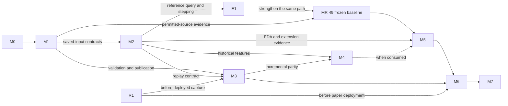

# Capability milestones and MR delivery

Owner: repository founder. Status: planned implementation, refined 2026-09-14
from the milestone review. No milestone below is claimed complete. Existing
domain/decoder foundations and MR 00/C0 are implemented; they are prerequisites,
not evidence of acquisition, EDA, streaming or trading operation.

This page owns delivery order, integrated acceptance and the milestone MR packages.
The [P1 implementation plan](p1-implementation-roadmap.md) supplies the detailed
data and baseline contracts referenced by this plan. Both pages use one MR sequence. The
[platform roadmap](README.md) owns broader maturity and capability status; the
[platform design](../architecture/platform-design.md) owns architectural seams.
Use the [engineering guide](../coding_standards/README.md) for generalized code,
configuration, library boundaries and milestone requirements.

## Completion and dependency model

A milestone delivers a runnable workflow for a declared supported scope, with
controlled failures and a demonstrated extension boundary. Merged MR counts do
not establish completion. Counts below describe logical review packages and
exclude completed MR 00/C0. Planned work retains **MR 01–62**, grouped by
responsibility; dependency cells determine delivery order. MR 00 remains the merged
specification; C0 identifies the completed cleanup. Milestone names M0–M7 are not
MR IDs. Use `codex/mr-<NN>-<topic>` for implementation branches unless another name
is requested. Split a package at useful review boundaries when necessary and
record its scope under the owning MR; counts do not weaken its acceptance.
E1 is an early integration checkpoint within existing research packages. R1 is
the artifact-consumer responsibility split out of MR 59 and scheduled before the
first deployment; it is one additional logical package, not an M7 prerequisite
on M6. Numeric MR IDs remain stable. MR 18 and MR 54 are conditional on their
declared consumer; deferred packages are not claimed implemented.

| Milestone | Runnable outcome | Assigned packages | Dependencies and scope |
| --- | --- | --- | --- |
| M0 — Minimal runnable foundation | Config resolves a bounded data job and runs a saved fixture through configured decoders. | MR 01–02: **2** | Current foundations and MR 00/C0. No network, registry service or universal runner framework. |
| M1 — Validated historical ingestion | Ingest, normalize, validate, publish and reopen a versioned historical dataset through documented commands. | MR 03–16: **14** | M0 and permitted source access for external acceptance. Initial trade-data path; full snapshot eligibility/coverage claims require their actual evidence. |
| M2 — Research data access and replay | Select instruments, intervals, columns and a snapshot for bounded-memory EDA and deterministic replay. | MR 17–21: **5**, with 18 conditional | Verified published inputs and 10/12/15 contracts; synthetic development does not await M1's acquisition commands or external acceptance. The reference reader suffices unless a measured workload needs 18. |
| M3 — Reliable live capture | Configured live inputs are validated, durably captured, recoverable and consumable through compatible canonical contracts. | MR 22–27: **6** | Prototype capture after 01, 03–04; complete with quality/publication and MR 20 replay contracts. Any deployed collector first requires R1. Live source/format is selected and verified in MR 22. |
| M4 — Reproducible features and model research | Versioned transforms and optional models have causal inputs, retained fit state and reproducible evaluation; supported incremental features match replay. | MR 28–32: **5** | Historical work starts after M2. Incremental/live parity uses M3. Model work applies only to a selected model consumer. |
| M5 — Strategy simulation and research controls | E1 first composes synthetic economics; MR 49 accepts the frozen baseline; M5 adds reusable research/workflow/isolation evidence. | MR 33–49: **17** | E1 uses reference query/replay contracts; full M5 requires M1/M2 workflow exits and 47–48. M4 only for consuming strategies; neither M3 nor ML blocks the deterministic baseline. |
| M6 — Paper/shadow deployment | The same versioned strategy/feature artifacts run against live inputs with order, risk, reconciliation, recovery and monitoring controls. | MR 50–57: **8**, with 54 conditional | M3 and M5; R1 before deployed acceptance; M4 where used. Single-instance accounts use base reconciliation; sharing requires 54 and allocation reconciliation. No executable orders. |
| M7 — Controlled live operation and expansion | A specifically authorized deployment operates within tested limits; a compatible additional instance can be onboarded without copying strategy code. | MR 58–62: **5**, with release-consumer work moved to R1 | M6 and maintained release/dependency admission. MR 59 binds trading authority. Each new product/venue needs acceptance for its actual mechanics before execution is enabled. |
| R1 — Trusted deployment artifact | Build, identify, verify and install one trusted immutable artifact for the first concrete deployment. | **1**, split from MR 59 | Existing build inputs and resolved dependency admission for the actual deployment graph; no M6, MR 58 or executable-account prerequisite. |

The arrows name actual interfaces, not a global waterfall. Historical EDA and
simple backtests are useful while live capture is developed. Early capture is
reasonable for otherwise irrecoverable feeds, but it must retain basic validation,
loss visibility and durable input identity from its first working slice.
Monitoring and recovery belong to the capability they protect throughout this graph.
The M1→M2 edge names saved-input contracts, not completion of downloader or CLI
work; synthetic verified snapshots can supply them. R1 edges apply to actual
deployment, while isolated development smoke may continue under current policy.

For founder delivery, follow one main path: configured fixture and early source
feasibility → durable historical data → reference query/replay and E1 → frozen
P1 reproduction → M5 reuse and useful live capture → one paper deployment →
scoped live operation. Pull capture forward for history worth preserving, and
R1 forward whenever that capture is actually deployed. Numeric milestone order
does not require completing live capture or models before research.

## Shared configuration and support contracts

Use the [scoped configuration design](../architecture/platform-design.md#configuration-and-active-workflows).
Keep instrument/universe definitions, data jobs, strategy definitions, strategy
instances and deployment authorization distinct. Data jobs can collect a broader
universe than their current research consumers. A strategy can depend on multiple
datasets; several strategies can share one matching immutable dataset. An active
strategy does not own collection globally, and collection grants no trading authority.

Configuration libraries resolve records and references; orchestrators load and
construct selected implementations. Foundation/configuration libraries do not
import provider implementations or pipelines, and provider adapters contain no
strategy logic. Keep the same dependency direction in tests and installed consumers.

Resolve each invocation into an immutable non-secret run manifest containing the
job/instance identity, actual universe and reference version, implementation/code
and schema versions, parameters, source/input identities, policies and seed where
used. Record attempt clocks separately. A named config or mutable universe alias
alone cannot reproduce a run. Add deployment/account/authorization references
only with the runtime consumer; never fabricate them for an offline notebook.

Support is per capability and mode, not a single asset-class boolean:

| Scope | Existing foundation | Planned proof and limitation |
| --- | --- | --- |
| Configured Binance spot trades | Canonical IDs/units, authored BTCUSDT/ETHUSDT catalog and payload decoding | M1/M2 prove ingestion/query for supported fixtures and a permitted sample. The catalog is an assumption, not historical venue evidence. |
| Binance depth messages | Stateless payload decoding | No complete book, recovery or book-dependent decision support is claimed. Add snapshot/update synchronization and gap recovery before enabling such a consumer. |
| Multiple research instances | Configuration/isolation requirements only | MR 48 proves separate state, cash, pending intents and results with overlapping inputs. Shared-account execution waits for MRs 53–55. |
| A deliberately different instrument family | Generic identity/value foundations only | MR 21 and MR 48 exercise the applicable neutral interfaces with explicit synthetic contract fixtures and reject unsupported mechanics. This does not admit that family to the spot decoder, ledger or live runtime. |
| Paper/shadow/live execution | Not implemented | M6/M7 qualify only the named product/venue/account/mode; lifecycle, units, valuation, margin, recovery and monitoring must be supported where applicable. |

Do not force a derivative into `SpotInstrument`, assume a multiplier of one in a
generic interface, convert quote currencies implicitly, or turn all strategy
outputs into spot target quantities. P1 retains its declared target-quantity
contract. Quoting/order-intent strategies add a meaningful contract and consuming
controls when selected. Track supported combinations with their owning configs
and tests; no new certification registry or evidence archive is required.

## M0 — Minimal runnable foundation

MR 01 supplies scoped data-job parsing, capability validation and resolved run
identity. It does not require strategy or deployment schemas before those consumers.

| MR | Depends on | Owned behavior and concrete consumer | Decisive evidence |
| --- | --- | --- | --- |
| **02 — Inspect a configured fixture** | 01, C0 | Start `pipelines/dataset.py` with a bounded fixture-inspection command: read config and an explicit saved frame, resolve instruments, compose retained decoders and return events/diagnostics with run identity. Libraries own parsing/validation; this pipeline owns construction and I/O sequencing. | Installed consumer outside the checkout handles a valid frame, unknown binding, wrong instrument and invalid timestamp. Failure is actionable and has a nonzero exit. No network or canonical publication is implied. |

Exit workflow: invoke fixture inspection with two supported instrument configs
and an invalid combination. Retain the actual command and outcomes in the MR.
This is a small runnable entry, not a new application framework.

## M1 — Validated historical ingestion

Reuse 03–06 for verified durable acquisition/resume and 08–15 for interpretation,
revisions, eligibility, quality and atomic publication. Data validity is evaluated
against the declared use: incomplete required coverage or unknown required
eligibility cannot be labeled valid. Preserve rejected inputs and reasons without
publishing them as an accepted dataset. Advanced cross-source reconciliation,
statistical anomaly detection and automatic repair are later, consumer-driven work.

| MR | Depends on | Owned behavior and concrete consumer | Decisive evidence |
| --- | --- | --- | --- |
| **07 — Make acquisition usable and observable** | 05–06 | Add the installed acquisition command in `pipelines/acquisition.py`; resolve data-job config, expose job/partition progress, retries, bytes, last successful persistence and terminal status. Reuse the existing manifest. | A permitted bounded download resumes after interruption; repeated input does not add logical completions. Mutated/missing stored bytes fail. Saved command/config identity and error status work outside the checkout. This is an intermediate raw-acquisition checkpoint, not M1 completion. |
| **16 — Publish and inspect a validated dataset** | 08–15, 07 | Extend the dataset command to normalize saved acquisitions, apply declared policies, publish/reopen by snapshot ID and return a compact quality/coverage report. Expose invalid counts, persistence failures and actionable status as work executes. | Ingest → normalize → validate → publish → reopen succeeds on the permitted supported sample. Duplicate ranges preserve logical content. Wrong schema/instrument/time/units, a coverage gap and interrupted publication cannot expose an apparently valid snapshot. |

Exit workflow: use documented acquisition and dataset commands for a configured
universe/range, interrupt and resume, reopen the published snapshot, and switch
to another supported synthetic instrument without shared-code edits. M1's external
acceptance remains incomplete while required source rights or evidence are missing;
fixture-based development may continue. No-trade/backtest results are not needed here.

## M2 — Research data access and replay

MR 17 owns revision-aware availability filtering before selection. Dataset
versioning and availability semantics are both required. A query must distinguish
event/effective, knowledge/availability and ingestion time and retain the selected
knowledge model; a historical download's wall clock is not historical availability.

| MR | Depends on | Owned behavior and concrete consumer | Decisive evidence |
| --- | --- | --- | --- |
| **18 — Add a measured query backend** | 14–15, 17, 19; selected workload requires it | Add a versioned columnar writer/reader behind MR 19's working query interface. Preserve exact units, revisions, availability and semantic snapshot identity. Benchmark a bounded candidate before dependency admission; defer if the reference reader meets the workload. | Reference parity and exact round trips; conversion cannot drop history or change selected values. Interrupted conversion leaves prior inputs readable. Retain measured I/O/memory benefit and added dependency cost. |
| **19 — Query selected data in bounded batches** | 17, not 18 | Introduce a working file/reference reader accepting snapshot ID, instruments, time/knowledge bounds and columns; return typed batches/aggregates and query identity. Preserve [applicable control/quality scope](../data/contracts.md#control-scope-through-queries) through selection/projection. Distinguish cutoff projections from replay history retaining revisions and their availability. MR 18 may later supply another implementation. | Compare with the as-of selector including late corrections. Applicable instrument-less disconnects survive projected queries; unrelated bindings' disconnects do not affect selected inputs. Replay retains earlier versions instead of using terminal-cutoff state. Measure memory/read counts; verify cancellation and bounded iteration. Projection cannot bypass eligibility or revision filtering. |
| **20 — Replay with shared event stepping** | 19 | Own the ordered iterator, clock, cursor and stepping under the [shared timing contract](../data/point-in-time-semantics.md#planned-economic-ordering-and-event-stepping). Advance chronologically through source availability, decisions, expiry, terminal and any additional fill-eligibility times; phase order applies at one timestamp across batch boundaries. Replay and E1/MR 44 research consume the same operation. | Preserve source order, bounded buffering, future-only prefix and cursor/resume parity. E1/MR 44 prove an earlier fill survives a later-known gap, batch sizes 1/k give identical economics, and equal-time controls, exact expiry and retained revisions stay causal. Read-ahead never advances knowledge. |
| **21 — Exercise EDA and extension boundaries** | 19–20 | An EDA orchestration entry resolves query config and produces retained query/summary identities; the activity notebook calls the same libraries. Include query duration, failures, rows/batches and memory/read observations. | Query multiple instruments, plot a bounded interval and replay it outside the notebook. An explicit different-family fixture exercises neutral identity/unit/query contracts; unsupported lifecycle or adapter requests fail. Notebook convenience does not require a hosted service or a production-supported second family. |

Exit workflow: select assets, dates, columns and a saved dataset version; inspect
EDA results and replay ordered inputs without loading the entire dataset eagerly.
Benchmark selection must record actual I/O and layout, not promise that every
filter avoids a full scan. Live ingestion and a feature store are not dependencies.
Complete 17, 19–21 with the reference reader first. MR 18 is required only when
the selected consumer's measured workload needs that representation; record its
deferral explicitly instead of gating observations or E1 on a backend choice.

Parquet with an embedded engine is a candidate, not an adopted stack. DuckDB
supports projection/filter pushdown and metadata-based row-group skipping; actual
I/O savings depend on the query and layout. Introduce a service or evaluate kdb+
when shared access, concurrency, isolation or a measured latency budget warrants
it. [DuckDB Parquet documentation](https://duckdb.org/docs/current/data/parquet/overview)
(reviewed 2026-09-13). Market-event queries and feature serving remain distinct contracts.

## M3 — Reliable live capture

Initial scope is a declared trade stream. Select the actual live source and
format in MR 22; do not silently extend the frozen Tardis historical experiment.
Tardis-machine documents exchange-native historical replay but normalized-only
real-time streaming, so its live output cannot be passed to the raw Tardis line
decoder as if provenance and format were identical.
[Tardis-machine documentation](https://docs.tardis.dev/tardis-machine/quickstart.md)
(reviewed 2026-09-13). A direct venue feed is another candidate with its own adapter.

| MR | Depends on | Owned behavior and concrete consumer | Decisive evidence |
| --- | --- | --- | --- |
| **22 — Bind and verify one live source** | 01, 03–04 | A provider/venue transport performs bounded subscription and frame receipt for one configured live data job; the live pipeline composes it. Define source/session identity, formats, clock precision, availability, permissions and stream-specific sequence guarantees. | Smallest permitted connection verifies actual framing/time assumptions; fixtures cover invalid subscription and unsupported combinations. Vendor archive capture is never invented as local live receipt. |
| **23 — Capture durably before downstream use** | 22 | Extend raw storage with append/segment boundaries, receipt/order metadata, durable cursors and replayable exact captured input. `pipelines/live.py` coordinates validation, persistence and publication to a bounded consumer. | Truncation, disk failure and process loss leave identifiable durable input and visible uncommitted loss. No acknowledgement beyond the durable boundary; invalid frames retain diagnosis. Initial schema/unit checks are active here. |
| **24 — Recover sessions without hiding gaps** | 23 | Pipeline connection lifecycle, backoff, resubscription, session epochs, bounded queues and source-specific gap/backfill reconciliation. Preserve duplicates as raw lineage and apply economic deduplication explicitly. | Disconnect/reconnect, duplicate delivery and overload cannot silently lose accepted data. Unknown gaps stay visible; a later backfill cannot acquire an earlier knowledge timestamp. No global exactly-once claim. |
| **25 — Apply continuous quality and recovery states** | 24, 10–15 | Reuse canonical validation/revision operations; add bounded lateness, freshness, watermark and recovery policy in cohesive data libraries consumed by the live pipeline. Publish valid segments/snapshots with their quality status. | Inject out-of-order/late events, stale progress, schema errors and relevant sequence gaps. Recovery cannot mark an invalid stream valid merely because the connection is open. Book consumers remain disabled until snapshot/update resynchronization is implemented. |
| **26 — Supervise live health and responses** | 24–25 | Configure process liveness, advancing ingestion/persistence, freshness, queue pressure, reconnect/invalid counts and alert responses. Use existing telemetry tools behind bounded library adapters; supervision/response composition stays in pipelines. | Detect a live heartbeat with stalled data, loss of the process/collector and persistence failure. Test alert delivery and the declared response; alert failure does not block local protective behavior. |
| **27 — Prove capture/replay parity** | 25–26, 20 | Complete the installed live workflow and replay its exact saved raw frames, receipt clocks and session transitions through the same normalization and downstream consumer. | Captured-input replay reproduces admitted canonical events, quality transitions and consumer outputs. Demonstrate restart and duplicates on a permitted bounded capture. A later vendor download is not substituted for this proof. |

Required quality states are `valid`, `degraded`, `stale`, `recovering` and
`unavailable`, with reason, scope, transition time and last durable progress.
`valid` admits only supported policy-compliant data; `degraded` requires explicit
consumer opt-in and visible limitations. `stale`, `recovering` and `unavailable`
block freshness-dependent decisions; resume requires the relevant synchronization
and validation. Historical EDA may inspect retained data with its status. State
names alone are insufficient: transition/recovery behavior is tested at the consumer.

## M4 — Reproducible features and model research

Historical feature research starts after M2. Each package ships with its actual
consumer; no generic feature graph or model registry is needed for a fixed rule.
The incremental subset closes only when M3 parity is exercised. A model package
is conditional on a selected trained-model consumer and is not a prerequisite
for M5's deterministic baseline.

| MR | Depends on | Owned behavior and concrete consumer | Decisive evidence |
| --- | --- | --- | --- |
| **28 — Compute versioned historical features** | M2 | Pure feature definitions with input requirements, units, windows, availability and lineage, composed by a historical feature pipeline. | Independent window examples and future perturbations preserve earlier outputs; missing/stale inputs retain explicit status and available-at time. |
| **29 — Fit and reuse preprocessing state** | 28 | Separate fit from transform with immutable state/version and explicit permitted training rows; keep fitted parameters out of global mutable configuration. | Held-out/future rows cannot influence fitted state; saved state reproduces transformations and rejects incompatible schema/units. |
| **30 — Reuse features incrementally** | 28, M3; 29 if fitted | Add bounded window state/checkpoints consumed by the streaming feature pipeline using the same semantic definitions. | Exact captured replay and historical processing agree under declared ordering, late-data and numerical policy; restart/warm-up does not silently reuse invalid state. |
| **31 — Record a model research attempt** | 28–29; selected model | Compose a selected trainer/evaluator with immutable code, config, feature, split, model and trial identities; tracking storage is an adapter to owned records. | Retained attempts, including failures, reproduce model inputs and evaluation under the declared numerical contract. A database or MLflow installation alone does not satisfy this package. |
| **32 — Evaluate delayed outcomes** | 31; selected model | Reusable evaluation operations bind prediction time, feature/model versions, label availability, label coverage and metrics. Record research drift/inference failures and defined responses for later runtime reuse. | Labels arriving later cannot influence earlier predictions; missing labels are not zero outcomes. Compare declared reference/current windows and attribute results to the correct model/input versions. |

Feature serving is separate from market-data access. Any store must preserve
availability as well as event time: Feast documents that its default event-time
join can include later corrections; availability filtering depends on the
selected backend and correctly interpreted timestamps.
[Feast point-in-time joins](https://docs.feast.dev/getting-started/concepts/point-in-time-joins)
(reviewed 2026-09-13). Test the chosen adapter rather than treating a product label
as proof of causal correctness. MLflow or another tracker remains optional.

Exit workflow: reproduce versioned historical features, then compare supported
incremental features on exact captured replay with restart. When a trained model
is selected, retain its fit/evaluation attempts and delayed-label results;
otherwise record those conditional packages as inapplicable to the current
feature scope, not implemented model support.

## M5 — Strategy simulation and research controls

Reuse 33–41, 43–46, 49 for completed observations, configured strategies, delayed fills,
exact accounting, trials and reports. Preserve the
[frozen P1 experiment](../research/p1-baseline.md): additional synthetic cases do
not revise its sample, strategy or costs. The 2026-09-14 arithmetic and ordering
clarifications apply before implementation. Start with
[E1](p1-implementation-roadmap.md#early-synthetic-economic-slice), which delivers
initial 33–42 behavior and the research callable together using the reference
query/scheduler. Keep it runnable while the remaining acceptance cases and
43–46 persistence/installed execution are added.

MR 49 accepts the frozen baseline only after every baseline requirement passes.
M5 additionally requires M1's installed workflows, M2's EDA/extension exit and
47–48 below, as assigned in the
[acceptance map](p1-implementation-roadmap.md#p1-acceptance-map). MR 18 remains
conditional on a measured consumer; neither outcome requires a columnar backend
merely to complete its package number.

| MR | Depends on | Owned behavior and concrete consumer | Decisive evidence |
| --- | --- | --- | --- |
| **42 — Enforce simulated decision limits** | 34–41 | A risk library validates unit-bearing intent, available cash, holdings and pending commitments against explicit supported limits. The research pipeline applies it outside strategy code before fills. Preserve frozen P1 bounds and the [intent/run outcome distinction](../research/p1-baseline.md#intent-outcomes-and-run-completion). | A strategy cannot bypass limits or change them; wrong units, excess size/cash and pending exposure are rejected with attributable reasons. An expected unaffordable intent produces no fill and unchanged balances, without alone failing a complete run. Broken invariants or incompatible required state still fail computation. Limits apply equally in no-trade/baseline composition. |
| **47 — Retain research selection controls** | 43–46 | Extend trial/config consumers with predeclared comparisons and applicable split, fit and holdout access records; integrate M4 state/model identities only when used. | Failed/rejected comparisons remain visible. A changed split/cost/config cannot overwrite a prior trial; a fitted consumer cannot use future/held-out inputs. The deterministic baseline records fitting as inapplicable. |
| **48 — Prove instance and capability isolation** | 44–46, 42, 47 | Exercise two strategy implementations/instances on overlapping multi-instrument fixtures through the same orchestration, with distinct state namespaces and identities. Reuse matching immutable inputs, not mutable cash or pending intents. | Failure/restart of one instance cannot change another's state, fills or output. A compatible strategy needs only implementation/config additions. A different-family contract fixture exposes unit/multiplier assumptions and rejects unsupported economic execution. No shared-account portfolio support is inferred. |

Exit workflow: run configured no-trade and baseline instances, reconcile a hand
ledger, reproduce a saved report outside the checkout and exercise the isolation
cases. Complete permitted-source MR 49 separately from synthetic evidence. Live
feeds, fitted models and feature services are not mandatory dependencies.

## R1 — Trusted artifact before first deployment

This package moves the release-consumer portion of MR 59 ahead of the first
actual deployment, including an early M3 collector. It has no dependency on M6,
MR 58, broker access or trading authority. Implement the smallest consumer for
the selected artifact/target when needed; a general signing platform is not a
prerequisite for synthetic research.

| Package | Depends on | Owned behavior and concrete consumer | Decisive evidence |
| --- | --- | --- | --- |
| **R1 — Build, verify and install a trusted artifact** | Existing build/lock inputs; actual deployment graph admitted under dependency policy | Resolve the [QuantLib deployment decision](../architecture/dependency-admission.md#first-deployment-dependency-decision), then implement the [artifact contract](../architecture/artifact-supply-chain.md) for a concrete collector or runtime installer. Bind source/lock/platform, immutable digest, trusted origin/builder, inventory/provenance and state compatibility; retain installation/rollback records. | Outside-checkout installation verifies trusted identities and exact bytes; tampering, unsafe archive members, unknown/missing provenance, incompatible state and dependency mismatches fail. Release-use checks remain fail-closed until both dependency admission and the consumer pass. Artifact verification grants no trading authority. |

Any deployed M3 acceptance and MR 57 depend on R1. Keep local wheel smoke labeled
development evidence while release is blocked. MR 59 later consumes this release
identity and independently binds the executable account/venue/limit/duration
envelope; it does not create the artifact consumer needed by its own prerequisites.

## M6 — Paper/shadow deployment

Promotion reuses versioned strategy/feature/model logic; it does not copy notebook
or research code into a second implementation. Libraries remain independent of
pipelines, provider SDKs stop at adapters and production code imports neither
notebooks nor workstation configuration. Deployed artifacts follow existing
[release/dependency boundaries](../architecture/README.md#dependency-and-release-boundaries).
Local development smoke can proceed while those boundaries block an actual release.
R1 must pass before any deployed acceptance. The first scope may be a single
trusted founder-authored strategy instance in a dedicated paper account. It
still needs durable orders/fills, pending reservations, account limits, duplicate
protection, reconciliation, monitoring, stop and recovery. MR 54's arbitration
and allocation-specific MR 55 evidence become mandatory before a second instance
shares that account; unsupported sharing must fail configuration/startup.

The initial threat model is trusted founder-authored code with logical state
separation, invariant checks and final risk enforcement outside strategy logic.
It does not guarantee isolation from malicious code. Adversarial/untrusted
strategies require a real privilege boundary with controlled communication and
credentials/limits outside their authority before onboarding; classes, namespaces
or a same-privilege process alone do not establish that guarantee.

| MR | Depends on | Owned behavior and concrete consumer | Decisive evidence |
| --- | --- | --- | --- |
| **50 — Resolve an immutable deployment** | M3, M5; M4 where used | Runtime orchestration resolves instance/run/deployment/state namespace, exact artifact/input versions, environment, accounts and explicit mode. Keep collection/research selections separate from executable authorization. | Incompatible artifacts/state/bindings fail startup; the same strategy decisions agree for matched research/runtime inputs. Paper/shadow cannot acquire an executable connection by adding a symbol to config. |
| **51 — Implement the paper order lifecycle** | 50 | Execution contracts and a working paper adapter handle submit/acknowledge/fill/reject/cancel/replace and unknown outcomes under one defined venue model. | Independent order/fill traces preserve IDs, quantities and states; timeout is not silently treated as rejection or permission to resend. |
| **52 — Journal and recover execution state** | 51 | Durable order/fill journal, idempotent transitions and a single-writer/fencing policy used by runtime startup and restart. | Duplicate/late messages and process loss cannot apply a fill twice; a stale process cannot continue owning the same session. |
| **53 — Enforce independent runtime risk** | 52, 42 | Strategy-instance budgets and account/portfolio hard limits include pending commitments. Enforce limits and kill controls outside trusted strategy logic under the stated threat model. | Supported strategy interfaces cannot raise limits, bypass stops or write peer state; failures retain protective behavior. Pending intents cannot spend reserved capital twice. No hostile-code isolation claim. |
| **54 — Attribute and arbitrate shared-account intents** | 52–53 | Explicit aggregation/allocation policy preserves strategy intents, account orders, fill/cost attribution and reservations. Required before multiple instances share a paper account. | Opposing synthetic intents net under a declared policy while gross strategy exposures/costs remain attributable; stopping one instance does not flatten another. Unsupported shorting/product execution is still rejected. |
| **55 — Reconcile before resuming** | 52–53 for base account; 54 additionally for sharing | Base reconciliation compares authoritative cash, positions, open orders and pending commitments against the durable journal. For shared accounts, also reconcile strategy allocations, reservations and fill/cost attribution under MR 54. Runtime owns break/repair sequencing. | Unknown sends, partial fills and interrupted restart produce visible breaks; no new risk before reconciliation succeeds. Single-instance acceptance exercises the base path; shared acceptance also proves allocations sum to account activity without hiding breaks. |
| **56 — Operate and stop the runtime** | 53, 55 base, 26; 54 and 55 allocation scope when sharing | Add heartbeat plus decision/order progress, acknowledgements, rejects, exposure, risk state and reconciliation metrics; explicit stop/cancel/restart/rollback operations with scoped responses. | Detect an alive-but-stalled strategy, collector failure and reconciliation break. Test alert delivery, protective behavior and compatible state recovery without relying on telemetry to enforce hard limits. |
| **57 — Exercise installed paper/shadow deployment** | R1, 50–53, 55 base, 56; 54 and 55 allocation scope when sharing | Run the trusted immutable artifact/config through paper and shadow with saved/live inputs and retained outcomes; document actual operating commands and accepted account scope. | Prove parity, state separation, disconnect/restart, stop and rollback. Reject shared-account configuration until arbitration and allocation reconciliation pass. Paper/shadow sends no executable orders; passing is not live authorization. |

## M7 — Controlled live operation and expansion

| MR | Depends on | Owned behavior and concrete consumer | Decisive evidence |
| --- | --- | --- | --- |
| **58 — Admit one executable venue path** | M6 | Implement the selected venue's bounded execution adapter and conform it to the owned lifecycle, throttling, unknown-outcome and reconciliation contracts. | Permitted sandbox/paper traces plus required actual-boundary checks establish that adapter's scope; unsupported order/product combinations fail. |
| **59 — Bind executable trading authority** | 58, R1; maintained release admission | Consume the verified immutable release/config/state identity and bind the explicit founder-authorized account, venue, instrument, capital, limits and duration at runtime. Release-consumer implementation belongs to R1. | Unverified/incompatible releases or out-of-envelope selections fail. Deployment and activation remain distinct; changed dependencies or expired authority block use. No additional institutional approver is invented. |
| **60 — Apply operational and economic monitoring** | 59, 56; 32 where used | Track data/feature freshness, inference/decision failures, execution quality, exposures and economic attribution for every strategy. Learned models also reuse prediction/drift and delayed-label evaluation definitions. | Inject stale features, a stalled decision path and attribution/label gaps; verify the defined response and model/instance/version identity. A healthy tracking server is not evidence of a healthy strategy. |
| **61 — Exercise bounded activation and recovery** | 59–60 | Complete actual scoped activation, stop/cancel, reconciliation and compatible rollback workflows with explicit founder authorization for external operation. | Retain the declared envelope and observed outcomes; recovery cannot undo filled orders or silently widen limits. No milestone plan itself grants capital authority. |
| **62 — Onboard a compatible additional instance** | 61; 54 and 55 allocation scope before sharing an account | Add an instance/asset within implemented capabilities through config and scoped authority, preserving artifact reuse and support declarations. Shared-account onboarding also consumes qualified allocations and reconciliation. | Prior instances remain correct; new inputs/orders/fills are attributable. Qualify the actual enabled mode. A new instrument family needs its own data/lifecycle/accounting/risk/adapter acceptance before support advances. |

## Acceptance records and maintenance

Each milestone closes with its documented installed command or notebook-plus-
package workflow, supported config/input identities, selected failure scenarios,
actual results and remaining operational/data limitations in the existing MR/run
records. Commands above describe planned workflows; they are not current verified
invocations. Add exact commands to owning component docs when implemented.

Tests, telemetry and recovery are delivered with the MR that introduces the
behavior; the final integration package connects and verifies them. Reuse shared
validation libraries, but keep historical coverage and live freshness/recovery
semantics explicit. Instrumentation backends do not own financial or data-quality
policy. Add an external metrics/alert service only with a running consumer and
tested delivery/collector-failure response, not as a detached platform exercise.

Use the existing PR template and focused validation from the
[P1 validation contract](p1-implementation-roadmap.md#validation-evidence-reuse-and-reversal).
No separate evidence archive, support-registry service or universal fault matrix
is introduced. Documentation refinements need link/semantic validation; changed
runtime/artifact boundaries need their affected proofs. Counts and status change
with actual delivery, while every retained requirement has an owning MR or an
explicitly applicable later capability.

Documentation review, 2026-09-14: these edits are based on
`778f86c64cc82a25f63ced935e6b797358da4b9e`. `uv run --frozen
alpha-governance-architecture` passes for all 18 documents under `docs/`, and
`git diff --check` passes. Independent Python `Fraction`/`Decimal` calculations
confirm `1/10003`, basis release `302/3` and remainder `604/3`, exact attribution,
and the `0.205` rounding tie at Decimal precisions 6, 28 and 60. Dependency and
completion rows were checked against their owning contracts. Runtime source,
tests, lock, dependency-policy TOML and packaged `docs/README.md` are unchanged; no
research, deployment, new consumer or end-to-end acceptance is claimed.

Follow-up review, 2026-09-14: clarified scoped control propagation, chronological
stepping/revision history and batch invariance, intent rejection versus run
completion, and the architecture overview's order/cost wording. The same local
link and diff checks pass. A focused documentation check confirms one owning row
for each MR 00–62 and R1, and MR 49 dependency coverage of every baseline
acceptance owner. The prior arithmetic verification remains applicable because
its contract is unchanged; new consumer scenarios are planned evidence in the
existing MRs/E1, not executed runtime tests. MR 01–02 remain the next delivery.
