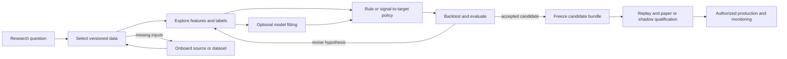

# Quant researcher implementation guide

Owner: repository founder. Updated 2026-09-21.
This is the activity-based guide for researching data, features, models and
strategies, then preparing accepted candidates for operation. The
[platform infrastructure roadmap](../docs/roadmap/README.md) owns what must be
built and its acceptance; the [research program](../docs/roadmap/research-program.md)
owns experimental methodology. This guide explains what a QR supplies, what the
platform does and what to retain. It is not a second implementation backlog.

**Available now:** bounded acquisition, saved-input publication, trade queries,
book reconstruction/replay, pinned multi-input selection, EDA, retained experiment
attempts, temporal splits, versioned observed-price feature/label studies, exact
model construction/evaluation, bounded synthetic spot economics, configured
costed reports, local serial pipelines and pinned lakeFS dataset versions.
The research comparison workflow adds compatible implementation registration, a distinct
reversal rule, retained Alphalens diagnostics and fixed-budget Optuna comparisons.
The [offline activity notebook](research-foundations.ipynb) includes a rule-only
comparison; the [marimo example](research-comparison.py) separates verified
DuckDB/Polars previews from an explicit formal factor run. The
[accepted tool amendment](../docs/roadmap/README.md#diagnostic-tool-requirement-amendment)
requires offline reference/current diagnostics using admitted computation
dependencies; Evidently is optional. The [window diagnostic consumer](#compare-reference-and-current-windows)
compares retained features/predictions with separate label-availability and
predictive-applicability rules, and publishes its own report through ClearML. The
[dependency review](../docs/architecture/dependency-admission.md#evidently-prerequisite-recheck)
preserves the rejected Evidently closure; it no longer makes Evidently a
prerequisite for delivering these diagnostic capabilities.
The [isolated Feast worker](../configs/development/research-worker/README.md)
provides bounded local offline retrieval without changing the core pandas pin.
**Planned:** candidate packaging and paper/live operation.
Exploratory notebook calculations are possible today; they do not establish that
the corresponding maintained platform workflow exists. Current empirical data
retains source-specific exploratory/degraded qualifications.

For a working starting point, choose a [current notebook](#start-with-your-research-question)
and follow [setup and execution](notebook-operations.md). For the intended research
process, follow the journey below. Future activities describe contracts and
handoffs, not commands or imports that can be run today.

## Research activities and journey

For the interactive comparison, use a completed installed feature-consumer output
directory containing `study.json`, `factor-study.json`, `tracking.json` and the
complete attempt store. Set `ALPHA_COMPARISON_DIRECTORY`,
`ALPHA_COMPARISON_SOURCE_ATTEMPT` and `ALPHA_COMPARISON_SOURCE_SHA256` to the exact
retained source. Then run `marimo run examples/research-comparison.py` from the
installed pinned environment. Its row slider only recomputes bounded read-only
views. **Run and retain factor diagnostics** creates a new attempt and requires
actual ClearML publication. It never fits or reads the final holdout.

For a fresh-process reproduction, use the same three source variables and explicit
`ALPHA_COMPARISON_RUN=1 python examples/research-comparison.py`. Without the run
switch, script execution only checks the preview. Compare retained report bytes,
not execution UUIDs or timestamps. Keep credentials in the existing private SDK
configuration. The source result and frozen factor configuration remain unchanged.

Compatible extensions use `FeatureRegistry`, `EstimatorRegistry` or `RuleRegistry`
from their curated owners. Register a unique implementation ID in the caller's
registry, select that ID in configuration and supply the registry to the existing
workflow. The feature and estimator seams preserve their existing typed definition
contracts; arbitrary new schemas are not accepted implicitly. The built-in reversal
rule buys only on a strict completed-price fall, unlike momentum. Each run receives
a fresh rule instance and retains its own state, pending intents and result.

### Compare reference and current windows

Use `WindowDiagnosticStudy` to freeze explicit half-open reference/current decision
windows inside the source's validation split, an evaluation cutoff before the
holdout, exact retained source attempt/digest pairs, minimum counts, KS thresholds,
and predictive applicability. The [experiment contract](../src/research/experiments/README.md#offline-window-diagnostics)
owns schema, restrictions and numerical interpretation. This is an offline
investigation, with no automatic retraining, promotion or trading.

The installed feature consumer creates `models/window-study.json` and
`models/tracking.json` beside its retained attempt store. Reopen that explicit
request from the installed environment:

```python
from pathlib import Path
from applications.explore import compare_windows, publish_experiments
from research.experiments import ClearMLDestination, WindowDiagnosticStudy
from serialization import DomainCodec

root = Path("/absolute/path/to/feature-consumer/models")
codec = DomainCodec()
study = codec.decode_json((root / "window-study.json").read_bytes(), WindowDiagnosticStudy)
tracking = codec.decode_json((root / "tracking.json").read_bytes(), ClearMLDestination)
attempt = compare_windows(study, attempts=root / "attempts", tracking=tracking)
print(attempt.start.attempt_id, attempt.status)
# After a transport failure, retry already saved artifacts without another diagnostic run:
receipts = publish_experiments(root / "attempts")
```

For the maintained marimo interface, set `ALPHA_WINDOW_DIRECTORY` to that `models`
directory and open [research-comparison.py](research-comparison.py). The displayed
windows/cutoff and **Run and retain window diagnostics** action are independent of
factor preview controls. Display updates create no attempt. An explicit
`ALPHA_WINDOW_RUN=1 python examples/research-comparison.py` runs the frozen request
in a fresh process. Credentials remain in the existing private SDK configuration.

Review per-instrument feature and prediction KS distance/p-value, sample counts,
missing/excluded row reasons, and exact MSE for labels actually available at cutoff.
Missing labels do not disable applicable feature diagnostics. An explicitly
inapplicable predictive metric retains its reason rather than reporting zero error.
Rerunning a saved request reproduces report bytes; a later label cutoff is a new
declared diagnostic request. Retain both attempts. These dependent temporal samples
and unadjusted p-values support investigation, not empirical alpha acceptance.



Feature research need not start with a chosen model. A signal diagnostic, factor
study or deterministic rule is a valid research consumer. Use only the applicable
activities: a rule can skip fitting; a batch model need not have streaming feature
machinery. Data inspection, predictive diagnostics and economic backtesting answer
different questions and should retain separate conclusions.

| Activity | You provide | Result to retain | Current support |
| --- | --- | --- | --- |
| [Frame the question](#frame-a-research-question) | Mechanism, universe, horizon and comparison intent | Research note and applicable evaluation boundaries | Methodology available; maintain records manually |
| [Select and inspect data](#select-and-inspect-research-data) | Explicit sample, fields, clocks and quality needs | Saved-input/snapshot/query identities and coverage limitations | Pinned trade/book selections and bounded discovery available |
| [Onboard missing inputs](#onboard-a-missing-source-or-dataset) | Source/data requirements and intended use | Qualified dataset plus source limitations | Existing source configurations supported; new capabilities require implementation |
| [Explore features and labels](#research-features-and-labels) | Formula, window, target and missingness policy | Versioned definitions, diagnostics and information intervals | Retained trailing-price diagnostics and separate forward-return labels available |
| [Compare models or rules](#compare-models-or-deterministic-rules) | Splits, transforms, trainer/rule and selection criteria | Complete attempts, out-of-sample predictions and applicable fitted state | Exact no-fit and train-only least-squares study available; see the model contract below |
| [Backtest](#build-and-backtest-a-strategy) | Signal-to-target policy and execution/cost assumptions | Reconciled economic trace | Synthetic spot rules, independent limits, delayed fills, exact accounting and bounded vectorbt comparison and configured costed reports available |
| [Promote and monitor](#freeze-and-qualify-a-candidate) | Frozen candidate and operating requirements | Qualification evidence and authorized deployment identity | Planned; no production workflow exists today |

### Frame a research question

Write the mechanism you want to test, required observations, intended decision
horizon and a simple comparator. Identify what would make the result uninformative:
missing historical availability, inadequate coverage, unstable behavior or an
execution assumption the data cannot support. Select the applicable methodology
from the [research program](../docs/roadmap/research-program.md#rules-for-every-workstream).

Exploration can begin with a small permitted sample. Before formal comparison,
record selection criteria and evaluation boundaries. Retain failed, rejected and
abandoned attempts that influence the next choice. The
[experiment attempt core](../src/research/experiments/README.md) retains semantic
inputs, temporal splits and execution outcomes. Its first consumer is a pinned
unfitted inspection; other notebook research still needs the applicable
[trial fields](../docs/roadmap/research-program.md#small-records-and-artifacts).
Ignored notebook run snapshots alone are not a durable research journal.

### Select and inspect research data

**Available, with bounded source-specific interfaces.** Start with the
[data-source index](../docs/data_source/README.md) and [current samples](#what-data-am-i-actually-researching).
The index describes sources; it is not an executable catalog of implemented
adapters. Use the existing acquisition/publication commands in the
[data command reference](../src/market_data/README.md), or the current notebooks.
Choose the explicitly offline or live notebook in the [catalog](#start-with-your-research-question).
Offline versions use synthetic or selected saved inputs; live versions initiate one bounded
public capture through the existing installed command. See the
[operations guide](notebook-operations.md#live-versions) for effects and retention.

Select instruments, business interval, requested fields and the decision/knowledge
cutoff explicitly. Inspect units, coverage, gaps, historical membership, revisions
and source clocks before calculating a result. Pin the saved selection JSON and
its addressed raw/snapshot stores
for repeatability; the QR notebook never selects a mutable latest-input alias.

Use `SnapshotCatalog.discover` to inspect saved trade/book manifest identities,
instruments, source requests and units. Discovery checks metadata only; opening
verifies every retained input. Author a `ResearchSelection` with uniquely named
trade/book queries, explicit snapshots, universes, fields and windows, and one
shared knowledge cutoff. Save that JSON and its printed selection identity.

The current Python entry `applications.explore.inspect_eda` reopens this selection
with the existing snapshot/raw stores and a retention callback. Its `dataset`
result retains separate typed inputs, query identities, exact units, controls,
quality and missingness. Trade windows use business time; book windows explicitly
use receipt time. The [research selection reference](../src/market_data/README.md#discover-and-reopen-research-selections)
shows the public records and retention workflow. Standalone `EdaQuery` remains
available for single-snapshot cutoff/history inspection.

Inspect coverage reasons even when values exist. An absent eligible value is not
a zero, an empty market or proof that membership was known. Unknown archive
availability stays unavailable at the decision cutoff. Missing files fail the
whole read. This interface does not resample, fill missing periods, convert USD
and USDT, or construct features. Trade and native book fields retain their own
schemas. The sum of input byte ceilings is bounded; it is not a total RSS bound.

Finish this activity with a pinned sample and a statement of what it can support.
If missing evidence prevents causal research, retain an exploratory conclusion
or obtain appropriate evidence; do not silently relabel the dataset.

For an inspection that influences comparison, author an `ExplorationStudy` with
its question, family, pinned selection and a `TemporalSplit`, then call
`applications.explore.inspect_experiment`. The [attempt contract and example](../src/research/experiments/README.md#inspect-a-retained-saved-data-study)
explain retained results, the explicit no-fit policy and failure recovery. The
installed handoff now exercises this path and repeats it in a fresh process.
Initial notebook inspection uses `inspect_eda`. The connected trade study then calls
`inspect_experiment`, `evaluate_model` and `compare_vectorbt`, retaining configurations,
attempts and artifacts; this still does not automatically journal every researcher choice. A final holdout is recorded as
consumed before access, including when its read later fails; changed studies
cannot reuse that consumed family holdout.

### Onboard a missing source or dataset

Start from the missing research input, not from a new downloader for each model.
Record the source, instruments/data family, fields and units, history/cadence,
availability/revision behavior, access/retention needs, expected volume and first
consumer. Distinguish obtaining more data from implementing a new capability.

| Requested addition | QR action | Platform implementation boundary |
| --- | --- | --- |
| Another supported instrument, interval or source selection | Supply compatible reference/configuration and inspect the resulting quality | Reuse existing acquisition/publication/query operations; unsupported selections fail |
| A new provider or data type | Supply a bounded sample/request and required semantics | Add the adapter/schema, identity/clock/revision mapping and shared publication/read integration |
| New historical-to-live use | Declare required cadence, freshness and recovery behavior | Qualify applicable capture/replay/runtime compatibility; historical access does not establish live availability |
| A new tradable product | Declare the product and intended strategy mechanics | Add missing lifecycle, simulation, accounting, risk and execution capabilities before economic/operational admission |

The configured `spot-comparison` job in
[`binance-archive.json`](../configs/data-jobs/binance-archive.json) selects BTC and
ETH through the existing acquisition command. The
[installed handoff](../tests/integration/consumers/datasets/ingestion_workflow.py)
acquires and publishes synthetic checksummed responses, combines the pinned trade
selection with a saved synthetic OKX book, and reopens all three named inputs in a
fresh process. The QR notebook uses that consumer to prepare its default tiny
sample; the engineer notebook diagnoses its interruption and recovery results.
It proves
software extension through configuration; it supplies no new empirical coverage,
historical eligibility or revision evidence. New unsupported capabilities
need an implementation change. Exploratory source calls may start in a notebook;
maintained source handling belongs to the shared data adapter, so multiple
candidates can reuse the resulting dataset. Keep a macro release or fundamental
revision in its appropriate schema rather than disguising it as a trade.

Return to data inspection with retrievable raw inputs, dataset identity, quality
and source limitations. A successful download alone does not complete onboarding.

### Research features and labels

**Versioned observed-price diagnostics are available.** The maintained
[`FeatureStudy` workflow](../src/research/features/README.md) runs through the
existing `inspect_experiment` application with `TrailingReturn` and an optional
`ForwardReturn`. It retains independent cutoff windows, missingness, definitions,
input identities and generated information/availability intervals. The
[installed example](../tests/integration/consumers/research/feature_study.py)
exercises two instruments and exact fresh-process reproduction. The offline QR
notebook now calls this interface over one explicitly synthetic, saved trade study. Define
a feature by its input bindings, formula, units, window, decision cadence,
availability, warm-up and missing/stale policy. Define a label separately by its
outcome, horizon, price convention, information interval and time of availability.
A forward label can evaluate an earlier prediction only after that outcome is
known; it cannot enter that prediction's inputs.

Use a small hand-inspectable sample first. Examine coverage and distributions,
then diagnostics appropriate to the hypothesis: stability, redundancy, decay or
relationship to a target. Missing observations must not quietly become zeroes.
Fitted normalization or feature selection belongs inside the training split.

For example, a proposed visible-book imbalance study could start with a saved
book diagnostic before choosing a model. A later forward-return label would need
suitable future prices and evidenced timing; the existing archive's unknown
historical availability does not become acceptable because the formula is simple.
This is an illustrative research path, not a selected experiment or a change to
frozen P1.

Prototype freely within the study's data/holdout boundaries. Promote a transform
when a retained consumer needs reproducible execution: put its logic behind the
supported feature interface, add decisive causal/window examples and let formal
notebook results call that implementation. Retain feature/label versions and
input identities. The [promotion methodology](../docs/roadmap/research-program.md#notebook-research-and-package-promotion)
and [delivered interface](../docs/roadmap/README.md#versioned-features-and-labels)
define the boundary; no feature registry service is required.

### Compare models or deterministic rules

**Exact configured and train-only model studies are available.** Supply the selected feature/label definitions,
temporal split specification, trainer or rule, transform choices, comparison
space, seeds, metrics and stopping/selection rule. Use a transparent comparator.
A model-free signal study can stop at diagnostics or proceed directly to a target
policy; it does not need a fitted model artifact.

The current split API admits explicit train-only sample IDs with information
interval, availability, purge and embargo checks. The current model consumer
constructs exact least-squares state from admitted training rows, evaluates the
declared validation interval, and retains predictions and complete attempts.
The offline QR notebook also runs the configured zero-predictor comparator and
reopens both model states. Follow the research program's information-interval rules for purging
and embargo; a generic row split is insufficient where outcomes overlap. A final
holdout is consumed evidence after evaluation, not another exploratory dataset.

Retain the exact split/fit rows, dataset/feature/label versions, fitted transform
state, model parameters/bytes, predictions and evaluation identity. Reload and
compare inference on fixed inputs under declared numerical tolerances. A new
training window or changed transform creates a new artifact/attempt rather than
overwriting the previous result. Predictive accuracy alone is not economic value.

### Build and backtest a strategy

**Available for bounded synthetic/offline spot research.** The
[economic workflow](../src/simulation/README.md) consumes verified saved inputs and
an explicit `BacktestSpec`. Select the no-trade or fixed completed-price momentum
rule, instrument binding, cadence, capital, quantity, independent limits, fees and
positive delay. `applications.backtest.run_backtest` composes shared replay,
observations, limits, fills and exact accounting. General prediction-to-target
policies and walk-forward model transitions remain planned.
The installed `alpha-backtest` command now accepts an explicit `BacktestRun`
configuration and aligned benchmark, retains exact results and readable reports,
and supports checkpoints, publication retry and serial local pipelines. Follow the
[configured run guide](../src/research/experiments/README.md#configured-economics-reports-and-serial-pipelines).

Inspect inputs, prediction/signal, target, risk rejection, fill, costs and NAV in
one trace. Reconcile a small economic example before interpreting aggregate
metrics. Preserve missing/gap periods and rejected intents; a completed run can
contain expected rejections, while broken accounting or missing required valuation
prevents a valid result. Trade prints and book replay alone establish no executable
fill or queue position.

For walk-forward retraining, each historical decision must use the model and
preprocessing state that could have been fitted by then, including label
availability and declared fit/deployment timing. Never apply a final full-history
fit to earlier decisions. Record model transitions and warm-up/reset behavior.

The [shared backtest](../docs/roadmap/README.md#first-economic-backtest)
retains a reconciled gross-to-net trace and complete resumable state. Its
[installed consumer](../tests/integration/consumers/backtest/economic_workflow.py)
demonstrates saved-input reopening, fresh-process resume and tracked vectorbt comparison. The existing
[frozen P1](../docs/research/p1-baseline.md) remains its own fixed engineering
baseline; new QR experiments have separate identities and assumptions. There is
no supported backtest command today. A negative economic result can still be a
valid completed experiment.

### Freeze and qualify a candidate

**Planned.** Freeze the chosen research components and their evidence into a
candidate manifest; do not copy notebook formulas into a separate production
implementation. The bundle's exact
[shared contract](../docs/architecture/platform-design.md#candidate-promotion-contract)
belongs to architecture. Its research-facing contents identify required inputs,
features/preprocessing, optional model, signal-to-target policy, state/warm-up
requirements and accepted experiment references. Retain the bytes as well as hashes.

Promotion changes the admitted input/execution composition while preserving those
versioned components. The platform checks compatible schemas, units, timing,
state and runtime capabilities. If incremental features are required, qualify
historical/replay/live semantics and restart behavior first; a scheduled batch
candidate can use a qualified batch path. Fitting is an explicit versioned job,
not an implicit side effect of inference.

Compare matched input/feature/prediction/target traces during replay and paper or
shadow qualification. Investigate the first difference before interpreting P&L
differences. Simulated fills demonstrate only their declared execution model.
Candidate acceptance, release installation and trading activation are separate
steps. The current [release restrictions](../docs/architecture/README.md#dependency-and-release-boundaries)
and [operating workflow](../docs/governance/workflow.md#activate-and-operate) still apply.

### Monitor, investigate and revise

**Strategy monitoring planned; bounded collector health exists.** Retain candidate,
instance, input and artifact identities beside freshness, missingness, inference/
decision failures, prediction behavior, delayed-label coverage and economic
attribution. The platform owns persistent collection, alert delivery and protective
runtime controls; a monitoring notebook inspects those records.

An investigation returns to the appropriate research activity with a new attempt:
data break, changed feature behavior, model degradation or execution mismatch.
Changing the model or data assumptions creates a new candidate and renews affected
qualification. Rollback requires compatible state and cannot undo external fills.
Collector health and matching saved replay alone do not establish strategy health.

## When research requires platform work

Within an implemented capability, a new formula, estimator, rule or compatible
instance should change its own implementation/configuration and focused tests,
without editing shared runners. A new source/schema, output contract, execution
mechanic or runtime state requirement may need infrastructure work first.

Describe that request using the blocked QR activity, smallest concrete input/
output example, missing capability, current workaround/limitation and observable
acceptance. Link it to the owning infrastructure MR or add a bounded follow-on
there. Keep the candidate's hypothesis and comparison attempts in its research
record. A request for another feature does not by itself justify a feature store,
new orchestration framework or second production implementation.

## Start with your research question

Two reader journeys each have an offline and a live version. The existing filenames
remain the offline entry points so saved commands and links continue to work.

| Reader | Offline version | Live version |
| --- | --- | --- |
| QR: question → data → quality → features/models → costed rules → handoff | [Research workflow — offline](research-foundations.ipynb): saved-input inspection plus a connected retained trade study through exact economics | [Research workflow — live](research-foundations-live.ipynb): one public Bitfinex capture, bounded book publication, pinned EDA and exact visible-size diagnostic |
| Engineer: inspect infrastructure and diagnose failures | [Infrastructure diagnostics — offline](infrastructure-diagnostics.ipynb): installed data/feature/model/economic consumers, fresh-process recovery and health diagnostics | [Infrastructure diagnostics — live](infrastructure-diagnostics-live.ipynb): one public Bitfinex capture, durable/native/canonical replay parity and observed quality |

Restart the kernel and **Run All in order**. Each version runs independently.
The live versions create new retained recordings on each run; the offline versions never
contact a provider. Both live versions produce `raw/`, `snapshots/` and `selection.json`
that the offline QR version can reopen, plus a recording directory for offline engineering.
Use the [operations guide](notebook-operations.md#live-versions) for exact commands,
source budgets, failures and saved-input handoff.

The former reliability/capture notebooks remain consolidated into these two reader
journeys. Live/offline entry points distinguish input effects while reusing the installed
capture, publication, query and replay operations. Future platform stages extend these
journeys when implemented; they do not require one notebook per roadmap item.
Older source, outputs, saved raw data and ignored run snapshots remain retained.

## What data am I actually researching?

The offline QR notebook's default is **synthetic software evidence**: two Binance-format
trade archives and one saved OKX L2 message sequence. The installed configured
workflow creates and publishes them without connecting to either venue. Six
historical trade observations yield zero decision-eligible trade rows because
original availability is unknown. One received book state supports a tiny exact
visible-size calculation, with degraded quality and unproven coverage/eligibility.

The subsequent **separate synthetic price study** authors 18 trade prints over six
minutes, explicit correction-availability evidence and fixture membership. Those
same saved bytes drive versioned trailing returns, separate forward labels, retained
train-only and configured models, and no-trade/momentum economics. This explicit
fixture does not repair the earlier archives or supply an empirical result for a
user-selected dataset. Training uses minute-one and minute-two decisions; validation
uses minute five, clear of the complete training information intervals. The reserved
minute-eight holdout is never opened. The exact expected momentum terminal NAV is
999.99354400 USDT; the negative result is a successful software reconciliation.

An explicit `ALPHA_RESEARCH_DATASET_DIRECTORY` selects an existing study containing
`raw/`, `snapshots/` and `selection.json`. The notebook prints the selection and
fully verifies its required bytes. A missing or corrupt supplied study fails;
there is no implicit fallback or latest-file search. Formula application remains
study-specific: the teaching imbalance is not applied automatically to arbitrary inputs.

Existing source adapters also support the permitted samples below. They are
acquired deliberately through [source commands](notebook-operations.md#acquire-and-reopen-permitted-inputs),
or by choosing the explicit live versions; offline tutorials make no source calls.

| Sample | What it exposes | Remaining boundary |
| --- | --- | --- |
| OKX historical L2 | Saved archive and bounded prefix reconstruction | No per-record historical receipt clock or source sequence; continuity and full-day coverage unproven |
| Bitfinex recorded R0 | Individual visible orders, exact native prices/sizes and receipt order | No exchange timestamp in R0, hidden orders, queue priority or executable fills |
| OKX public live books | Aggregate price levels, source timestamps and local receipt evidence | Bounded feed depth and capture interval, not the complete exchange book |

A book describes visible interest; a trade records a transaction. L2 levels are
not L3 orders. **USD is not USDT** and sequential captures are not simultaneous.
Do not join unrelated prices or infer an arbitrage result from their difference.

## What the data pipeline provides

| Capability | What a researcher gets |
| --- | --- |
| Acquisition and original storage | Exact bytes, request identity, integrity checks and explicit access/timeout failures |
| Acquisition checkpoints | Resume verified completed partitions; unfinished files may need downloading again |
| Row and occurrence readers | Exact values, raw positions, source order and binding-scoped controls |
| Duplicate and correction admission | One economic event with all duplicate origins and evidenced predecessor versions |
| Historical eligibility | Separate valid/knowledge clocks, retained exclusions and explicit unknown outcomes |
| Dataset quality and publication | Declared use scope, deterministic identity and atomic snapshots reopened by explicit ID |
| Queries and replay | Cutoff/history modes, scoped controls and shared chronological stepping |

The [Bitfinex collector](../docs/data/l3-collectors.md) and
[OKX readers](../docs/data/okx-market-data.md) have source-specific recovery contracts.
An acquisition checkpoint does not make every live recording or archive download
resumable. Output batch sizes do not bound total process memory.

The [frozen P1 experiment](../docs/research/p1-baseline.md) retains its Binance trade
sample and economic assumptions. Book research does not replace that sample or
resolve its historical eligibility, coverage and revision-availability gaps.
Synthetic archive failure checks run offline in the engineer notebook.

## Follow the connected dataset walkthrough

The QR notebook follows research activities, with current support explicit at each stage.
Its sections follow the implemented research/development pipeline through MR 5.

| Section | QR action and result | Platform status |
| --- | --- | --- |
| 1. Frame the research question | Declare observable, universe, horizon, comparator and stop conditions; identify the installed execution | Manual research note and installed identity available |
| 2. Select or onboard the required data | Start with a synthetic or explicitly saved study; discover manifest metadata and pin named inputs, fields, windows and cutoff | Implemented dataset access; actual onboarding uses the existing acquisition/publication APIs |
| 3. Inspect values, missingness and clocks | Read through `inspect_eda`, retain input evidence and move the cutoff earlier without changing saved facts | Implemented; unknown availability and coverage remain visible |
| 4. Prototype a book feature | Inspect one exact synthetic L2 imbalance; identify why a trade label requires separate evidence | Exploratory book prototype only |
| 5. Publish a controlled trade study | Author known synthetic availability and pin saved native ZIP inputs | Existing publication/query APIs; independent of the earlier supplied selection |
| 6. Retain features and labels | Execute exact trailing/forward diagnostics, compare repeat run identity and distinct attempts | `inspect_experiment`, `FeatureStudy`, `AttemptStore` |
| 7. Compare models and reopen state | Train-only least squares versus configured zero, exact MSE, reload and publication outbox | `evaluate_model`; offline publication failure fixture or explicitly configured SDK transport |
| 8. Evaluate fixed-rule economics | No-trade/momentum, independent risk, positive-delay fills, exact ledger, full resume and vectorbt | MR 5's supported workflows; fitted predictions are not wired into targets |
| 9. Hand off to quant development | Retain input/configuration/model/attempt/checkpoint identities and limitations | Installed reproduction and recovery; Configured reports/pipelines available; MR 8 empirical acceptance remains future |

The [engineer notebook](infrastructure-diagnostics.ipynb) owns infrastructure
failure interpretation and runs the actual installed data, feature/model and economic
consumers, including fresh-process model reload and pending-intent resume. It retains
child logs and artifacts and deliberately disables optional real-server test transport.
Set `ALPHA_RESEARCH_STUDY_DIRECTORY` to the QR notebook's printed `price-study`
directory to reproduce that actual handoff in the developer's fresh kernel. It
checks pinned models, exact validation and whole/resumed economic results against
retained bytes; no implicit refit, source call or latest-file selection occurs.
Focused regression
coverage stays in [tests](../tests/README.md), with no copied notebook test framework.
The [historical workload record](evidence/query-workload-measurements.json) and
[reproduction procedure](notebook-operations.md#query-workload-evidence) retain their
original measured revision; notebook cleanup does not create new performance evidence.

## How to interpret the evidence

**An unchanged file** means its bytes match the saved fingerprint. It does not
establish that the provider observed every trade or that every value is correct.

**A missing file** means an expected input is unavailable. **An empty input** does
not establish a quiet market. In the OKX historical summary, `gaps=None` means
continuity is unknown because source sequences are absent. A reconstructed book
can be available while coverage remains unproven.

**Source time** describes the exchange's timestamp where supplied.
**Local receipt and save times** describe the collector's observation or archive
acquisition. Downloading an old OKX archive now does not establish historical
knowledge time. Bitfinex R0 supplies receipt order and sequences, but no exchange
timestamp in these messages. Do not substitute one clock for another.

**A live gap** makes the reconstructed book unavailable until synchronization is
restored. A matching offline replay proves that the same saved messages produced
the same states; it does not prove complete observation of the exchange.

**Reopening the same saved input** helps reproduce an analysis. A later provider
revision or different implementation/settings needs its own identity. Keep older
raw inputs and run records; a content fingerprint alone cannot recover a lost file.

## A useful way to work through a notebook

1. State the question and identify the sample. Distinguish a real source observation
   from a deliberately constructed teaching example.
2. Inspect the outputs: selected instrument and interval, row counts, clocks,
   values and any rejection or unknown status.
3. Explain what those outputs establish. Keep unresolved coverage, availability,
   eligibility and execution assumptions visible beside the finding.
4. Preserve the inputs and the attempted run before changing an interpretation.
   Keep code, small reviewed outputs and guide changes in Git; retain bulk data
   and generated run snapshots in their designated ignored locations.
5. Write the next research question. Change exploratory scenarios deliberately;
   keep fixed reference examples and the frozen P1 specification unchanged.

The notebook runner saves successful and failed attempts, but these local snapshots
are not a backed-up research journal. An attempt that influences hypothesis or
parameter selection also needs the [research program's trial record](../docs/roadmap/research-program.md#small-records-and-artifacts).
Final holdouts are not exploratory notebook inputs.

## Small vocabulary for reading existing outputs

| Term in the code or output | Researcher's meaning |
| --- | --- |
| Raw object | The original saved source file, such as the OKX archive or recorded message journal. |
| Partition | One requested piece of source data; here, one instrument's UTC day. |
| Manifest | A saved record of the request, its inputs and completed files. |
| SHA-256 / digest | A fingerprint used to detect changed bytes; it is not a completeness score. |
| Provenance / origin | The trail from an observation back to its source file, row and acquisition record. |
| Immutable | Preserve the saved original; make a separately identified version for a change. |
| Canonical observation | A consistently interpreted event that later analysis can use; the archive decoder preserves its raw origin. |
| Replay | Process saved observations in order. Reconstructing a book alone does not simulate whether your order would fill. |

## Keeping this guide useful as the project grows

Update this guide in the same change that alters a researcher's workflow or adds
a usable capability. Refresh the date and status, the notebook entry point, what
the outputs mean, remaining limitations and the next useful research action.
Link the actual acceptance record for measured examples; do not present planned
work or an old sample count as newly verified behavior. The roadmap continues to
own MR scope, dependencies and acceptance.

Use a consistent notebook pattern: **question → sample and assumptions → action →
observed output → interpretation and limits → next question**. Use capability
names for sections and links. Put execution/repair detail in the operations guide and
shared calculations in the package once they become maintained behavior.

## Construct and evaluate a retained model

The [model study contract](../src/research/models/README.md) shows the supported
`applications.explore.evaluate_model` interface over pinned feature results. It
supports configured no-fit coefficients and train-only exact least squares,
reopens immutable state for inference, and retains predictive errors separately
from strategy economics. The [local ClearML setup](../configs/development/clearml/README.md)
provides the explicit tracking consumer. Dependency admission verifies the locked
ClearML wheel against pinned upstream source; no empirical model quality is claimed.

Use the installed [saved-input consumer](../tests/integration/consumers/research/feature_study.py)
as the executable construction/reload example. The offline QR notebook now constructs, evaluates and reloads exact models through
that public workflow. Its default explicitly injects unavailable publication after
local retention; the optional real transport requires authored configuration. The live
notebooks keep their book-only scope. No notebook starts a Docker service. Actual pipeline execution is exercised by
the separate installed agent consumer; SHAP and runtime binding retain their
conditional or later scope.
