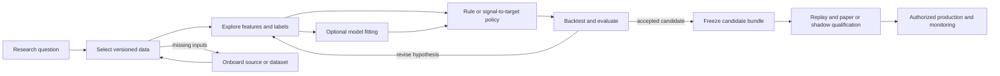

# Quant researcher implementation guide

Owner: repository founder. Updated 2026-09-19 against source layout `58bc99a`.
This is the activity-based guide for researching data, features, models and
strategies, then preparing accepted candidates for operation. The
[platform infrastructure roadmap](../docs/roadmap/README.md) owns what must be
built and its acceptance; the [research program](../docs/roadmap/research-program.md)
owns experimental methodology. This guide explains what a QR supplies, what the
platform does and what to retain. It is not a second implementation backlog.

**Available now:** bounded acquisition, saved-input publication, trade queries,
book reconstruction/replay and EDA. **Planned:** reusable feature/label and model
workflows, economic backtesting, candidate packaging and paper/live operation.
Exploratory notebook calculations are possible today; they do not establish that
the corresponding maintained platform workflow exists. Current empirical data
retains source-specific exploratory/degraded qualifications.

For a working starting point, choose a [current notebook](#start-with-your-research-question)
and follow [setup and execution](notebook-operations.md). For the intended research
process, follow the journey below. Future activities describe contracts and
handoffs, not commands or imports that can be run today.

## Research activities and journey

Feature research need not start with a chosen model. A signal diagnostic, factor
study or deterministic rule is a valid research consumer. Use only the applicable
activities: a rule can skip fitting; a batch model need not have streaming feature
machinery. Data inspection, predictive diagnostics and economic backtesting answer
different questions and should retain separate conclusions.

| Activity | You provide | Result to retain | Current support |
| --- | --- | --- | --- |
| [Frame the question](#frame-a-research-question) | Mechanism, universe, horizon and comparison intent | Research note and applicable evaluation boundaries | Methodology available; maintain records manually |
| [Select and inspect data](#select-and-inspect-research-data) | Explicit sample, fields, clocks and quality needs | Saved-input/snapshot/query identities and coverage limitations | Bounded APIs and notebooks available; unified assembly planned |
| [Onboard missing inputs](#onboard-a-missing-source-or-dataset) | Source/data requirements and intended use | Qualified dataset plus source limitations | Existing source configurations supported; new capabilities require implementation |
| [Explore features and labels](#research-features-and-labels) | Formula, window, target and missingness policy | Versioned definitions, diagnostics and information intervals | Notebook exploration possible; reusable workflow planned |
| [Compare models or rules](#compare-models-or-deterministic-rules) | Splits, transforms, trainer/rule and selection criteria | Complete attempts, out-of-sample predictions and applicable fitted state | Maintained fit/evaluation workflow planned |
| [Backtest](#build-and-backtest-a-strategy) | Signal-to-target policy and execution/cost assumptions | Reconciled economic trace and net report | Planned; current replay is not a backtest |
| [Promote and monitor](#freeze-and-qualify-a-candidate) | Frozen candidate and operating requirements | Qualification evidence and authorized deployment identity | Planned; no production workflow exists today |

### Frame a research question

Write the mechanism you want to test, required observations, intended decision
horizon and a simple comparator. Identify what would make the result uninformative:
missing historical availability, inadequate coverage, unstable behavior or an
execution assumption the data cannot support. Select the applicable methodology
from the [research program](../docs/roadmap/research-program.md#rules-for-every-workstream).

Exploration can begin with a small permitted sample. Before formal comparison,
record selection criteria and evaluation boundaries. Retain failed, rejected and
abandoned attempts that influence the next choice. Until the shared trial journal
exists, use an append-only text record beside protected research outputs with the
[trial fields](../docs/roadmap/research-program.md#small-records-and-artifacts).
Ignored notebook run snapshots alone are not a durable research journal.

### Select and inspect research data

**Available, with bounded source-specific interfaces.** Start with the
[data-source index](../docs/data_source/README.md) and [current samples](#what-data-am-i-actually-researching).
The index describes sources; it is not an executable catalog of implemented
adapters. Use the existing acquisition/publication commands in the
[data command reference](../src/market_data/README.md), or the current notebooks.
Reading saved notebook outputs makes no source request; running the capture
notebook acquires new inputs.

Select instruments, business interval, requested fields and the decision/knowledge
cutoff explicitly. Inspect units, coverage, gaps, historical membership, revisions
and source clocks before calculating a result. Pin the printed saved directories
for notebook repeatability; formal queries use explicit snapshot identity rather
than a mutable latest-input selection.

The current Python entry `applications.explore.inspect_eda` consumes an explicit
`research.exploration.EdaQuery` configuration, saved snapshots and a `RawStore`,
with a retention callback. See the [configured EDA contract](../src/market_data/README.md#configured-eda-and-extension-boundaries-mr-21)
and the connected notebook example. It returns summaries and retainable query/
quality identities; it does not acquire data or construct a feature matrix.
Trade `QueryReader` batches and [book replay](../src/market_data/README.md#published-book-queries-and-shared-stepping-mr-27)
are distinct interfaces. Their byte budgets bound retained inputs, not total RSS.

**Planned assembly:** D1 will expose saved-data discovery and bounded multi-input
selection/alignment over these interfaces. A research selection will retain its
snapshot/universe/field/time identities plus missingness and quality information.
Joining an input cannot make it visible before its actual availability. Unknown
historical knowledge remains unknown, even when a file can be opened successfully.

Finish this activity with a pinned sample and a statement of what it can support.
If missing evidence prevents causal research, retain an exploratory conclusion
or obtain appropriate evidence; do not silently relabel the dataset.

### Onboard a missing source or dataset

Start from the missing research input, not from a new downloader for each model.
Record the source, instruments/data family, fields and units, history/cadence,
availability/revision behavior, access/retention needs, expected volume and first
consumer. Distinguish obtaining more data from implementing a new capability.

| Requested addition | QR action | Platform implementation boundary |
| --- | --- | --- |
| Another supported instrument, interval or source selection | Supply compatible reference/configuration and inspect the resulting quality | Reuse existing acquisition/publication/query operations; unsupported selections fail |
| A new provider or data type | Supply a bounded sample/request and required semantics | Add the adapter/schema, identity/clock/revision mapping and shared publication/read integration |
| New historical-to-live use | Declare required cadence, freshness and recovery behavior | Qualify applicable capture/replay/runtime compatibility; historical access does not establish live availability |
| A new tradable product | Declare the product and intended strategy mechanics | Add missing lifecycle, simulation, accounting, risk and execution capabilities before economic/operational admission |

The planned [D1 extension workflow](../docs/roadmap/README.md#d1-research-dataset-access-and-source-onboarding)
will exercise a concrete source extension. Today, new unsupported capabilities
need an implementation change. Exploratory source calls may start in a notebook;
maintained source handling belongs to the shared data adapter, so multiple
candidates can reuse the resulting dataset. Keep a macro release or fundamental
revision in its appropriate schema rather than disguising it as a trade.

Return to data inspection with retrievable raw inputs, dataset identity, quality
and source limitations. A successful download alone does not complete onboarding.

### Research features and labels

**Notebook exploration is possible; the maintained workflow is planned.** Define
a feature by its input bindings, formula, units, window, decision cadence,
availability, warm-up and missing/stale policy. Define a label separately by its
outcome, horizon, price convention, information interval and time of availability.
A forward label can evaluate an earlier prediction only after that outcome is
known; it cannot enter that prediction's inputs.

Use a small hand-inspectable sample first. Examine coverage and distributions,
then diagnostics appropriate to the hypothesis: stability, redundancy, decay or
relationship to a target. Missing observations must not quietly become zeroes.
Fitted normalization or feature selection belongs inside the training split.

For example, a proposed visible-book imbalance study could start with a saved
book diagnostic before choosing a model. A later forward-return label would need
suitable future prices and evidenced timing; the existing archive's unknown
historical availability does not become acceptable because the formula is simple.
This is an illustrative research path, not a selected experiment or a change to
frozen P1.

Prototype freely within the study's data/holdout boundaries. Promote a transform
when a retained consumer needs reproducible execution: put its logic behind the
supported feature interface, add decisive causal/window examples and let formal
notebook results call that implementation. Retain feature/label versions and
input identities. The [promotion methodology](../docs/roadmap/research-program.md#notebook-research-and-package-promotion)
and [planned interfaces](../docs/roadmap/README.md#m4-reproducible-features-and-model-research)
define the boundary; no feature registry service is required.

### Compare models or deterministic rules

**Maintained workflow planned.** Supply the selected feature/label definitions,
temporal split specification, trainer or rule, transform choices, comparison
space, seeds, metrics and stopping/selection rule. Use a transparent comparator.
A model-free signal study can stop at diagnostics or proceed directly to a target
policy; it does not need a fitted model artifact.

The platform will execute the declared folds, fit transforms/models only on
permitted then-available rows and labels, save predictions and record complete
attempts. Follow the research program's information-interval rules for purging
and embargo; a generic row split is insufficient where outcomes overlap. A final
holdout is consumed evidence after evaluation, not another exploratory dataset.

Retain the exact split/fit rows, dataset/feature/label versions, fitted transform
state, model parameters/bytes, predictions and evaluation identity. Reload and
compare inference on fixed inputs under declared numerical tolerances. A new
training window or changed transform creates a new artifact/attempt rather than
overwriting the previous result. Predictive accuracy alone is not economic value.

### Build and backtest a strategy

**Planned.** A model produces predictions; the QR supplies a separate policy that
turns available predictions or a deterministic signal into targets. Declare the
supported instrument/output contract, decision cadence, position/capital policy,
fees, delay and execution assumptions. The platform runner will compose that
policy with shared replay, independent limits, fills, accounting and reports.

Inspect inputs, prediction/signal, target, risk rejection, fill, costs and NAV in
one trace. Reconcile a small economic example before interpreting aggregate
metrics. Preserve missing/gap periods and rejected intents; a completed run can
contain expected rejections, while broken accounting or missing required valuation
prevents a valid result. Trade prints and book replay alone establish no executable
fill or queue position.

For walk-forward retraining, each historical decision must use the model and
preprocessing state that could have been fitted by then, including label
availability and declared fit/deployment timing. Never apply a final full-history
fit to earlier decisions. Record model transitions and warm-up/reset behavior.

The [planned shared backtest](../docs/roadmap/README.md#m5-strategy-simulation-and-research-controls)
will produce a reproducible gross-to-net report and trace. The existing
[frozen P1](../docs/research/p1-baseline.md) remains its own fixed engineering
baseline; new QR experiments have separate identities and assumptions. There is
no supported backtest command today. A negative economic result can still be a
valid completed experiment.

### Freeze and qualify a candidate

**Planned.** Freeze the chosen research components and their evidence into a
candidate manifest; do not copy notebook formulas into a separate production
implementation. The bundle's exact
[shared contract](../docs/architecture/platform-design.md#candidate-promotion-contract)
belongs to architecture. Its research-facing contents identify required inputs,
features/preprocessing, optional model, signal-to-target policy, state/warm-up
requirements and accepted experiment references. Retain the bytes as well as hashes.

Promotion changes the admitted input/execution composition while preserving those
versioned components. The platform checks compatible schemas, units, timing,
state and runtime capabilities. If incremental features are required, qualify
historical/replay/live semantics and restart behavior first; a scheduled batch
candidate can use a qualified batch path. Fitting is an explicit versioned job,
not an implicit side effect of inference.

Compare matched input/feature/prediction/target traces during replay and paper or
shadow qualification. Investigate the first difference before interpreting P&L
differences. Simulated fills demonstrate only their declared execution model.
Candidate acceptance, release installation and trading activation are separate
steps. The current [release restrictions](../docs/architecture/README.md#dependency-and-release-boundaries)
and [operating workflow](../docs/governance/workflow.md#activate-and-operate) still apply.

### Monitor, investigate and revise

**Strategy monitoring planned; bounded collector health exists.** Retain candidate,
instance, input and artifact identities beside freshness, missingness, inference/
decision failures, prediction behavior, delayed-label coverage and economic
attribution. The platform owns persistent collection, alert delivery and protective
runtime controls; a monitoring notebook inspects those records.

An investigation returns to the appropriate research activity with a new attempt:
data break, changed feature behavior, model degradation or execution mismatch.
Changing the model or data assumptions creates a new candidate and renews affected
qualification. Rollback requires compatible state and cannot undo external fills.
Collector health and matching saved replay alone do not establish strategy health.

## When research requires platform work

Within an implemented capability, a new formula, estimator, rule or compatible
instance should change its own implementation/configuration and focused tests,
without editing shared runners. A new source/schema, output contract, execution
mechanic or runtime state requirement may need infrastructure work first.

Describe that request using the blocked QR activity, smallest concrete input/
output example, missing capability, current workaround/limitation and observable
acceptance. Link it to the owning infrastructure MR or add a bounded follow-on
there. Keep the candidate's hypothesis and comparison attempts in its research
record. A request for another feature does not by itself justify a feature store,
new orchestration framework or second production implementation.

## Start with your research question

| What I want to understand | Open this notebook | What it gives me | What running it does |
| --- | --- | --- | --- |
| What did my saved inputs show, and how do I build and query a dataset? | [Saved inputs to a research dataset](research-foundations.ipynb) — start here after acquisition | Real book reconstruction, one generic publication workflow with separate synthetic inputs, and cutoff selection | Reads saved books and creates temporary synthetic datasets; no network or credentials. |
| How could timing, units or damaged inputs change my conclusions? | [Data reliability lab](foundation-contract-checks.ipynb) — optional depth | Small synthetic examples of availability, arithmetic, wrong inputs, interruption and recovery | Offline; creates temporary test files and child processes. No provider access. |
| How do I obtain a new sample without exchange account credentials? | [Acquire OKX and Bitfinex books](market-data-capture.ipynb) — run first if you have no saved inputs | Bounded public live observations, saved reconstruction, gap examples and an OKX historical prefix | Records two new live samples and downloads an archive; an explicit saved-archive override avoids the download. |

Read the question and output interpretation in each section before inspecting its
code. Setup and implementation-heavy cells are collapsed in clients supporting
Jupyter cell visibility; expand them when needed. For execution, restart the
kernel and **Run All in order**: later cells depend on earlier ones. Each notebook
runs independently of the other notebooks.

For interpreter setup, actual commands, cached-data controls and error recovery,
use the [notebook operations guide](notebook-operations.md). Reading the saved
notebook outputs does not start a download or collector.

## What data am I actually researching?

The maintained research examples now use **order books**, following the available
OKX and Bitfinex implementations. They require no Binance access. A book describes
displayed buying and selling interest; a trade records an executed transaction.
These are different observations and support different research questions.

| Sample | What I can inspect | What it does not tell me |
| --- | --- | --- |
| OKX BTC-USDT historical L2, 8 September 2026 | A verified daily archive and reconstruction summary for its first 10,000 records; reported depth is 400 price levels per side | Individual order IDs, source sequences, historical receipt times or proven continuity; this is a prefix, not the entire day. The current archive API does not return a price/feature table. |
| Bitfinex BTC/USD recorded R0 | A bounded live sample, visible individual orders, exact prices/sizes and the spread at its final reconstructed state; configured depth is 25 | Earlier Bitfinex history, exchange timestamps in R0 messages, hidden orders, queue priority or executable fills. |
| OKX BTC-USDT public live `books` | A bounded L2 sample with source timestamps, local receipt records and continuity checks | Individual orders or the full exchange book beyond the feed's depth. |

The capture notebook uses the public [Bitfinex raw-book feed](https://docs.bitfinex.com/reference/ws-public-raw-books)
and [OKX market-data APIs](https://www.okx.com/docs-v5/en/) without API keys
(documentation checked 2026-09-16). Source availability can still depend on the
endpoint and location; a denied request fails explicitly. There is no credential
prompt or automatic switch to another venue.

The samples differ in date, receipt interval, depth and quote currency: **USD is
not USDT**, and sequential live captures are not simultaneous. Do not subtract
their prices and label the result an arbitrage opportunity.

The main notebook selects the latest completed saved input matching each maintained
configuration, prints its identity and then verifies its bytes. For repeatability,
pin the printed directories using the [operations guide](notebook-operations.md).
A new capture is a new sample; it does not silently extend the previous recording.

## What the raw-input stage provides

The historical acquisition MRs provide the following foundations. Their original
acceptance uses Tardis/Binance contracts; the existing native
[Bitfinex collector](../docs/data/l3-collectors.md) and
[OKX readers](../docs/data/okx-market-data.md) have their own capture/archive
contracts and reuse shared storage. In particular, the resumable MR 06 checklist
does not make an interrupted OKX download or live recording resumable.

| Completed work | What I get as a researcher | Research problem it addresses |
| --- | --- | --- |
| MR 03: identify saved input | An exact content fingerprint and a record of which request the file belongs to | I can detect changed input and identify what an experiment used. |
| MR 04: preserve originals | Complete saved files that repeated writes cannot silently replace | An interrupted save cannot expose half a file as ready for analysis. |
| MR 05: controlled download | Explicit access, response, integrity and timeout failures | Failed acquisition cannot quietly masquerade as usable input. The original Tardis path has synthetic evidence; MR 07 added the historical Binance path. |
| MR 06: resume collection | A saved checklist of verified completed files | I can continue unfinished work without repeating completed downloads. The unfinished file may need downloading again. |
| MR 07: run and observe acquisition | A documented command, saved settings and progress/status | I can tell what was requested, what was saved and why a run stopped. |
| MR 08: inspect original rows | Exact row text, source order, row positions, file origins and research bounds | I can trace observations and see missing or malformed input without silent drops or invented observations. |
| MR 09: decode and trace occurrences | Exact archive trades, raw origins and stable identities across rebuilds, including separate input scopes | Repeated sequence numbers cannot confuse two files or make a disconnect apply to unrelated input. |
| MR 10: admit duplicates and corrections | One economic trade with all duplicate origins and explicitly evidenced predecessor versions | Inserted rows cannot create new trades, and a late correction cannot erase an earlier version. |
| MR 11: read eligibility assertions | Retained membership, evidence identities and independent valid/knowledge clocks tied to the selected catalog | A 2026-authored assumption cannot be backdated to the historical sample; excluded members remain visible. |

The fixed [P1 experiment specification](../docs/research/p1-baseline.md) retains the
Binance trade sample, hypothesis and economic assumptions. This notebook migration
does not replace that sample with book data or report a strategy result. Its source
access remains a separate unresolved research dependency for the frozen study.
The [MR 08 record](../docs/roadmap/mr-08-implementation.md) retains the earlier
verified Binance run (638,484 daily rows; 27,480 selected-hour trades). Its synthetic
row-order and missing-input checks now live in section 16 of the offline lab,
where they run without provider access.

## Follow the connected dataset walkthrough

The main notebook condenses the former NB 09–17 milestone exercises into one
workflow. Repeated archive setup and exhaustive negative cases remain in the
[test guide](../tests/README.md) and historical [MR records](../docs/roadmap/README.md).
The current notebook has eighteen sections:

| Sections | Question and evidence |
| --- | --- |
| 1–2: implementation and inputs | Verify the installed runtime, record its identity and pin the saved books. |
| 3–4: reconstruction and clocks | Inspect the OKX historical prefix and Bitfinex visible orders, repeat the state trace and observe a disconnect. |
| 5: dataset inputs | Bind each saved acquisition to its own policy and eligibility history with `DatasetInput`. The example uses two synthetic trade inputs; assembly preserves separate partitions. |
| 6: publication and verification | Call `publish_dataset`, reopen by explicit snapshot ID, check CLI/Python parity and compare identities after changing one input's policy. Unknown archive availability remains unavailable to cutoff selection. |
| 7: cutoff selection | Use a captured synthetic trade to show the original price, a late correction at its availability boundary and a later membership change, while retaining earlier query results. |
| 8: bounded query batches | Project prices with scoped controls and quality evidence, compare late corrections, retain replay chains, and exercise cancellation and required refusals. |
| 9: measured query workload | Recompute the MR 18 decision from retained installed measurements of 27,480 permitted trade observations; distinguish these measurements from synthetic correctness examples. |
| 10: chronological replay | Step the retained original, gap and correction at their availability; compare batches, inspect phase order, resume a serialized cursor and reject incompatible checkpoints. |
| 11: configured EDA | Select six synthetic revisions across two instruments, retain exact summaries and attempt observations, plot the three-second business interval and inspect standalone replay. Exercise a synthetic contract projection and unsupported capability refusals. |
| 12: source negotiation | Inspect the saved Bitfinex version, native acknowledgement, sequence range and exact receipt clocks. Refuse incompatible subscriptions, versions and product/stream combinations without reconnecting. |
| 13: durable capture | Inspect the committed input cursor; exclude uncommitted tails and reject damaged committed bytes, failed writers and invalid units. |
| 14: MR 16 acquisition handoff | Acquire a synthetic two-instrument universe through installed commands, interrupt/resume without repeating completed fetches, refuse the incomplete acquisition and interrupted snapshot, then publish/reopen and inspect six history rows. HTTP is injected; persistence and all downstream stages are real. |
| 18: capture/replay parity | Compare whole-message canonical histories and visible-spread outputs, inspect snapshot/recovery state, resume a shared cursor in a separate process and retain the first divergence. |
| 17: collector health | Watch synthetic child collectors with independent heartbeat, ingestion, persistence, freshness and count limits. Inspect process death, journal failure, local syslog delivery and protection when alert delivery fails. |

The generic composition boundary is in place. Installed saved-input publication
supports trade archives and MR 25's explicit bounded book format. Book snapshots
retain exploratory degraded scope; trade queries do not silently accept that format.
Future source combinations retain distinct source/venue streams within one dataset.
The real OKX/Bitfinex book readers still have separate capture/archive formats.
This walkthrough supplies no empirical historical membership or revision evidence
and leaves the frozen P1 source-access gap open.

## How to interpret the evidence

**An unchanged file** means its bytes match the saved fingerprint. It does not
establish that the provider observed every trade or that every value is correct.

**A missing file** means an expected input is unavailable. **An empty input** does
not establish a quiet market. In the OKX historical summary, `gaps=None` means
continuity is unknown because source sequences are absent. A reconstructed book
can be available while coverage remains unproven.

**Source time** describes the exchange's timestamp where supplied.
**Local receipt and save times** describe the collector's observation or archive
acquisition. Downloading an old OKX archive now does not establish historical
knowledge time. Bitfinex R0 supplies receipt order and sequences, but no exchange
timestamp in these messages. Do not substitute one clock for another.

**A live gap** makes the reconstructed book unavailable until synchronization is
restored. A matching offline replay proves that the same saved messages produced
the same states; it does not prove complete observation of the exchange.

**Reopening the same saved input** helps reproduce an analysis. A later provider
revision or different implementation/settings needs its own identity. Keep older
raw inputs and run records; a content fingerprint alone cannot recover a lost file.

## What I can investigate, and what is still ahead

| Research task | Current position |
| --- | --- |
| Inspect historical book coverage and a bounded live book | Available in the main notebook: OKX prefix summary and Bitfinex visible prices/sizes/spread. |
| Check exact price × quantity values for small examples | Available through financial-unit APIs in the offline lab; this is not an executed strategy ledger. |
| Learn how timing, wrong instruments, corruption and interruption are handled | Available in the offline reliability lab. |
| Inspect visible order-book observations and reconstruction | Available for the bounded collector examples, with each source's gaps and access limits reported separately. L2 aggregates price levels; L3 retains visible individual orders. Neither establishes fills or queue priority. |
| Obtain consistently interpreted historical trade events | MR 09 supplies a saved Binance archive iterator with exact values and raw-origin identities. Exploratory publication is available; historical availability remains unknown. |
| Treat duplicate trades and corrections consistently | MR 10 supplies bounded in-memory admission, complete duplicate lineage and linear evidenced correction histories. Original archive knowledge remains unknown; exploratory datasets retain that limitation. |
| Inspect historical membership assertions | MR 11 reads evidence-labeled histories without dropping excluded members. Today's catalog is still an authored assumption. |
| Establish the historically eligible research universe | MR 12 selects by independent validity and knowledge, preserving corrections and explicit unknown/unsupported outcomes. Actual historical evidence is still required for empirical P1 acceptance. |
| Decide whether the data meets the experiment's quality requirements | MR 13. Unknown required coverage or eligibility cannot silently pass. |
| Identify admitted partitions and verify their saved files | MR 14 supplies deterministic manifest identity and verified reading, retaining exploratory degraded scope. |
| Preserve a completed dataset across interrupted later builds | MR 15 publishes one atomic local snapshot and reopens by explicit ID, with retained raw inputs and unchanged degraded quality. |
| Inspect publication through an installed dataset command | MR 16 publishes saved acquisitions and reopens an explicit ID, reporting degraded quality, invalid/gap/duplicate counts and persistence status. |
| Select the revisions knowable at a cutoff | Section 7 uses the installed as-of selector, showing late correction and eligibility boundaries; detailed ordering/control cases remain in the tests. Unknown archive knowledge remains unavailable; full quality/history stays separate from selected events. |
| Consume bounded price batches with query identity | MR 19 supplies a reference reader with an explicit aggregate canonical-byte budget, mandatory scoped controls/quality and distinct cutoff/history modes. MR 18 reuses admitted partitions and isolates returned records/evidence. Batch size bounds output rows; it does not bound total process memory. |
| Advance a reproducible source clock | MR 20 replays admitted trade/control history in availability/source order. Equal-time sources precede expiry, fill, decision and mark callbacks. Completed cursors bind inputs/configuration; consumer state and schedules must be saved alongside them. MR 27 separately adds the book adapter with exact retained receipts and conservative microsecond scheduling. |
| Run the frozen strategy and interpret costed results | Later research/simulation work in the roadmap. The acquisition notebook supplies no empirical strategy conclusion. |

## A useful way to work through a notebook

1. State the question and identify the sample. Distinguish a real source observation
   from a deliberately constructed teaching example.
2. Inspect the outputs: selected instrument and interval, row counts, clocks,
   values and any rejection or unknown status.
3. Explain what those outputs establish. Keep unresolved coverage, availability,
   eligibility and execution assumptions visible beside the finding.
4. Preserve the inputs and the attempted run before changing an interpretation.
   Keep code, small reviewed outputs and guide changes in Git; retain bulk data
   and generated run snapshots in their designated ignored locations.
5. Write the next research question. Change exploratory scenarios deliberately;
   keep fixed reference examples and the frozen P1 specification unchanged.

The notebook runner saves successful and failed attempts, but these local snapshots
are not a backed-up research journal. An attempt that influences hypothesis or
parameter selection also needs the [research program's trial record](../docs/roadmap/research-program.md#small-records-and-artifacts).
Final holdouts are not exploratory notebook inputs.

## Small vocabulary for reading existing outputs

| Term in the code or output | Researcher's meaning |
| --- | --- |
| Raw object | The original saved source file, such as the OKX archive or recorded message journal. |
| Partition | One requested piece of source data; here, one instrument's UTC day. |
| Manifest | A saved record of the request, its inputs and completed files. |
| SHA-256 / digest | A fingerprint used to detect changed bytes; it is not a completeness score. |
| Provenance / origin | The trail from an observation back to its source file, row and acquisition record. |
| Immutable | Preserve the saved original; make a separately identified version for a change. |
| Canonical observation | A consistently interpreted event that later analysis can use; the historical archive path reaches this in MR 09. |
| Replay | Process saved observations in order. Reconstructing a book alone does not simulate whether your order would fill. |

## Keeping this guide useful as the project grows

Update this guide in the same change that alters a researcher's workflow or adds
a usable capability. Refresh the date and status, the notebook entry point, what
the outputs mean, remaining limitations and the next useful research action.
Link the actual acceptance record for measured examples; do not present planned
work or an old sample count as newly verified behavior. The roadmap continues to
own MR scope, dependencies and acceptance.

Use a consistent notebook pattern: **question → sample and assumptions → action →
observed output → interpretation and limits → next question**. Keep technical
checkpoint IDs for traceability inside supporting notes, rather than making them
the research narrative. Put execution/repair detail in the operations guide and
shared calculations in the package once they become maintained behavior.

The [migration verification](notebook-operations.md#okx-and-bitfinex-migration-verification)
records fresh executions and limitations for these examples. The earlier
[presentation verification](notebook-operations.md#researcher-guide-verification)
is retained as historical evidence.

MR 19 adds the network-free query exercise in section 8. Start with the explicit
published snapshot ID, then compare the captured synthetic prices before and after
correction availability. Inspect the BTC disconnect in a price-only projection and
the retained original/correction chain after membership withdrawal. The
[MR 19 record](../docs/roadmap/mr-19-implementation.md) retains execution evidence,
measured memory/read counts and the reference reader's aggregate-input limit.
Section 9 adds the [MR 18 workload evaluation](../docs/roadmap/mr-18-implementation.md).
The original reader exceeded the accepted offline memory and latency budgets. A
bounded Parquet experiment and reference admission-reuse candidate are measured
separately; the record owns the final backend decision and its limits. The notebook
uses retained timing evidence and runs its synthetic contract/failure cases afresh.
It does not require a new Binance download or a DuckDB installation. MR 20 shared
stepping is exercised in section 10. Section 11 adds MR 21 configured
EDA through the same installed libraries and a fresh standalone consumer. It retains
query/summary identities, per-instrument counts and price ranges, query/total duration,
process peak RSS and OS input-block observations. The consumer separately counts
actual snapshot/raw file opens; zero OS blocks can reflect caching. This tiny example
is not a performance qualification.

The explicit synthetic future fixture uses contract units and a 50-unit multiplier
at the neutral projection boundary. It grants no derivative snapshot, lifecycle,
valuation or execution support. The [MR 21 record](../docs/roadmap/mr-21-implementation.md)
retains installed and notebook evidence and exact refusals. Section 12 adds MR 22 source verification using saved Bitfinex input and controlled
refusals. The [MR 22 record](../docs/roadmap/mr-22-implementation.md) identifies the
real installed-candidate capture and fresh-kernel evidence. The later MR 23–27
sections below describe durability, recovery, quality, supervision and replay.

Section 13 adds NB 23: observe exact synthetic message bytes, receipt nanoseconds,
committed record counts and byte boundaries. A failed fsync leaves a complete line
that replay excludes; a torn uncommitted suffix is also excluded, while truncating
the committed prefix fails before yielding records. A failed writer refuses reuse
or publication. A separate same-day recording preserves the first attempt, and an
invalid zero-size order remains saved with an unusable consumer state.

The [MR 23 record](../docs/roadmap/mr-23-implementation.md) identifies the candidate,
fresh-kernel run, process-death and slow-consumer tests. This is synthetic durability
evidence, not uninterrupted venue coverage or a new source observation. The next
research question is how reconnects and unknown gaps remain visible under MR 24.

Section 14 exercises the MR 16 whole-acquisition handoff through installed commands:
acquire BTC/ETH, interrupt and resume without refetching completed input, then
validate, publish, reopen and inspect the saved dataset. The
[merge verification](../docs/roadmap/mr-16-implementation.md#integration-with-mr-23)
records the combined candidate and fresh execution of both checkpoints.

## Can a reconnect hide what I missed?

Section 15 (NB 24) of the foundations notebook uses synthetic Coinbase L3 input
and the installed collector to inspect a repeated match, a conflicting repeat,
stale snapshots and recovery failures. Raw duplicates keep their receipt clocks;
one exact match changes the maker size once. A delayed snapshot keeps its later
receipt and cannot erase the earlier unknown gap. Tables show three bounded
connection/REST attempts with 1- then 2-second backoff requests for disconnect,
bridge-gap and simulated rate-limit failures; all remain unsynchronized.

The scenario opens no venue connection and uses no credentials. Existing saved
Bitfinex and OKX inputs remain the earlier sections' independent observations.
This is raw capture/replay evidence; canonical quality/publication is the next
question in MR 25, after MR 24 merges. Use the
[MR 24 acceptance record](../docs/roadmap/mr-24-implementation.md) for commands
and limits.

## Which saved books can pass publication and freshness checks?

Section 16 (NB 25) publishes a 32-position prefix of the saved Bitfinex recording
and OKX historical archive, retaining raw and snapshot identities. Native L3 order
IDs remain separate from L2 price levels. The archive has no invented receipt,
source sequence or historical knowledge time. Both inputs remain exploratory
degraded; the sample does not establish full depth, coverage or executable liquidity.

A separate installed consumer shows an uninitialized-prefix refusal, interrupted
publication with the old snapshot intact, and quality transitions from recovering
to degraded, stale, recovering and unavailable. A heartbeat advances durable receipt
but cannot refresh economic progress. Default freshness-dependent use refuses
degraded state; explicit exploratory opt-in is required. The retained tests also
exercise late source/receipt clocks, native gaps, exact L3 duplicate handling,
malformed atomic messages and L2 zero-size deletion.

The [MR 25 record](../docs/roadmap/mr-25-implementation.md) owns commands, installed
identity and limitations. MR 26 covers supervision; MR 27 owns
shared canonical stepping and capture/replay parity. Section 9 retains MR 18's
historical measurements at their original source identity. MR 25 changes snapshot
format dispatch and imports, so those timings are not current-candidate benchmarks.

## Does capture reproduce the same consumer state?

Section 18 (NB 27) publishes and queries 32-position saved prefixes, then compares
the same visible-spread consumer through shared chronological stepping. Tables retain
raw, snapshot and replay identities, queried versus scheduled counts, accepted
snapshot position, recovery epoch and fresh-process resume results. Exact receipts
remain nanoseconds; the shared microsecond clock rounds up and cannot expose a
message early. Archive records with unknown original availability remain queryable
but produce no scheduled source events.

A controlled probe reuses permitted Bitfinex frames with new local receipts,
injects a disconnect and one exact duplicate per session, and preserves the gap.
A deliberately changed first receipt is refused with retained first-divergence
observations. This is a labelled intervention, not an assertion that the source
itself sent duplicates. Old recordings support saved-input checks; the capture
notebook's new section 10 compares actual live normalization for fresh Bitfinex and
OKX recordings before publication, then repeats consumer/cursor recovery outside
the checkout. The same candidate and independent kernel run every cell.

All results retain exploratory degraded scope, source depth and unknown coverage.
L2 levels and L3 orders remain distinct, Coinbase live access is unverified, and no
fills, strategies or deployment are enabled. The
[MR 27 acceptance record](../docs/roadmap/mr-27-implementation.md) retains commands,
identities and observed limits. Next is **MR 28 — Compute versioned historical
features**, after MR 27 merges; it is not implemented here.
